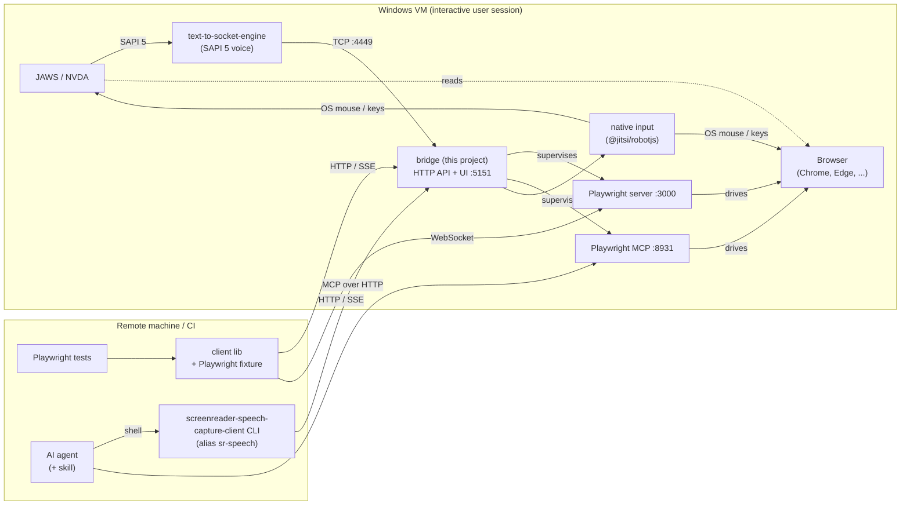
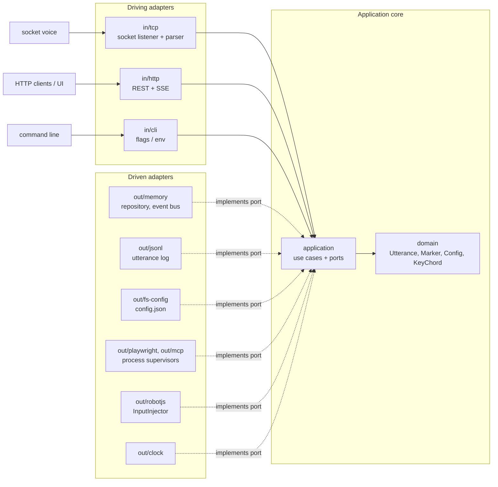

# screenreader-speech-capture

Capture what a screen reader **says**, and make it available to automated tests.

`screenreader-speech-capture` is a bridge that runs on a Windows (VM) next to **JAWS** or **NVDA**.
A third-party SAPI 5 voice, [`text-to-socket-engine`](https://github.com/AmadeusITGroup/Assistive-Webdriver/tree/master/components/text-to-socket-engine)
(MIT, from Amadeus' Assistive-Webdriver), sends the screen reader's speech output to a TCP port
instead of an audio device. The bridge listens on that port, records every utterance with timestamps
and exposes the recording through an **HTTP API** and a **web UI**.

The bridge also starts a **Playwright server** and **Playwright MCP**, so remote test runners and
AI agents can open a browser *on the same machine where the screen reader is running*,
interact with a page, and then check what the screen reader announced. For keys that the screen
reader itself must see (its own commands), the bridge can send **native OS input**.



> **Status: early design / work in progress.** This README describes the planned
> architecture and interfaces. Nothing is implemented yet. Ports, endpoints and flags may change.

---

## Contents

- [Why Node.js (and not Go)](#why-nodejs-and-not-go)
- [Requirements](#requirements)
- [Quick start](#quick-start)
- [Socket voice setup](#socket-voice-setup)
- [Screen reader setup](#screen-reader-setup)
- [Native input](#native-input)
- [HTTP API](#http-api)
- [Test client (library + CLI)](#test-client-library--cli)
- [Agent skill](#agent-skill)
- [Remote Playwright & MCP](#remote-playwright--mcp)
- [Configuration](#configuration)
- [Running on the VM](#running-on-the-vm)
- [Security](#security)
- [Architecture](#architecture)
- [Development](#development)
- [Roadmap](#roadmap)

---

## Why Node.js (and not Go)

The bridge is written in **TypeScript on Node.js**:

1. **Playwright server and Playwright MCP are Node programs.** Whatever language the bridge is in,
   Node has to be on the VM. The bridge runs them as supervised child processes and can install
   and start exactly the Playwright version a client needs (`npx playwright@<version> run-server`).
2. **One language end to end.** The bridge, the shared API contract, the client and the SvelteKit
   UI are all TypeScript in one pnpm monorepo.
3. **Simple distribution.** `npm i -g screenreader-speech-capture` works on any machine that
   already has Node for Playwright.

Go's main strength here would be a single static binary. That counts for less when Node has to be
installed anyway.

---

## Requirements

On the Windows machine or VM that runs the screen reader:

| Requirement | Notes |
|---|---|
| Windows 10 / 11 | Physical or VM. Needs an interactive, unlocked desktop session (see [Running on the VM](#running-on-the-vm)). |
| Node.js ≥ 20 | Includes `npx`. |
| JAWS **or** NVDA | Both can use SAPI 5 voices. JAWS without a license runs in 40-minute demo mode (see [Running on the VM](#running-on-the-vm)). |
| [`text-to-socket-engine`](https://www.npmjs.com/package/text-to-socket-engine) | The SAPI 5 voice that forwards speech text over TCP. Registering it needs an administrator prompt (see [Socket voice setup](#socket-voice-setup)). |
| Playwright browsers | Installed on first run, or with `npx playwright install`. Branded Chrome / Edge are recommended. |
| [`@jitsi/robotjs`](https://www.npmjs.com/package/@jitsi/robotjs) | Native mouse / keyboard input. A dependency of the bridge with prebuilt Windows binaries, so no build tools are needed. |

For development you also need [pnpm](https://pnpm.io/) (see [Development](#development)).

---

## Quick start

```powershell
# on the Windows VM, in a normal (non-elevated) user session
npm i -g screenreader-speech-capture
screenreader-speech-capture
```

Then:

1. Install and register `text-to-socket-engine` ([Socket voice setup](#socket-voice-setup)).
   Its default voice already sends to `127.0.0.1:4449`, which is the bridge's default port.
2. Select the voice **"Text To Socket 127.0.0.1:4449"** in NVDA or JAWS ([Screen reader setup](#screen-reader-setup)).
3. Open the UI at <http://localhost:5151>. Utterances appear live as the screen reader speaks.

### CLI flags

| Flag | Default | Description |
|---|---|---|
| `--tcp-host <addr>` | `127.0.0.1` | Interface for the speech TCP listener. The voice runs locally, so keep it on loopback. |
| `--tcp-port <n>` | `4449` | Port the socket voice connects to (the default voice of `text-to-socket-engine` uses 4449). |
| `--tcp-encoding <enc>` | `auto` | Character encoding of the incoming text. `auto` uses the VM's ANSI code page (see [Wire format](#wire-format)). |
| `--host <addr>` | `0.0.0.0` | Interface for HTTP, Playwright server and MCP (these are reached remotely). |
| `--http-port <n>` | `5151` | HTTP API + web UI. |
| `--playwright-port <n>` | `3000` | Playwright server (WebSocket). |
| `--playwright-version <v>` | *(bundled)* | Playwright version of the server. Must match the clients (see [Playwright server](#playwright-server)). |
| `--mcp-port <n>` | `8931` | Playwright MCP (HTTP). |
| `--no-playwright` | | Don't start the Playwright server. |
| `--no-mcp` | | Don't start Playwright MCP. |
| `--no-input` | | Disable the native input endpoints. |
| `--log-file <path>` | *(off)* | Also append every utterance to a JSONL file. |
| `--config <path>` | see [Configuration](#configuration) | Use a different config file. |

---

## Socket voice setup

[`text-to-socket-engine`](https://github.com/AmadeusITGroup/Assistive-Webdriver/tree/master/components/text-to-socket-engine)
is a SAPI 5 text-to-speech engine that produces no audio. It sends every piece of text it is asked
to speak to a TCP address that is set per voice.

### Install

In an **administrator** prompt:

```powershell
npm install -g text-to-socket-engine
text-to-socket-engine-register
```

The package ships a 32-bit and a 64-bit DLL (`TextToSocketEngine-x86.dll`,
`TextToSocketEngine-amd64.dll`). `text-to-socket-engine-register` registers both and creates
the default voice in both, so 32-bit and 64-bit screen readers can use it:

| Voice id | Display name | Sends to |
|---|---|---|
| `textToSocketVoice` | `Text To Socket 127.0.0.1:4449` | `127.0.0.1:4449` |

### More voices / other ports

```powershell
# text-to-socket-engine-add-voice <id> "<display name>" <host> <port> [tcpHeader]
text-to-socket-engine-add-voice ssc5000 "Text To Socket 127.0.0.1:5000" 127.0.0.1 5000 voice=ssc5000

text-to-socket-engine-remove-voice ssc5000
text-to-socket-engine-unregister      # removes the engine and the default voice
```

The optional `tcpHeader` is sent once as the first line of every new connection. The bridge
stores it as `voice` on each utterance, which tells you which voice an utterance came from when
several are in use.

> **Voice not listed?** SAPI keeps separate voice lists for 32-bit and 64-bit processes. Check
> both control panels (`%windir%\SysWOW64\Speech\SpeechUX\sapi.cpl` for 32 bit,
> `%windir%\System32\Speech\SpeechUX\sapi.cpl` for 64 bit) and run the register command again
> from an administrator prompt.

### Wire format

From the engine's source (`ttsengobj.cpp`):

- **The engine is the TCP client** and the bridge is the server. The engine connects lazily on the
  first text it has to speak. If a send fails it reconnects and retries once. Otherwise the text is
  dropped without an error, so **start the bridge before the screen reader speaks**.
- Each SAPI instance (each speaking process) opens **its own connection**. The bridge accepts many
  connections at the same time.
- If a `tcpHeader` is set, it is sent once right after connecting, followed by `\r\n`.
- Each SAPI `Speak` call becomes **one line**: the text fragments joined with a single space,
  ended by `\r\n`. The bridge records one utterance per line.
- The text is converted with the system **ANSI code page**, not UTF-8. Characters that the code
  page can't represent arrive as `?`. With `--tcp-encoding auto` (the default) the bridge reads the
  code page from `HKLM\SYSTEM\CurrentControlSet\Control\Nls\CodePage\ACP` (this also covers the
  "Use Unicode UTF-8" beta setting, code page 65001). If that fails it uses `windows-1252`.
- SSML/XML markup and bookmarks are not forwarded, only the spoken text.
- The engine sends no timing or audio information. `receivedAt` is the time the bridge received
  the line.
- Text is sent when the screen reader *asks* for it to be spoken. Speech that the screen reader
  interrupts or cancels a moment later (for example when you press the next key) is still recorded.
  The recording shows what was **sent to speech**, which can be more than a listener would hear.

---

## Screen reader setup

The UI has the same instructions under **Setup**. In both screen readers, select the voice
**"Text To Socket 127.0.0.1:4449"** (or the display name of a voice you added).

### NVDA

1. Open the NVDA menu (`NVDA+N`) → **Preferences** → **Settings…** → **Speech**.
2. Under **Synthesizer**, choose **Change…** → **Microsoft Speech API version 5** → OK.
3. Under **Voice**, select the socket voice.
4. Optional, for less noisy recordings:
   - **Keyboard** category: turn off *Speak typed characters* and *Speak typed words*.
   - **Speech** category: set *Punctuation/symbol level* to the level your tests expect.
5. Optional: save this as a separate NVDA **configuration profile** so you can switch back to an audible voice.

### JAWS

1. Open JAWS → **Options** → **Voices** → **Voice Adjustment…**.
2. Create or select a **voice profile** and set its **Synthesizer** to **SAPI 5** (the exact label
   can differ between JAWS versions).
3. Select the socket voice as the **Voice** for the profile, and apply it to all contexts
   (PC Cursor, Keyboard, Message, …) so that all speech is captured.
4. Save the profile. Make it the default only on the test VM.
5. Optional: lower verbosity (**Settings Center** → *Verbosity*) to match what your tests expect.

### Checking the setup

With the bridge running, press a key that makes the screen reader speak (for example
`Insert+T` to read the window title). The utterance should appear in the UI within a few
milliseconds. `GET /api/status` should list at least one entry in `tcp.connections`.

The exact text depends on the screen reader, its version and its verbosity settings. Phrases like
`"Submit, button"` in this README are only examples.

---

## Native input

Playwright sends keys and clicks **into the browser** through its browser protocol (CDP for
Chromium). The operating system, and so the screen reader, never sees them. This is how it plays
out:

| What you do | Works with Playwright input? | Why |
|---|---|---|
| `Tab`, typing, clicking buttons | **Yes** | Focus and value changes happen in the page. The screen reader announces them through the accessibility API. |
| Screen reader commands: NVDA browse mode `H` / `K` / arrows, `Insert+T`, `Insert+F7`, JAWS virtual cursor | **No** | The screen reader catches these keys with a keyboard hook *before* the browser gets them. Synthetic browser keys skip that hook. |
| Making the browser the active window | **No** | `page.bringToFront()` only switches tabs. The screen reader follows the **OS foreground window**. |

So the bridge has two native-input endpoints, both built on
[`@jitsi/robotjs`](https://github.com/jitsi/robotjs) (a maintained robotjs fork with prebuilt binaries):

- **`POST /api/set-focus`** does a real mouse click at screen coordinates. The browser window becomes
  the foreground window, and the screen reader starts reading it. After that, Playwright input works as usual.
- **`POST /api/input/keys`** sends real key presses, for screen reader commands.

The bridge doesn't own the page, so it doesn't know where the browser window is. The
**client calculates the coordinates**. `setFocus(page)` reads `window.screenX/Y`, the difference
between the outer and inner window size, and `devicePixelRatio` through `page.evaluate`. From those
it computes a safe click point: the window's title bar by default, or the centre of a `target`
element you pass. Then it calls `/api/set-focus`.

**Which keys to use:**

| Goal | Use |
|---|---|
| Interact with the page (Tab, type, Enter on a button) | Playwright: `page.keyboard.press('Tab')` |
| Give the screen reader a command (next heading, read title, elements list) | Native: `speech.pressKeys('h')`, `speech.pressKeys('Insert+T')` |
| Before either: make the browser the foreground window | `speech.setFocus(page)` (the fixture does this automatically) |

**Key names** (`/api/input/keys`): keys are joined with `+` for chords (`Insert+T`, `Control+Home`)
and passed as an array for sequences (`["h", "h", "Insert+Down"]`). Names follow robotjs
(`a`–`z`, `0`–`9`, `enter`, `tab`, `escape`, `up`, `down`, `left`, `right`, `home`, `end`,
`pageup`, `pagedown`, `f1`–`f12`, `space`, `backspace`, `delete`, `insert`, `capslock`), case-insensitive.
Modifiers are `Control`, `Shift`, `Alt`, `Win`. `Insert` and `CapsLock` also work as modifiers,
because NVDA and JAWS use them as their screen reader key: they are held down with `keyToggle`
while the other keys are pressed.

**Caveats:**

- The bridge must run **non-elevated in the logged-in user session**. Windows (UIPI) blocks input
  from or to elevated windows, and input can't reach a locked or disconnected desktop.
- Use a fixed screen resolution and **100 % display scaling** on the VM. With other scaling
  the client corrects for `devicePixelRatio`, but browser zoom and multi-monitor setups can still
  move the click point.
- Native input goes to whatever window is in the foreground. Call `setFocus` again after anything
  that could steal focus (a new window, a dialog, the MCP browser).

---

## HTTP API

Base URL: `http://<vm>:5151/api`. All responses are JSON unless noted otherwise.

### Data model

```jsonc
// Utterance
{
  "id": "01JC…",                         // unique id
  "seq": 42,                             // increasing sequence number, never reused (survives clear)
  "kind": "speech",                      // "speech" | "marker"
  "text": "Submit, button",
  "receivedAt": "2026-11-07T14:03:12.345Z",
  "monotonicMs": 123456.789,             // high-resolution, for measuring durations
  "source": "tcp",                       // "tcp" | "api" (markers)
  "voice": "ssc5000",                    // tcpHeader of the sending voice, null if not set
  "connectionId": 3                      // TCP connection that delivered it
}
```

### Endpoints

| Method & path | Description |
|---|---|
| `GET /api/utterances?since=<seq>&limit=<n>` | List utterances with `seq > since` (oldest first). |
| `DELETE /api/utterances` | Clear the buffer. Call this between tests. |
| `GET /api/utterances/stream` | Server-Sent Events: one `utterance` event per new entry. |
| `GET /api/utterances/wait?contains=<text>&since=<seq>&timeoutMs=<n>` | Long-poll until an utterance with `seq > since` matches, then return it (also if it arrived before the request). `regex=<pattern>` can be used instead of `contains`, `normalize=1` ignores case and extra whitespace. Returns `408` on timeout, with the utterances seen so far. |
| `POST /api/markers` `{ "label": "step 3" }` | Insert a marker into the timeline (shown in the UI, returned in lists). |
| `POST /api/set-focus` `{ "x": 640, "y": 12, "button": "left" }` | Native mouse click at screen coordinates (physical pixels). See [Native input](#native-input). |
| `POST /api/input/keys` `{ "keys": "Insert+T" \| ["h", "h"], "delayMs": 50 }` | Native key presses: one chord, or a sequence with `delayMs` between them. |
| `GET /api/config` / `PUT /api/config` | Read or update the configuration. Changing ports restarts the affected listeners. |
| `GET /api/status` | Health: TCP connections, buffer size, Playwright / MCP process state and versions, native input available. |
| `POST /api/services/{playwright\|mcp}/{start\|stop\|restart}` | Control the child services. |

`GET /api/status` example:

```jsonc
{
  "tcp": {
    "listening": true,
    "encoding": "windows-1252",
    "connections": [{ "id": 3, "voice": null, "connectedAt": "2026-11-07T14:01:02.000Z" }]
  },
  "buffer": { "size": 120, "lastSeq": 342 },
  "playwright": { "state": "running", "version": "1.56.1", "port": 3000 },
  "mcp": { "state": "running", "version": "0.0.40", "port": 8931 },
  "input": { "enabled": true }
}
```

### curl examples

```bash
VM=http://my-test-vm:5151

curl -X DELETE $VM/api/utterances
curl "$VM/api/utterances?since=0"
curl "$VM/api/utterances/wait?contains=Submit%2C%20button&timeoutMs=5000"
curl -N $VM/api/utterances/stream
curl -X POST $VM/api/input/keys -H 'content-type: application/json' -d '{"keys":"Insert+T"}'
```

For tests and agents, the [test client](#test-client-library--cli) wraps these endpoints.

---

## Test client (library + CLI)

`screenreader-speech-capture-client` is a small npm package for **test code and agents**. It talks
to the bridge's HTTP API and contains:

- a **TypeScript library** (`SpeechCaptureClient`) for Playwright or any other Node test runner,
- a **Playwright fixture** (`/playwright` subpath export),
- a **CLI** (`screenreader-speech-capture-client`, alias `sr-speech`) with the same functions, for AI agents and shell scripts,
- an **agent skill** (see [Agent skill](#agent-skill)).

It only uses `fetch` (Node ≥ 20) and depends only on `packages/shared`. `@playwright/test` is an
optional peer dependency, needed only for the fixture and `setFocus(page)`.

```bash
pnpm add -D screenreader-speech-capture-client
```

### Library

```ts
import { SpeechCaptureClient } from 'screenreader-speech-capture-client';

const sr = new SpeechCaptureClient({ baseUrl: 'http://my-test-vm:5151' }); // or env SR_SPEECH_URL
```

#### The cursor

Speech often arrives **before** your code starts waiting for it: the screen reader reacts to
`focus()` within milliseconds. So waiting can't start "from now". Instead every client keeps a
**cursor** (a `seq`):

- `clear()` sets the cursor to the end of the buffer (the fixture calls it before each test).
- `waitForOutput` / `waitForSequence` search **from the cursor**, so speech that already arrived
  is found. On a match the cursor moves past the matched utterance, so the next wait only sees
  what came after it.
- `mark()` and an explicit `since` option let you control the range yourself.
- `cursor()` returns the current value, `setCursor(seq)` sets it.

#### Functions

| Function | Returns | Description |
|---|---|---|
| `getUtterances({ since?, limit?, includeMarkers? })` | `Utterance[]` | Recorded utterances, oldest first. `since` defaults to the cursor. |
| `getText({ since?, separator? })` | `string` | All speech since `since` (default: the cursor), joined into one string. Handy for snapshot assertions. |
| `clear()` | `void` | Clear the buffer and reset the cursor. |
| `waitForOutput(match, { timeout?, since?, normalize? })` | `Utterance` | Wait until an utterance after the cursor (or `since`) matches, then move the cursor past it. `match` is a `string` (substring), a `RegExp` or a predicate `(u) => boolean`. `normalize: true` ignores case and extra whitespace. Throws `SpeechTimeoutError` (with the utterances seen so far) on timeout. Default `timeout`: 5000 ms. |
| `waitForSequence(matches[], { timeout?, since?, normalize? })` | `Utterance[]` | Wait until the matches occur in this order (other utterances may come in between). Moves the cursor past the last match. |
| `waitForSilence({ quietFor?, timeout? })` | `void` | Wait until nothing has been spoken for `quietFor` ms (default 500). Useful before asserting on "everything that was said". |
| `record(fn)` | `{ result, utterances }` | Run `fn` and return everything spoken while it ran (waits for silence at the end, then moves the cursor to the end). |
| `mark(label)` | `Utterance` | Insert a marker. Its `seq` can be used as `since`. |
| `setFocus(page, { target? })` | `void` | Make the page's browser window the OS foreground window with a native click (on the title bar, or the centre of the `target` locator). See [Native input](#native-input). |
| `click({ x, y })` | `void` | Native click at screen coordinates (`POST /api/set-focus`). |
| `pressKeys(keys, { delayMs? })` | `void` | Native key presses, for screen reader commands (`'Insert+T'`, `['h', 'h']`). |
| `onUtterance(cb)` | `() => void` | Subscribe to the live SSE feed. Returns an unsubscribe function. |
| `status()` | `Status` | Bridge health (TCP connections, Playwright/MCP state, versions). |
| `playwrightEndpoint()` | `string` | WebSocket URL of the bridge's Playwright server, for `browserType.connect()`. |

### Playwright fixture

```ts
// tests/form.spec.ts
import { test, expect } from 'screenreader-speech-capture-client/playwright';

test('submit button is announced', async ({ page, speech }) => {
  await page.goto('https://example.org/form');

  // Playwright input: focus changes are announced
  await page.getByRole('button', { name: 'Submit' }).focus();
  await speech.waitForOutput('Submit, button'); // found even if it arrived before this line

  const { utterances } = await speech.record(() => page.keyboard.press('Tab'));
  expect(utterances.map((u) => u.text)).toContain('Name, edit, blank');

  // Native input: a screen reader command (NVDA browse mode, next heading)
  await speech.pressKeys('h');
  await speech.waitForOutput(/heading, level 2/);
});
```

```ts
// playwright.config.ts
import { defineConfig } from '@playwright/test';

export default defineConfig({
  workers: 1,
  use: {
    speechCaptureUrl: 'http://my-test-vm:5151', // fixture option (or env SR_SPEECH_URL)
    channel: 'chrome',                          // or 'msedge': the browsers real users run
  },
});
```

The fixture:

- sets Playwright's `connectOptions.wsEndpoint` to the bridge's Playwright server and forces
  `headless: false`, so `page` opens visibly in the VM's desktop session where the screen reader runs,
- calls `setFocus(page)` after the page is created (turn off with `speechCaptureFocus: false`),
- clears the speech buffer and resets the cursor before each test,
- attaches the speech transcript of the test to the Playwright report (always, or only on failure,
  set with `speechCaptureAttach: 'always' | 'on-failure' | 'off'`).

> Tests that use the screen reader must run **serially** (`workers: 1`). There is only one screen
> reader, and only one window can be in the foreground.

> Use **Chrome / Edge** (`channel`) or Playwright's Chromium. Firefox may work. Playwright's
> WebKit build on Windows doesn't expose an accessibility tree that screen readers can use.

### CLI for agents

The package installs two names for the same CLI:

| Command | Use it when |
|---|---|
| `screenreader-speech-capture-client` | Always works with `npx`, even where nothing is installed, because it's the same as the package name. **Use this one in agent prompts, scripts and CI.** |
| `sr-speech` | Short alias. Only available when the package is installed (in the project, or globally with `npm i -g`). |

Every command takes `--url` (or env `SR_SPEECH_URL`, default `http://localhost:5151`) and `--json`
for machine-readable output. A CLI call has no memory between invocations, so there is no
cursor. Use `mark` and `--since` instead.

```bash
npx screenreader-speech-capture-client status
npx screenreader-speech-capture-client clear
npx screenreader-speech-capture-client utterances [--since <seq>] [--limit <n>]
npx screenreader-speech-capture-client text [--since <seq>]
npx screenreader-speech-capture-client wait "Submit, button" [--regex] [--normalize] [--timeout 5000] [--since <seq>]
npx screenreader-speech-capture-client wait-silence [--quiet-for 500] [--timeout 10000]
npx screenreader-speech-capture-client mark "before tab"   # prints the marker's seq
npx screenreader-speech-capture-client focus --x 640 --y 12  # native click
npx screenreader-speech-capture-client press "Insert+T"      # native keys; several args = sequence
npx screenreader-speech-capture-client tail                # live feed until Ctrl+C (NDJSON with --json)

# installed, same commands with the alias:
sr-speech wait "Submit, button"
```

Exit codes, so agents can branch on them without parsing output:

| Code | Meaning |
|---|---|
| `0` | Success (for `wait`: match found) |
| `1` | Timeout / no match |
| `2` | Bridge not reachable or HTTP error |
| `3` | Invalid usage |

Typical agent loop with Playwright MCP:

```bash
export SR_SPEECH_URL=http://my-test-vm:5151
SEQ=$(npx screenreader-speech-capture-client mark step-1)
# … act through Playwright MCP, or send a screen reader command:
npx screenreader-speech-capture-client press h
npx screenreader-speech-capture-client wait-silence
npx screenreader-speech-capture-client text --since "$SEQ" --json   # → judge the output
```

---

## Agent skill

The client package ships an agent skill in the [Claude Code skill format](https://docs.claude.com/en/docs/claude-code/skills):

```
packages/client/skills/screenreader-speech-capture/SKILL.md
```

It teaches an agent how to use the CLI:

- the loop **mark → act → wait-silence → text --since**,
- when to use Playwright MCP input and when to use `press` (screen reader commands),
- that the browser must be in the foreground first (`focus`), and when to do that again,
- the exit codes, and that the exact wording depends on the screen reader and its verbosity.

Install it into a project (or into `~/.claude/skills/` for all projects):

```bash
npx screenreader-speech-capture-client install-skill [--dir .claude/skills]
```

Ready-made **subagent definitions** (for example an `a11y-screenreader-tester` that audits a page
with the screen reader and reports what was announced) are on the [roadmap](#roadmap).

---

## Remote Playwright & MCP

### Playwright server

The bridge runs `npx playwright@<version> run-server --port 3000 --host 0.0.0.0` as a supervised
child process. Connect from anywhere:

```ts
const browser = await chromium.connect('ws://my-test-vm:3000/', { headless: false });
```

The client's `@playwright/test` / `playwright` version must match the server's. Set
`--playwright-version` (or `playwright.version` in the config) to your test project's version. The
bridge installs it on first start. `GET /api/status` reports the running version.

Remote launches are **headless by default**. A headless browser has no window, so the screen reader
can't read it. Always pass `headless: false` (the fixture does this for you).

### Playwright MCP

The bridge runs [`@playwright/mcp`](https://github.com/microsoft/playwright-mcp) in HTTP mode:

```
npx @playwright/mcp@<version> --port 8931 --host 0.0.0.0 --allowed-hosts *
```

`--allowed-hosts` is needed because MCP rejects requests from other hosts by default. Point an MCP
client at it:

```json
{
  "mcpServers": {
    "screenreader-vm": {
      "url": "http://my-test-vm:8931/mcp"
    }
  }
}
```

An agent can then drive the browser through MCP and read the screen reader output through the
CLI or the HTTP API above.

> The MCP browser and a browser started by a test through the Playwright server are **separate
> windows**. The screen reader reads whichever is in the foreground, so use only one at a time and
> call `focus` after switching.

---

## Configuration

Precedence: **CLI flags > environment variables > config file > defaults**.

- Config file: `%APPDATA%\screenreader-speech-capture\config.json`
- Environment variables: `SR_SPEECH_` + the flag name in upper snake case, for example
  `SR_SPEECH_TCP_PORT=4449`, `SR_SPEECH_HTTP_PORT=5151`, `SR_SPEECH_NO_MCP=1`.
- The **Settings** page in the UI edits the config file through `PUT /api/config`.

```jsonc
{
  "tcp":        { "host": "127.0.0.1", "port": 4449, "format": "text-to-socket", "encoding": "auto" },
  "http":       { "host": "0.0.0.0",   "port": 5151 },
  "playwright": { "enabled": true, "port": 3000, "version": null },  // null = bundled version
  "mcp":        { "enabled": true, "port": 8931, "version": null },
  "input":      { "enabled": true },
  "buffer":     { "maxUtterances": 10000 },
  "log":        { "file": null }
}
```

`tcp.format` selects the parser for the incoming wire format. `text-to-socket` (the default) reads
CRLF-terminated lines, with an optional header line, as described in [Wire format](#wire-format).
`tcp.encoding` is the code page used to decode them (`auto` = the VM's ANSI code page).

---

## Running on the VM

### Run in the user session, not as a service

Windows services run in **session 0**. Browsers started there are invisible to the
screen reader on the user's desktop, and native input can't reach the desktop. Run the bridge
**in the logged-in user session** instead, **non-elevated**:

- **Task Scheduler**: trigger *At log on*, action `cmd /c screenreader-speech-capture`,
  with *Run only when user is logged on* selected and *Run with highest privileges* **not** selected.
- or a shortcut in the **Startup** folder (`shell:startup`).

Install a **pinned version** globally (`npm i -g screenreader-speech-capture@x.y.z`) instead of
using `npx` at log on. At log on the network may not be ready yet, and `npx` would pick up new
versions without notice.

Set up the VM like this:

- log on automatically, turn off the screen lock and the screen saver, so the session stays
  interactive and unlocked,
- a fixed screen resolution with **100 % display scaling** (for native clicks),
- don't connect over RDP and then disconnect: a disconnected RDP session has no active desktop.
  Use the hypervisor console, or VNC.

### Screen reader licensing

- **NVDA** is free and has no time limit.
- **JAWS** without a license runs in **40-minute demo mode** and then needs a Windows restart.
  For CI, either license JAWS for the VM or restart / reset the VM snapshot before each run.

### Firewall

Open the ports that are reached remotely (the speech TCP port stays on loopback):

```powershell
New-NetFirewallRule -DisplayName "screenreader-speech-capture" `
  -Direction Inbound -Protocol TCP -LocalPort 5151,3000,8931 -Action Allow
```

---

## Security

There is **no authentication** by default. Anyone who can reach the ports can:

- read what the screen reader said and change the configuration,
- **run programs on the VM**: Playwright's `run-server` accepts launch options from the client,
  such as `executablePath` and `args`, so access to port 3000 is effectively remote command execution,
- control the desktop through the native input endpoints and a browser through MCP.

Use it only on isolated test VMs or networks. An optional shared-secret token is on the roadmap.

---

## Architecture

pnpm monorepo:

```
packages/
  bridge/   Node/TS process: TCP listener, HTTP API, native input, process supervisor (hexagonal)
  ui/       SvelteKit app (adapter-static), served by the bridge (hexagonal-lite)
  client/   npm lib + CLI (`screenreader-speech-capture-client` / `sr-speech`) + Playwright fixture
            + agent skill, for tests and agents
  shared/   HTTP API contract (DTO types), used by bridge, UI and client
```

Published packages: `screenreader-speech-capture` (the bridge, with the UI bundled in) and
`screenreader-speech-capture-client`. `shared` is bundled into both and isn't published on its own.
The client never imports from the bridge, so test projects don't pull in the bridge's dependencies
(such as robotjs).

### Bridge: hexagonal (ports & adapters)



```
packages/bridge/src/
  domain/            Utterance, Marker, Config, KeyChord (key-name parsing + validation). Pure, no I/O.
  application/
    ports/in/        driving ports (use cases): RecordSpeech, QueryUtterances,
                     WaitForUtterance, ClearUtterances, AddMarker, SendNativeInput,
                     ManageConfig, ManageServices, GetStatus
    ports/out/       driven ports: UtteranceRepository, UtteranceEventBus, ConfigStore,
                     ProcessSupervisor, InputInjector, CodePageProvider, Clock
    services/        use-case implementations (only depend on domain + ports)
  adapters/
    in/tcp/          socket listener + wire-format parsers → RecordSpeech
    in/http/         REST + SSE routes → driving ports; serves the built UI
    in/cli/          flags / env → ManageConfig
    out/memory/      ring-buffer repository, in-process event bus
    out/jsonl/       append-only utterance log
    out/fs-config/   config.json in %APPDATA%
    out/playwright/  supervisor for the Playwright server (installs the configured version)
    out/mcp/         supervisor for Playwright MCP
    out/robotjs/     InputInjector on @jitsi/robotjs (mouse click, key chords)
    out/registry/    CodePageProvider: reads the ANSI code page for tcp.encoding=auto
    out/clock/       system clock
  main.ts            composition root: the only place adapters are wired to ports
```

**Dependency rule:** `adapters → application → domain`. The domain imports nothing, the application
imports only the domain and its own ports, and the adapters implement or call the ports. Only `main.ts`
knows the concrete adapters.

**Extending:**

- A different socket-voice wire format is a new parser in `adapters/in/tcp/`, selected with `tcp.format`.
- Persistent storage (for example SQLite) is a new `UtteranceRepository` in `adapters/out/`.
- A different screen reader capture (for example an NVDA add-on instead of SAPI) is a new
  driving adapter calling `RecordSpeech`.
- A different input method (for example direct `SendInput` through FFI, or the hypervisor's
  keyboard API) is a new `InputInjector`.

### UI: SvelteKit, hexagonal-lite

```
packages/ui/src/
  lib/
    core/        client-side domain + use cases (filter/search log, config draft & validation)
                 and ports: SpeechFeed, ConfigApi, StatusApi
    adapters/    HTTP/SSE implementations of those ports (talk to the bridge API)
    stores/      Svelte state built on the use cases; ports are wired to adapters here
  routes/        pages: Live log, Settings, Setup (NVDA / JAWS docs)
```

Components never call `fetch` directly. They go through the ports, so the UI can be developed and
tested against fake adapters without a running bridge.

`packages/shared` holds only the **API contract** (DTOs). Each hexagon owns its own domain model and
maps to and from the DTOs in its HTTP adapter.

---

## Development

```bash
pnpm install
pnpm dev          # bridge (watch) + SvelteKit dev server; Vite proxies /api to the bridge
pnpm test         # unit + integration tests
pnpm build        # builds the UI into the bridge package and compiles the bridge
```

You don't need Windows or a screen reader for most of the work. A fake speech sender stands in for the
SAPI voice:

```bash
pnpm fake-speech --port 4449      # behaves like text-to-socket-engine (header line, CRLF lines)
# or by hand:
printf 'voice=dev\r\nSubmit, button\r\nEdit, Name, blank\r\n' | nc 127.0.0.1 4449
```

Outside Windows (or with `--no-input`), the bridge uses a recording fake `InputInjector` that logs
the clicks and keys it would send.

**Testing strategy**

- **Domain / application:** unit tests against in-memory fakes of the driven ports (fake clock,
  in-memory repository, fake input injector), with no sockets or processes involved.
- **Adapters:** integration tests per adapter (real TCP socket, real HTTP server, temporary config dir).
  The robotjs adapter is tested only on Windows.
- **Client:** library and CLI tested against a real bridge fed by `fake-speech`, covering
  the cursor, timeouts and exit codes. `setFocus` coordinate maths is unit-tested.
- **UI:** component tests with fake port implementations. End-to-end tests against a bridge
  fed by `fake-speech`.
- **Smoke test on a real VM:** NVDA + socket voice + Chrome, checking one focus announcement and one
  native screen reader command (`Insert+T`).

---

## Roadmap

- [x] Identify the SAPI socket voice and document its wire format (`text-to-socket-engine`)
- [ ] Bridge: TCP capture (encoding auto-detection), in-memory buffer, HTTP API, SSE
- [ ] Bridge: Playwright server + MCP supervision (with selectable Playwright version)
- [ ] Bridge: native input (`/api/set-focus`, `/api/input/keys`)
- [ ] UI: live log, settings, setup docs
- [ ] Client: library (with cursor), Playwright fixture, CLI
- [ ] Agent skill (`SKILL.md`) + `install-skill` command
- [ ] Subagent definitions (for example `a11y-screenreader-tester`)
- [ ] Global npm distribution
- [ ] Optional auth token
- [ ] Optional persistent storage / session export

## License

TBD
