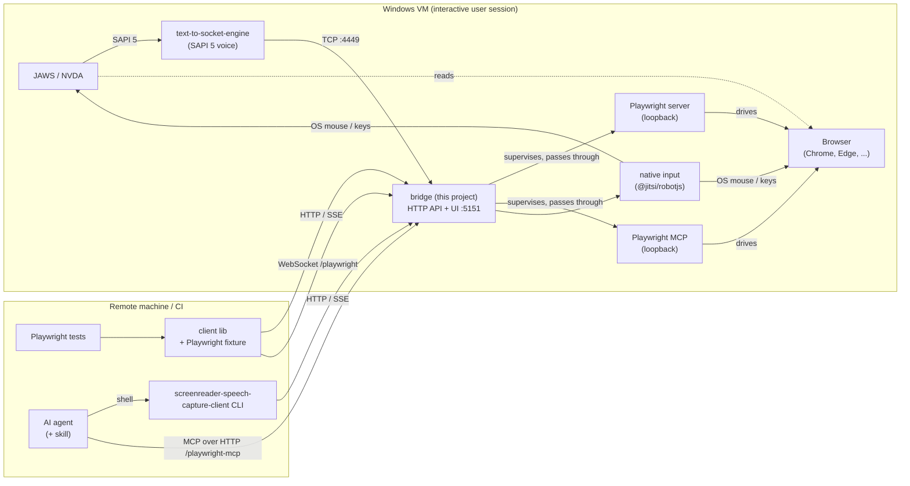

# screenreader-speech-capture

Capture what a screen reader **says**, and make it available to automated tests.

`screenreader-speech-capture` is a bridge that runs on a Windows (VM) next to **JAWS** or **NVDA**.
A third-party SAPI 5 voice, [`text-to-socket-engine`](https://github.com/AmadeusITGroup/Assistive-Webdriver/tree/master/components/text-to-socket-engine)
(MIT, from Amadeus' Assistive-Webdriver), sends the screen reader's speech output to a TCP port
instead of an audio device. The bridge listens on that port, records everything it says with timestamps
and exposes the recording through an **HTTP API** and a **web UI**.

The bridge also starts a **Playwright server** and **Playwright MCP**, so remote test runners and
AI agents can open a browser *on the same machine where the screen reader is running*,
interact with a page, and then check what the screen reader announced. For keys that the screen
reader itself must see (its own commands), the bridge can send **native OS input**.



> **Status: work in progress.** The [Roadmap](docs/ROADMAP.md) shows what works today and what is
> still design.

## What it does

- **Records speech** from NVDA or JAWS, one entry per spoken phrase, with timestamps.
- **HTTP API + live stream** to read, wait for and clear the recorded speech, plus a **web UI** to watch them (UI planned, [M5](docs/ROADMAP.md#m5-web-ui-)).
- **Test client**: a TypeScript library with a Playwright fixture (`waitForOutput('Submit, button')`,
  fixture planned, [M3](docs/ROADMAP.md#m3-playwright--mcp-)) and a CLI for scripts and AI agents.
- **Remote browser** on the screen reader's machine through a Playwright server and Playwright MCP.
- **Native input** for screen reader commands (`Insert+T`, browse mode `H`) that Playwright can't send
  (planned, [M4](docs/ROADMAP.md#m4-native-input-)).

## Quick start

On the Windows VM:

```powershell
# 1. the socket voice (administrator prompt)
npm install -g text-to-socket-engine
text-to-socket-engine-register

# 2. the bridge (normal, non-elevated user session)
npm i -g screenreader-speech-capture
screenreader-speech-capture
```

3. In NVDA or JAWS, select the voice **"Text To Socket 127.0.0.1:4449"**.
4. Make the screen reader speak and watch the text arrive live with
   `npx screenreader-speech-capture-client tail` (the web UI at <http://localhost:5151> comes with
   M5).

In your test project (the Playwright fixture comes with M3; until then use the
[library](docs/usage/client.md#library)):

```ts
import { test } from 'screenreader-speech-capture-client/playwright';

test('submit button is announced', async ({ page, speech }) => {
  await page.goto('https://example.org/form');
  await page.getByRole('button', { name: 'Submit' }).focus();
  await speech.waitForOutput('Submit, button');
});
```

Details: [VM setup](docs/usage/vm-setup.md), [Test client](docs/usage/client.md).

## Following speech live

The bridge pushes each speech entry the moment it arrives (Server-Sent Events). Watch it with
`npx screenreader-speech-capture-client tail`, or subscribe in code with `sr.onSpeech(...)`. Details:
[Test client → Live feed](docs/usage/client.md#live-feed).

## Documentation

The [documentation index](docs/README.md) lists everything, split into **usage** (setup, API,
client, Playwright, agents) and **implementation** (architecture, decisions, development), each
with sequence diagrams of the main flows. Good places to start:

- [VM setup](docs/usage/vm-setup.md): socket voice, NVDA / JAWS, running the bridge
- [Test client](docs/usage/client.md): library, Playwright fixture, CLI
- [HTTP API](docs/usage/http-api.md) and its [flows](docs/usage/flows/http.md)
- [Roadmap](docs/ROADMAP.md): what works today

## Security

There is **no authentication**. Anyone who can reach the ports can read the speech, control the
desktop and effectively run programs on the VM. Use it only on isolated test VMs or networks
([details](docs/usage/security.md)).

## License

TBD
