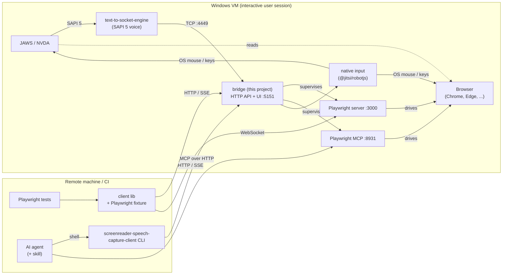
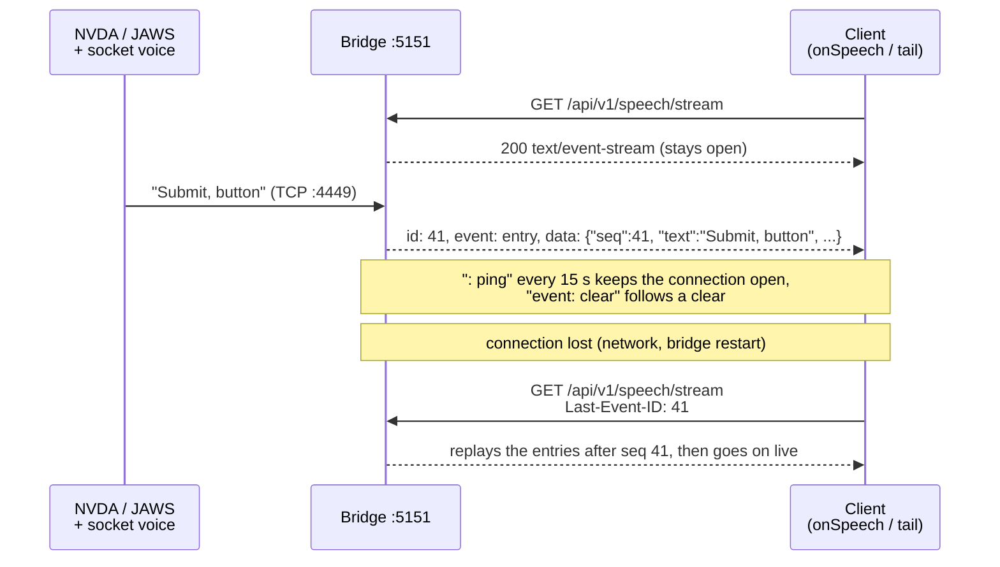

# screenreader-speech-capture

Capture what a screen reader **says**, and make it available to automated tests.

`screenreader-speech-capture` is a bridge that runs on a Windows (VM) next to **JAWS** or **NVDA**.
A third-party SAPI 5 voice, [`text-to-socket-engine`](https://github.com/AmadeusITGroup/Assistive-Webdriver/tree/master/components/text-to-socket-engine)
(MIT, from Amadeus' Assistive-Webdriver), sends the screen reader's speech output to a TCP port
instead of an audio device. The bridge listens on that port, records everything it says with timestamps
and exposes the recording through an **HTTP API** and a **web UI**.

The bridge also starts a **Playwright server** and **Playwright MCP**, so remote test runners and
AI agents can open a browser *on the same machine where the screen reader is running*,
interact with a page, and then check what the screen reader announced. For keys that the screen
reader itself must see (its own commands), the bridge can send **native OS input**.



> **Status: work in progress.** Speech capture, the HTTP API and the test client (library, CLI,
> live feed) work. The Playwright server and MCP, native input and the web UI are still design: the
> docs describe the planned architecture and interfaces. Ports, endpoints and flags may change. See
> the [Roadmap](docs/ROADMAP.md) for what is done and what comes next.

## What it does

- **Records speech** from NVDA or JAWS, one entry per spoken phrase, with timestamps.
- **HTTP API + live stream** to read, wait for and clear the recorded speech, plus a **web UI** to watch them.
- **Test client**: a TypeScript library with a Playwright fixture (`waitForOutput('Submit, button')`)
  and a CLI for scripts and AI agents.
- **Remote browser** on the screen reader's machine through a Playwright server and Playwright MCP.
- **Native input** for screen reader commands (`Insert+T`, browse mode `H`) that Playwright can't send.

## Quick start

On the Windows VM:

```powershell
# 1. the socket voice (administrator prompt)
npm install -g text-to-socket-engine
text-to-socket-engine-register

# 2. the bridge (normal, non-elevated user session)
npm i -g screenreader-speech-capture
screenreader-speech-capture
```

3. In NVDA or JAWS, select the voice **"Text To Socket 127.0.0.1:4449"**.
4. Open <http://localhost:5151> and make the screen reader speak. The text appears live.

In your test project:

```ts
import { test } from 'screenreader-speech-capture-client/playwright';

test('submit button is announced', async ({ page, speech }) => {
  await page.goto('https://example.org/form');
  await page.getByRole('button', { name: 'Submit' }).focus();
  await speech.waitForOutput('Submit, button');
});
```

Details: [VM setup](docs/vm-setup.md), [Test client](docs/client.md).

## Following speech live

The bridge pushes every speech entry the moment it arrives, over
[Server-Sent Events](https://developer.mozilla.org/en-US/docs/Web/API/Server-sent_events/Using_server-sent_events)
(SSE): one long-lived HTTP response that the bridge keeps writing to. The client wraps it, so you
never parse the stream yourself, and it reconnects without losing an entry.



From a shell or an agent (one JSON event per line with `--json`):

```bash
npx screenreader-speech-capture-client tail      # until Ctrl+C
```

From code:

```ts
const sr = new SpeechCaptureClient();
const stop = sr.onSpeech((entry) => console.log(entry.text)); // call stop() to unsubscribe
```

Or the raw stream: `curl -N http://my-test-vm:5151/api/v1/speech/stream`.

Details: [Test client → Live feed](docs/client.md#live-feed), wire format in
[HTTP API](docs/http-api.md#endpoints).

## Documentation

| Doc | What it covers |
|---|---|
| [VM setup](docs/vm-setup.md) | Requirements, socket voice, NVDA / JAWS setup, running the bridge on the VM |
| [Speech capture](docs/speech-capture.md) | Wire format of the socket voice, how the bridge turns it into speech entries, the buffer |
| [HTTP API](docs/http-api.md) | Data model, endpoints, errors, versioning |
| [Test client](docs/client.md) | Library, cursor, Playwright fixture, CLI and exit codes |
| [Native input](docs/native-input.md) | Real clicks and key presses: when Playwright input isn't enough |
| [Remote Playwright & MCP](docs/playwright-mcp.md) | The Playwright server and Playwright MCP run by the bridge |
| [Agents](docs/agents.md) | Agent loop with the CLI, agent skill |
| [Web UI](docs/web-ui.md) | Live log, settings, setup page |
| [Configuration](docs/configuration.md) | CLI flags, environment variables, config file |
| [Operations](docs/operations.md) | Startup, shutdown, crash recovery, logging |
| [Troubleshooting](docs/troubleshooting.md) | Common problems and fixes |
| [Limitations](docs/limitations.md) | What this project can't do |
| [Security](docs/security.md) | Risks of the open ports |
| [Architecture](docs/architecture.md) | Why Node.js, monorepo, hexagonal bridge and client, UI structure |
| [Development](docs/development.md) | Building, testing without Windows, CI and releases |
| [Roadmap](docs/ROADMAP.md) | Milestones, state per topic, open questions |

## Security

There is **no authentication**. Anyone who can reach the ports can read the speech, control the
desktop and effectively run programs on the VM. Use it only on isolated test VMs or networks
([details](docs/security.md)).

## License

TBD
