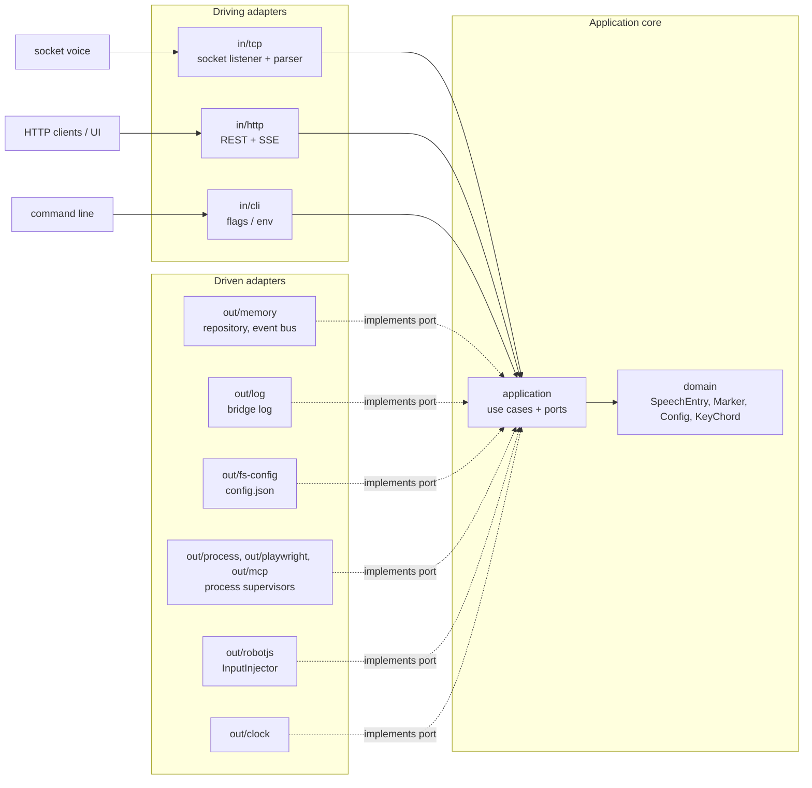

# Architecture

How the code is organised, and why it is written in Node.js.

## Why Node.js (and not Go)

The bridge is written in **TypeScript on Node.js**:

1. **Playwright server and Playwright MCP are Node programs.** Whatever language the bridge is in,
   Node has to be on the VM. The bridge runs them as supervised child processes and can install
   and start exactly the Playwright version a client needs (`npx playwright@<version> run-server`).
2. **One language end to end.** The bridge, the shared API contract, the client and the SvelteKit
   UI are all TypeScript in one pnpm monorepo.
3. **Simple distribution.** `npm i -g screenreader-speech-capture` works on any machine that
   already has Node for Playwright.

Go's main strength here would be a single static binary. That counts for less when Node has to be
installed anyway.

## Monorepo

pnpm monorepo:

```
packages/
  bridge/   Node/TS process: TCP listener, HTTP API, native input, process supervisor (hexagonal)
  ui/       SvelteKit app (adapter-static), served by the bridge (hexagonal-lite)
  client/   npm lib + CLI (`screenreader-speech-capture-client`) + Playwright fixture
            + agent skill, for tests and agents
  shared/   HTTP API contract (DTO types), used by bridge, UI and client
```

Published packages: `screenreader-speech-capture` (the bridge, with the UI bundled in) and
`screenreader-speech-capture-client`. `shared` is bundled into both and isn't published on its own.
The client never imports from the bridge, so test projects don't pull in the bridge's dependencies
(such as robotjs).

## Bridge: hexagonal (ports & adapters)



```
packages/bridge/src/
  domain/            SpeechEntry, Marker, Config, KeyChord (key-name parsing + validation). Pure, no I/O.
  application/
    ports/in/        driving ports (use cases): RecordSpeech, QuerySpeech,
                     WaitForSpeech, ClearSpeech, AddMarker, SendNativeInput,
                     ManageConfig, GetStatus
    ports/out/       driven ports: SpeechRepository, SpeechEventBus, CaptureStatusSource,
                     ConfigStore, ProcessSupervisor, InputInjector, Logger, Clock
    services/        use-case implementations (only depend on domain + ports)
  adapters/
    in/tcp/          socket listener + wire-format parsers → RecordSpeech;
                     tracks its connections (CaptureStatusSource)
    in/http/         REST + SSE routes → driving ports; serves the built UI
    in/net/          listen helper shared by the TCP and HTTP listeners
    shared/net/      reachable URLs of a listener, used by in and out adapters
    in/cli/          flags / env → startup overrides (win over the config file)
    out/memory/      speech repository (capped list), in-process event bus
    out/fs-config/   config.json in %APPDATA%
    out/process/     generic supervisor (ProcessSupervisor): spawn, readiness, restarts
                     with backoff, process-tree kill
    out/playwright/  the Playwright server on that supervisor (installs the configured version)
    out/mcp/         supervisor for Playwright MCP
    out/robotjs/     InputInjector on @jitsi/robotjs (mouse click, key chords)
    out/log/         bridge log: console + file, prefixes, colours, rotation
    out/clock/       system clock
  main.ts            composition root: the only place adapters are wired to ports
```

**Dependency rule:** `adapters → application → domain`. The domain imports nothing, the application
imports only the domain and its own ports, and the adapters implement or call the ports. Only `main.ts`
knows the concrete adapters. Adapters don't import the concrete services or each other (`in` ↔
`out`). ESLint (`no-restricted-imports` in `eslint.config.js`) enforces all of this.

**Extending:**

- A different socket-voice wire format is a new parser in `adapters/in/tcp/`, selected with `tcp.format`.
- Persistent storage (for example SQLite) is a new `SpeechRepository` in `adapters/out/`.
- A different screen reader capture (for example an NVDA add-on instead of SAPI) is a new
  driving adapter calling `RecordSpeech`.
- A different input method (for example direct `SendInput` through FFI, or the hypervisor's
  keyboard API) is a new `InputInjector`.

## Client: hexagonal

The client uses the bridge's layout and the same ESLint rules (see the dependency rule above). The
CLI and the Playwright fixture are **driving adapters on the same in-ports as the library**, so they
can't drift from it (see [Test client](client.md)).

```
packages/client/src/
  domain/              bridge URL validation + precedence, config keys, speech entry model,
                       text matching + normalize, API version compatibility, errors
  application/
    ports/in/          ManageClientConfig, SpeechCapture (the library's functions)
    ports/out/         ClientConfigStore, BridgeApi, Clock
    services/          ClientConfigService, SpeechCaptureService (cursor, waits by polling)
  adapters/
    in/cli/            argv → in-ports → stdout + exit code; parsing and output only
    out/fs-config/     client.json in %APPDATA% / ~/.config, atomic writes
    out/http/          BridgeApi on fetch (REST + SSE parser), DTO ↔ domain mapping
    out/clock/         system clock
  main.ts              composition root: createClientConfig(env) and SpeechCaptureClient, the only
                       place that knows the concrete adapters and reads process.env
  index.ts             public API: re-exports from main.ts, in-port types and domain types
```

Unlike the bridge, the client is also used as a library, so the in-port interfaces are its public
types (users can fake them in their own tests). Users don't call `main.ts` functions explicitly
for the speech client: the public `SpeechCaptureClient` class lives in `main.ts` and passes the
default adapters to the service, so `new SpeechCaptureClient()` just works.

## UI: SvelteKit, hexagonal-lite

```
packages/ui/src/
  lib/
    core/        client-side domain + use cases (filter/search log, config draft & validation)
                 and ports: SpeechFeed, ConfigApi, StatusApi
    adapters/    HTTP/SSE implementations of those ports (talk to the bridge API)
    stores/      Svelte state built on the use cases; ports are wired to adapters here
  routes/        pages: Live log, Settings, Setup (NVDA / JAWS docs)
```

Components never call `fetch` directly. They go through the ports, so the UI can be developed and
tested against fake adapters without a running bridge.

`packages/shared` holds only the **API contract** (DTOs). Each hexagon owns its own domain model and
maps to and from the DTOs in its HTTP adapter.
