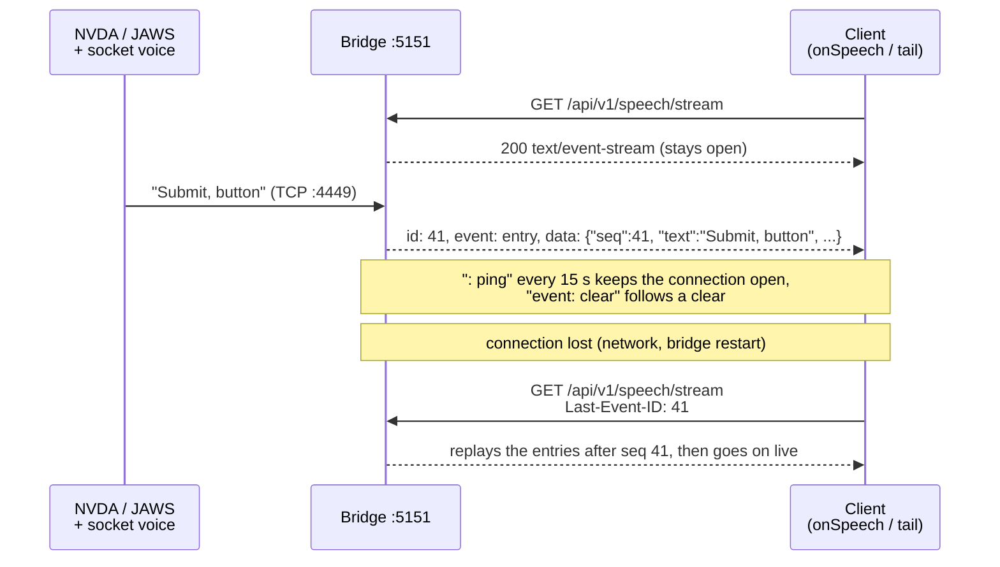

# Test client (library + CLI)

The npm package for test code and agents: library, Playwright fixture and CLI.

`screenreader-speech-capture-client` is a small npm package for **test code and agents**. It talks
to the bridge's HTTP API and contains:

- a **TypeScript library** (`SpeechCaptureClient`) for Playwright or any other Node test runner,
- a **Playwright fixture** (`/playwright` subpath export) *(planned, [M3](ROADMAP.md#m3-playwright--mcp-))*,
- a **CLI** (`screenreader-speech-capture-client`) with the same functions, for AI agents and shell scripts,
- an **agent skill** (see [Agent skill](agents.md#agent-skill)) *(planned, [M6](ROADMAP.md#m6-agents-))*.

On its first call, the client checks the bridge's API version and throws `IncompatibleBridgeError`
if the major version differs (see [Versioning](http-api.md#versioning)). The client's package
version doesn't have to match the bridge's.

It only uses `fetch` (Node ≥ 20) and depends only on `packages/shared`. `@playwright/test` is an
optional peer dependency, needed only for the fixture and `setFocus(page)` (both planned).

```bash
pnpm add -D screenreader-speech-capture-client
```

## Bridge URL

Set the bridge URL once per user, and the CLI, the library and the fixture all use it:

```bash
npx screenreader-speech-capture-client config set url http://my-test-vm:5151
```

The library, the fixture and the CLI use the first of these that is set:

1. passed explicitly: `baseUrl` (library), `speechCaptureUrl` (fixture) or `--url` (CLI)
2. env `SR_SPEECH_URL` (handy in CI)
3. `url` in the client config file
4. `http://localhost:5151`

The client config file is separate from the [bridge's config file](configuration.md), so a bridge
and a client on the same machine never share settings:

| OS | Path |
|---|---|
| Windows | `%APPDATA%\screenreader-speech-capture\client.json` |
| Linux, macOS | `$XDG_CONFIG_HOME` (or `~/.config`), then `screenreader-speech-capture/client.json` |

Env `SR_SPEECH_CLIENT_CONFIG` points the client at a different file.

| Command | Description |
|---|---|
| `config set url <url>` | Store the URL. Only `http://` and `https://` are accepted, and a trailing slash is removed. It does not contact the bridge: use `status` for that. |
| `config get url` | Print the URL in use and where it comes from (`--url`, `SR_SPEECH_URL`, config file or default). With `--json`: `{ key, value, source }`. |
| `config unset url` | Remove the stored URL. |
| `config list` | All settings with their source. |
| `config path` | The path of the config file. |

An invalid URL or a broken config file gives exit code `3` and an error that names the file.

## Library

```ts
import { SpeechCaptureClient } from 'screenreader-speech-capture-client';

const sr = new SpeechCaptureClient(); // URL from SR_SPEECH_URL or the config file, see Bridge URL
const vm = new SpeechCaptureClient({ baseUrl: 'http://my-test-vm:5151' }); // or pass it explicitly
// `clientName` (default `<host> pid <process id>`) names this client to the bridge, which warns
// when one client ends or replaces another one's session (http-api.md#clients).
```

The client reads the config file once, on its first request, and only if no explicit URL or
`SR_SPEECH_URL` is set.

### The cursor

Speech often arrives **before** your code starts waiting for it: the screen reader reacts to
`focus()` within milliseconds. So waiting can't start "from now". Instead every client keeps a
**cursor**: the `seq` of the last entry it consumed. `seq` is the ID of one entry
([data model](http-api.md#data-model)), and the cursor is the client's read position. Every function
with a `since` option uses the cursor as its default `since`, so it looks at entries with
`seq > cursor`.

- A new client starts at `0`. `startSession(name)` starts a [session](speech-capture.md#sessions)
  and moves the cursor to the session's start (its `startSeq`), so everything after it belongs to
  the session. The
  fixture *(planned, [M3](ROADMAP.md#m3-playwright--mcp-))* does this before each test. Earlier sessions stay in the buffer for the
  [web UI](web-ui.md#context-pane).
- `clear()` wipes the whole buffer and sets the cursor back to `0`. It is meant for manual use;
  tests and agents start a session instead.
- `waitForOutput` / `waitForSequence` search **from the cursor**, so speech that already arrived
  is found. On a match the cursor moves to the matched entry, so the next wait only sees
  what came after it.
- `mark()` and an explicit `since` option let you control the range yourself.
- `cursor()` returns the current value, `setCursor(seq)` sets it.
- The cursor survives a bridge restart: `seq` keeps rising across runs
  ([data model](http-api.md#data-model)), so after a restart the next read or wait starts at the
  new run's first entry. The speech of the old run is gone.

### Functions

| Function | Returns | Description |
|---|---|---|
| `getSpeech({ since?, limit?, includeMarkers?, session? })` | `SpeechEntry[]` | Recorded speech entries, oldest first. `since` defaults to the cursor, `includeMarkers` to `false`. `session` (an `id` or `'current'`) returns only that session's entries; without it, all entries. |
| `getText({ since?, separator?, session? })` | `string` | All speech since `since` (default: the cursor), joined into one string (`separator` default `'\n'`). Handy for snapshot assertions. |
| `startSession(name, { run? })` | `Session` + `replaced` | Start a [session](speech-capture.md#sessions) (the previous one ends) and move the cursor to its start. `run` groups sessions, for example of one test run. `replaced` is the session of another client it ended (`null` if none): a sign that two clients share the screen reader. The CLI prints a warning for it. |
| `endSession()` | `void` | End the current session. Speech after this belongs to no session. |
| `sessions()` | `{ sessions, currentId }` | The sessions still in the buffer plus the current one, newest first. |
| `clear()` | `void` | Wipe the whole buffer (all sessions) and reset the cursor. For manual use. |
| `waitForOutput(match, { timeout?, since?, normalize?, session? })` | `SpeechEntry` | Wait until a speech entry after the cursor (or `since`) matches, then move the cursor past it. `match` is a `string` (substring), a `RegExp` or a predicate `(u) => boolean`. `normalize: true` ignores case and extra whitespace. `session` (an `id` or `'current'`) only matches that session's entries; `'current'` is the session current when the wait starts, even if another one starts meanwhile. Markers never match. Waits read the buffer, then follow the [live feed](#live-feed): no polling. Throws `SpeechTimeoutError` (with the speech seen so far in `entries`) on timeout. Default `timeout`: 5000 ms. |
| `waitForSequence(matches[], { timeout?, since?, normalize?, session? })` | `SpeechEntry[]` | Wait until the matches occur in this order (other entries may come in between). Moves the cursor past the last match. |
| `waitForSilence({ quietFor?, timeout? })` | `void` | Wait until nothing new has been spoken for `quietFor` ms (default 500), counted from the call. Throws `SpeechTimeoutError` if speech goes on until `timeout` (default 10000 ms). Useful before asserting on "everything that was said". |
| `record(fn, { quietFor?, timeout? })` | `{ result, entries }` | Run `fn` and return everything spoken while it ran (waits for silence at the end, then moves the cursor to the end). |
| `mark(label)` | `SpeechEntry` | Insert a marker. Its `seq` can be used as `since`. |
| `setFocus(page, { target? })` | `void` | *(planned, [M4](ROADMAP.md#m4-native-input-))* Make the page's browser window the OS foreground window with a native click (on the title bar, or the centre of the `target` locator). See [Native input](native-input.md). |
| `click({ x, y })` | `void` | *(planned, [M4](ROADMAP.md#m4-native-input-))* Native click at screen coordinates (`POST /api/v1/set-focus`). |
| `pressKeys(keys, { delayMs? })` | `void` | *(planned, [M4](ROADMAP.md#m4-native-input-))* Native key presses, for screen reader commands (`'Insert+T'`, `['h', 'h']`). |
| `onSpeech(cb, { since?, includeMarkers?, onSession?, onClear?, onTruncated?, onError? })` | `() => void` | Subscribe to the live feed (see [Live feed](#live-feed)). `cb` gets every new speech entry as the bridge receives it. Returns an unsubscribe function. |
| `status()` | `BridgeStatus` | Bridge health (TCP connections, Playwright/MCP state, versions). |
| `waitForReady({ timeout? })` | `BridgeStatus` | Wait until the bridge answers and is `ready` (default `timeout` 120000 ms). Throws `BridgeNotReadyError` on timeout. |
| `playwrightEndpoint()` | `string` | *(planned, [M3](ROADMAP.md#m3-playwright--mcp-))* WebSocket URL of the bridge's Playwright server, for `browserType.connect()`. |

### Live feed

The bridge pushes every entry the moment it arrives, over
[Server-Sent Events](https://developer.mozilla.org/en-US/docs/Web/API/Server-sent_events/Using_server-sent_events)
(SSE): one long-lived HTTP response that the bridge keeps writing to. `onSpeech` and the CLI's
[`tail`](#cli-for-agents) wrap it, so you never parse the stream yourself, and they reconnect
without losing an entry:



`onSpeech` keeps a connection to [`GET /speech/stream`](http-api.md#endpoints) (Server-Sent
Events) open and calls `cb` for every new entry, with no polling:

```ts
const stop = sr.onSpeech((entry) => console.log(entry.text), {
  onError: (error, { retrying }) => console.warn(error.message, retrying ? '(reconnecting)' : ''),
});
// …
stop();
```

- It starts with the entries that arrive after the call. `since: <seq>` first replays the buffered
  entries after that `seq` (`since: 0`: the whole buffer).
- Markers are left out unless `includeMarkers: true`. `onSession(session)` is called when a
  session starts or ends (`endedAt` is set once it ended), `onClear` after a clear,
  `onTruncated` when entries of a replay were already dropped from the bridge's full buffer.
- It doesn't move the [cursor](#the-cursor): waits work the same with or without a feed.
- A lost connection is reconnected by itself (after 250 ms, doubling up to 5 s), and the bridge
  replays what was missed, so nothing is lost or repeated, also after a bridge restart: the feed goes
  on from the new bridge's first entry. If no data, not even the bridge's
  15 s ping, arrives for 45 s, the connection counts as lost.
- `onError(error, { retrying })`: `retrying: true` for a lost connection or an
  exception thrown by a callback (the feed goes on); `retrying: false` when the feed has stopped for good
  (`IncompatibleBridgeError`, an HTTP `4xx`, an invalid bridge URL).

### Errors

| Error | When |
|---|---|
| `SpeechTimeoutError` | A wait ended without a match. `entries` holds the speech seen while waiting. |
| `BridgeNotReadyError` | `waitForReady` timed out. |
| `BridgeUnreachableError` | No connection to the bridge (wrong URL, bridge not running, network). |
| `BridgeHttpError` | The bridge answered with an [error](http-api.md#errors): `status`, `code`, `details`. |
| `IncompatibleBridgeError` | The bridge has another major API version (see [Versioning](http-api.md#versioning)). |
| `ClientConfigError` | Invalid bridge URL or client config file. |

## Playwright fixture

*(planned, [M3](ROADMAP.md#m3-playwright--mcp-))*

```ts
// tests/form.spec.ts
import { test, expect } from 'screenreader-speech-capture-client/playwright';

test('submit button is announced', async ({ page, speech }) => {
  await page.goto('https://example.org/form');

  // Playwright input: focus changes are announced
  await page.getByRole('button', { name: 'Submit' }).focus();
  await speech.waitForOutput('Submit, button'); // found even if it arrived before this line

  const { entries } = await speech.record(() => page.keyboard.press('Tab'));
  expect(entries.map((e) => e.text)).toContain('Name, edit, blank');

  // Native input: a screen reader command (NVDA browse mode, next heading)
  await speech.pressKeys('h');
  await speech.waitForOutput(/heading, level 2/);
});
```

```ts
// playwright.config.ts
import { defineConfig } from '@playwright/test';

export default defineConfig({
  workers: 1,
  use: {
    speechCaptureUrl: 'http://my-test-vm:5151', // optional, see Bridge URL
    channel: 'chrome',                          // or 'msedge': the browsers real users run
  },
});
```

The fixture:

- sets Playwright's `connectOptions.wsEndpoint` to the bridge's Playwright server
  (`ws://<bridge>/playwright`, [Remote Playwright & MCP](playwright-mcp.md)) and forces
  `headless: false`, so `page` opens visibly in the VM's desktop session where the screen reader runs,
- calls `setFocus(page)` after the page is created (turn off with `speechCaptureFocus: false`),
- starts a [session](speech-capture.md#sessions) per test before it runs (`startSession`, named
  after the test's title path, with one `run` label per Playwright run) and ends it after the test.
  It doesn't clear the buffer, so earlier tests stay visible in the [web UI](web-ui.md#context-pane),
- attaches the speech transcript of the test (its session) to the Playwright report (always, or only on failure,
  set with `speechCaptureAttach: 'always' | 'on-failure' | 'off'`).

> Tests that use the screen reader must run **serially** (`workers: 1`). There is only one screen
> reader, and only one window can be in the foreground.

> Use **Chrome / Edge** (`channel`) or Playwright's Chromium. For Firefox and WebKit, see
> [Limitations](limitations.md#browsers).

## CLI for agents

The CLI command has the same name as the package, `screenreader-speech-capture-client`, so
`npx screenreader-speech-capture-client` works even where nothing is installed.

Every command takes `--url` (overrides the [stored bridge URL](#bridge-url)) and `--json` for
machine-readable output. A CLI call has no memory between invocations, so there is no
cursor. Instead, `speech`, `text` and `wait` read the **current
[session](speech-capture.md#sessions)** (everything since `session start`) by default, or the whole
buffer when no session is current. `--session <id>` picks another one, `--all` ignores sessions.
Use `mark` and `--since` to look at a smaller range.

```bash
npx screenreader-speech-capture-client config set url http://my-test-vm:5151   # once, see Bridge URL
npx screenreader-speech-capture-client status [--wait-ready] [--timeout 120000]
npx screenreader-speech-capture-client session start "checkout flow" [--run <label>]   # prints the session id
npx screenreader-speech-capture-client session end
npx screenreader-speech-capture-client session list
npx screenreader-speech-capture-client clear                 # wipes everything, all sessions
npx screenreader-speech-capture-client speech [--since <seq>] [--limit <n>] [--include-markers] [--session <id> | --all]
npx screenreader-speech-capture-client text [--since <seq>] [--separator <s>] [--session <id> | --all]
npx screenreader-speech-capture-client wait "Submit, button" [--regex] [--normalize] [--timeout 5000] [--since <seq>] [--session <id> | --all]
npx screenreader-speech-capture-client wait-silence [--quiet-for 500] [--timeout 10000]
npx screenreader-speech-capture-client mark "before tab"   # prints the marker's seq
npx screenreader-speech-capture-client focus --x 640 --y 12  # native click (planned, M4)
npx screenreader-speech-capture-client press "Insert+T"      # native keys, several args = sequence (planned, M4)
npx screenreader-speech-capture-client tail [--since <seq>]  # live feed until Ctrl+C (NDJSON with --json)
```

Exit codes, so agents can branch on them without parsing output:

| Code | Meaning |
|---|---|
| `0` | Success (for `wait`: match found) |
| `1` | Timeout / no match (also `status --wait-ready` and `wait-silence`) |
| `2` | Bridge not reachable, HTTP error, or incompatible bridge version |
| `3` | Invalid usage or invalid client config |

`session start` prints the new session's id (the whole session with `--json`). `session list`
prints one line per session, newest first (`#7 checkout test (run nightly-42): current, 3 entries,
seq 340-342`), or `{ sessions, currentId }` with `--json`. Without a current session, `speech`, `text` and
`wait` read the whole buffer.

With `--json`, `wait` prints `{ "matched": true, "entry": {...} }`, or on timeout
`{ "matched": false, "entries": [...] }` with the speech seen (the same shapes as
[`GET /speech/wait`](http-api.md#endpoints)). `mark` prints the marker's `seq`, or the whole entry
with `--json`.

`tail` prints each entry as it arrives (`#12 Submit, button`, markers included) until Ctrl+C or
`SIGTERM`, then exits with `0`. A closed pipe (`tail --json | head -3`) ends it too, once the next
line is written. By default it shows only new speech; `--since
<seq>` first prints the buffered entries after `seq`. With `--json` it prints one event per line:
`{"type":"entry","entry":{...}}`, `{"type":"session","session":{...}}` (a session started or
ended), `{"type":"clear"}` and `{"type":"truncated"}`. If the bridge is
not reachable at the start it exits with `2`; a connection lost later is reconnected (with a note
on stderr) without losing entries.

For the typical agent loop, see [Agents](agents.md#agent-loop).
