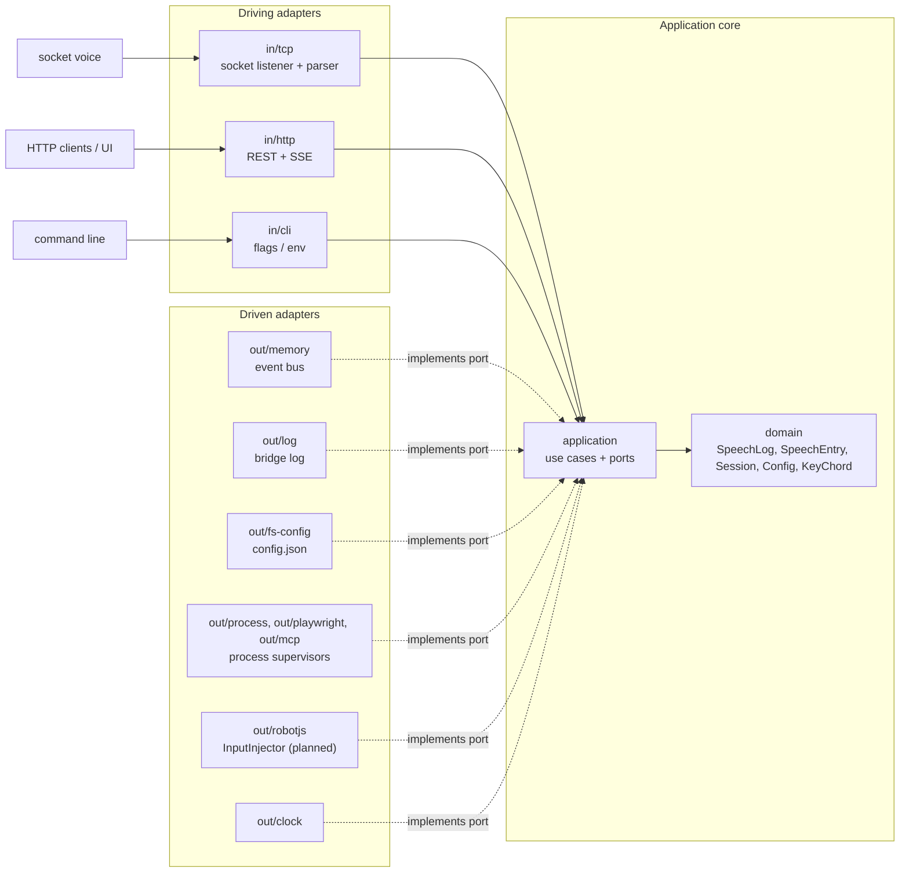

# Architecture

How the code is organised. Why it is written in Node.js is in [Decisions](decisions.md#nodejs-not-go).

Flows: [capture](flows/capture.md), [lifecycle](flows/lifecycle.md), [config](flows/config.md), [child services](flows/child-services.md).

## Monorepo

pnpm monorepo:

```
packages/
  bridge/   Node/TS process: TCP listener, HTTP API, native input, process supervisor (hexagonal)
  ui/       SvelteKit app (adapter-static), served by the bridge (hexagonal-lite), planned (M5)
  client/   npm lib + CLI (`screenreader-speech-capture-client`) + Playwright fixture (M3)
            + agent skill (M6), for tests and agents
  shared/   HTTP API contract (DTO types), used by bridge, UI and client
```

Published packages: `screenreader-speech-capture` (the bridge, with the UI bundled in from M5) and
`screenreader-speech-capture-client`. `shared` is bundled into both and isn't published on its own.
The client never imports from the bridge, so test projects don't pull in the bridge's dependencies
(such as robotjs).

## Bridge: hexagonal (ports & adapters)



```
packages/bridge/src/
  domain/            SpeechLog (the buffer and the sessions, with their rules), SeqCursor (a
                     follower's position: no duplicate between replay and live), SpeechEntry,
                     Session, CaptureState (listener and connections for the status), Config,
                     child services (settings from the config, reachability, crash policy),
                     KeyChord (key-name parsing + validation). Pure, no I/O.
  application/
    ports/in/        driving ports (use cases): RecordSpeech, TrackCapture, SpeechUseCases (list, watch, clear,
                     mark), ResizeBuffer, WaitForSpeech, ManageSessions, SendNativeInput,
                     ManageConfig, GetStatus, ChildServices (start, apply a config change,
                     stop, reachability), BridgeLifecycle (ready, shutdown order)
    ports/out/       driven ports: SpeechEventBus, ConfigStore, ProcessSupervisor, InputInjector, Logger, Clock
    services/        use-case implementations (only depend on domain + ports)
    shared/          helpers several services use: option checks, followLog (buffer replay
                     then live events, paced, no gap: watch and wait)
  adapters/
    in/tcp/          socket listener + wire-format parsers → RecordSpeech;
                     reports its listener and connections → TrackCapture
    in/http/         server, router, request/response helpers; serves the built UI
      routes/        one file per resource → driving ports
      sse/           open SSE streams (SseHub) and the frame format
      proxy/         passes /playwright and /playwright-mcp through to the child services
                     on loopback (HTTP streams and WebSocket tunnels)
      dto/           domain → API contract mappers, one file per resource
    shared/net/      listen helper (ListenError), port probe, reachable URLs of a listener,
                     used by in and out adapters
    in/cli/          flags / env → startup overrides (win over the config file)
    out/memory/      in-process event bus
    out/fs-config/   config.json in %APPDATA%
    out/process/     generic supervisor (ProcessSupervisor): spawn, readiness, restarts
                     with backoff, process-tree kill
    out/playwright/  the Playwright server on that supervisor (installs the configured version)
    out/mcp/         supervisor for Playwright MCP
    out/robotjs/     InputInjector on @jitsi/robotjs (mouse click, key chords)
    out/log/         bridge log: console + file, prefixes, colours, rotation
    out/clock/       system clock
    out/platform/    default file locations (config, log, Playwright cache) on shared `appDir`
  main.ts            composition root: startBridge, the only place adapters are wired to ports
  composition/       its helpers: config loading, logging, building the supervisors and the
                     proxy routes, wiring the live re-apply (PUT /config), listener start order.
                     Rules belong in the services; this only constructs and connects
  bin/cli.ts         executable: parses argv (adapters/in/cli), starts main.ts
```

Planned, not in the code yet: `KeyChord`, `SendNativeInput`, `InputInjector` and `out/robotjs/`
([M4](../ROADMAP.md#m4-native-input-)), and serving the built UI ([M5](../ROADMAP.md#m5-web-ui-)).

**Dependency rule:** `adapters → application → domain`. The domain imports nothing, the application
imports only the domain and its own ports, and the adapters implement or call the ports. Only the
composition root (`main.ts` + `composition/` in the bridge, `main.ts` in the client) knows the
concrete adapters. Adapters don't import the concrete services, the composition root or
each other (`in` ↔ `out`); the executables in `bin/` sit outside the adapters and call `main.ts`. ESLint (`no-restricted-imports` in `eslint.config.js`) enforces all of this. In the domain and the
application it also forbids the timer globals, `Date.now()` / `new Date()`, `process`, `fetch`
and `performance`: time and timers come through the `Clock` port, so tests can replace them.

**Extending:**

- A different socket-voice wire format is a new parser in `adapters/in/tcp/`, selected by a new
  `tcp.format` setting.
- Persistent storage (for example SQLite) would add a driven port that the services write each
  `SpeechLog` change to, with the log staying the owner of the rules
  ([decisions](decisions.md#the-speech-log-owns-the-buffer-and-session-rules)).
- A different screen reader capture (for example an NVDA add-on instead of SAPI) is a new
  driving adapter calling `RecordSpeech` and `TrackCapture`.
- A different input method (for example direct `SendInput` through FFI, or the hypervisor's
  keyboard API) is a new `InputInjector`.

### Native input in the bridge

*(planned, [M4](../ROADMAP.md#m4-native-input-))*

The bridge is bundled into one `cli.mjs`, and CI and development run on Linux, so robotjs must not
be required to build or start it:

- The `InputInjector` out-port has two adapters: `RobotjsInputInjector` and a
  `DisabledInputInjector` that throws `INPUT_DISABLED` with a reason ("not on Windows",
  `--no-input`, "robotjs failed to load: …").
- `@jitsi/robotjs` is an **optional dependency**, external in `tsdown.config.ts`, loaded with a
  dynamic `import()` in the composition root. If loading fails, the bridge starts with the disabled
  injector and logs why. The status reports the same reason (`input: { enabled, reason }`).
- Key-name parsing (`KeyChord`) lives in the domain and knows no robotjs names. The adapter maps
  them, so another `InputInjector` can replace it.
- Input is serialized in one queue, so a click and a key chord from two requests can't interleave.

## Client: hexagonal

The client uses the bridge's layout and the same ESLint rules (see the dependency rule above). The
CLI and the Playwright fixture (planned) are **driving adapters on the same in-ports as the library**, so they
can't drift from it (see [Test client](../usage/client.md)).

```
packages/client/src/
  domain/              bridge URL validation + precedence, config keys, speech entry model,
                       text matching + normalize, API version compatibility, errors
  application/
    ports/in/          ManageClientConfig, SpeechCapture (the library's functions)
    ports/out/         ClientConfigStore, BridgeApi, Clock
    services/          ClientConfigService, SpeechCaptureService (cursor, waits on the live feed),
                       live feed (onSpeech: SSE with reconnect and backoff)
  adapters/
    in/cli/            argv → in-ports → stdout + exit code; parsing and output only
    out/fs-config/     client.json in %APPDATA% / ~/.config, atomic writes
    out/http/          BridgeApi on fetch (REST + SSE parser), DTO ↔ domain mapping
    out/clock/         system clock
  main.ts              composition root: createClientConfig(env) and SpeechCaptureClient, the only
                       place that knows the concrete adapters and reads process.env
  index.ts             public API: re-exports from main.ts, in-port types and domain types
  bin/cli.ts           executable: wires main.ts into the CLI adapter (adapters/in/cli)
```

Unlike the bridge, the client is also used as a library, so the in-port interfaces are its public
types (users can fake them in their own tests). Users don't call `main.ts` functions explicitly
for the speech client: the public `SpeechCaptureClient` class lives in `main.ts`, implements
`SpeechCapture` and delegates to a service built with the default adapters, so
`new SpeechCaptureClient()` just works. It wraps the service (a private `#service` field) instead
of extending it, so the service's internals never become public types.

### Native input in the client

*(planned, [M4](../ROADMAP.md#m4-native-input-))*

Native input gets its own in-port, `NativeInput` (`click(point)`, `pressKeys(keys)`,
`setFocus(point)`), instead of growing `SpeechCapture`: it has a different availability (Windows
only, `INPUT_DISABLED`), and users' fakes of `SpeechCapture` shouldn't grow with it. The port works
in **screen coordinates** and has no Playwright types, so `@playwright/test` never becomes a type
dependency of the core.

The fixture (the `./playwright` subpath, a driving adapter) reads the window geometry from the
`Page` (see [Native input](../usage/native-input.md)) and calls `NativeInput`. A pure domain function
`clickPoint(geometry, target?)` does the math, so it is unit-tested without a browser. The fixture
can still expose one `speech` object composed from both ports. To avoid a hand-written forwarding
method per function in `main.ts`, generate the delegation (a small `delegate()` helper or a
`Proxy`) or expose the services through a factory.

## UI: SvelteKit, hexagonal-lite

*(planned, [M5](../ROADMAP.md#m5-web-ui-))*

```
packages/ui/src/
  lib/
    core/        client-side domain + use cases (filter/search log, config draft & validation)
                 and ports: SpeechFeed, SessionsApi, StatusApi, InputApi, ConfigApi
    adapters/    HTTP/SSE implementations of those ports (talk to the bridge API)
    stores/      Svelte state built on the use cases; ports are wired to adapters here
  routes/        pages: Live log (with context pane and actions), Settings, Setup (NVDA / JAWS docs);
                 status bar + status panel in the layout
```

Components never call `fetch` directly. They go through the ports, so the UI can be developed and
tested against fake adapters without a running bridge. `eslint.config.js` gets hexagon rules for
`packages/ui` that enforce this.

### Serving the UI

The API `Router` (`adapters/in/http/router.ts`) only matches exact `METHOD path` keys under
`/api/v1` and stays as it is. A separate `StaticAssets` handler in `adapters/in/http/` serves
everything else: the built SvelteKit app with an SPA fallback to `index.html`, long cache headers
for hashed assets, correct content types and path-traversal safety. The build copies the UI to
`packages/bridge/dist/ui`, resolved relative to `import.meta.url` at runtime and listed in the
package's `files`.

`packages/shared` holds only the **API contract**: the DTOs as valibot schemas, the protocol limits
and a check function ([decisions](decisions.md#the-api-contract-is-valibot-schemas)). Each hexagon
owns its own domain model and maps to and from the DTOs in its HTTP adapter. The one piece of behaviour in it is the `normalize`
text rule (`text-match.ts`): it is part of the contract, so the bridge's `GET /speech/wait` and the
client's waits use the same copy.

It also has one Node-only entry, `@screenreader-speech-capture/shared/platform-paths`: `appDir`
resolves the per-user config, state and cache folders (`%APPDATA%` / `%LOCALAPPDATA%` on Windows,
XDG elsewhere). It is shared because the bridge's `config.json` and the client's `client.json` must
sit in the same folder, and kept out of the main entry so the UI's bundle stays free of `node:*`.
