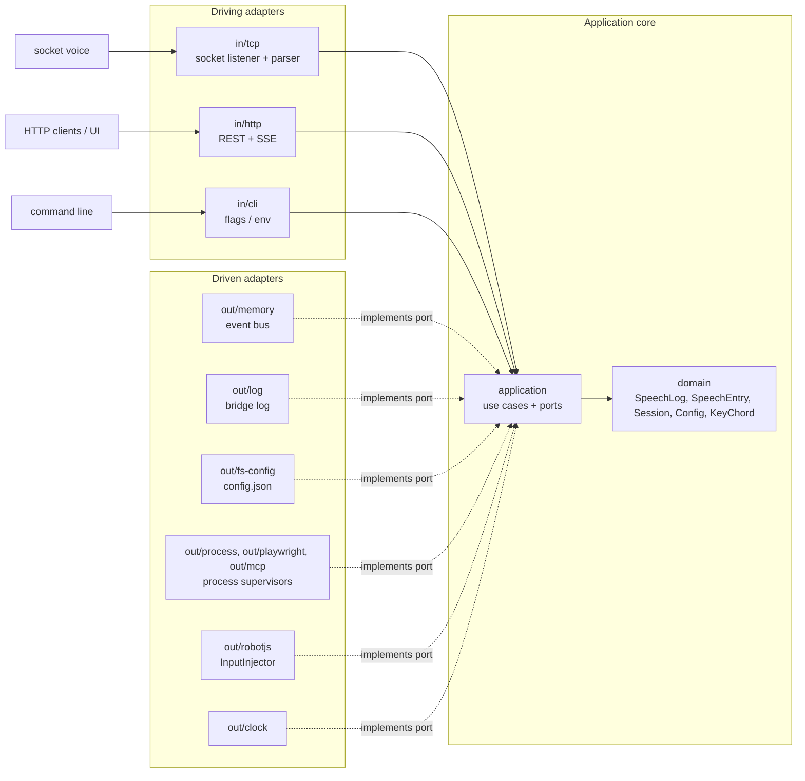

# Architecture

How the code is organised. Why it is written in Node.js is in [Decisions](decisions.md#nodejs-not-go).

Flows: [capture](flows/capture.md), [lifecycle](flows/lifecycle.md), [config](flows/config.md), [child services](flows/child-services.md).

## Monorepo

pnpm monorepo:

```
packages/
  bridge/   Node/TS process: TCP listener, HTTP API, native input, process supervisor (hexagonal)
  ui/       SvelteKit BFF (adapter-node), mounted in the bridge process (hexagonal-lite)
  client/   npm lib + CLI (`screenreader-speech-capture-client`) + Playwright fixture
            + agent skill (M6), for tests and agents
  shared/   HTTP API contract (DTO types), used by bridge, UI and client
```

Published packages: `screenreader-speech-capture` (the bridge, with the built UI in `dist/ui`) and
`screenreader-speech-capture-client`. `shared` is bundled into both and isn't published on its own.
The client never imports from the bridge, so test projects don't pull in the bridge's dependencies
(such as robotjs).

## Bridge: hexagonal (ports & adapters)



```
packages/bridge/src/
  domain/            SpeechLog (the buffer and the sessions, with their rules), SeqCursor (a
                     follower's position: no duplicate between replay and live), SpeechEntry,
                     Session, CaptureState (listener and connections for the status), Config,
                     child services (settings from the config, reachability, crash policy),
                     KeyChord (key-name parsing + validation). Pure, no I/O.
  application/
    ports/in/        driving ports (use cases): RecordSpeech, TrackCapture, SpeechUseCases (list, watch, clear,
                     mark), ResizeBuffer, WaitForSpeech, ManageSessions, SendNativeInput,
                     ManageConfig, GetStatus, ChildServices (start, apply a config change,
                     stop, reachability), BridgeLifecycle (ready, shutdown order)
    ports/out/       driven ports: SpeechEventBus, ConfigStore, ProcessSupervisor, InputInjector, Logger, Clock
    services/        use-case implementations (only depend on domain + ports)
    shared/          helpers several services use: option checks, followLog (buffer replay
                     then live events, paced, no gap: watch and wait)
  adapters/
    in/tcp/          socket listener + wire-format parsers → RecordSpeech;
                     reports its listener and connections → TrackCapture
    in/http/         server, router, request/response helpers; hands every other path to the UI
      routes/        one file per resource → driving ports
      sse/           open SSE streams (SseHub) and the frame format
      proxy/         passes /playwright and /playwright-mcp through to the child services
                     on loopback (HTTP streams and WebSocket tunnels)
      dto/           domain → API contract mappers, one file per resource
    shared/net/      listen helper (ListenError), port probe, reachable URLs of a listener,
                     used by in and out adapters
    in/cli/          flags / env → startup overrides (win over the config file)
    out/memory/      in-process event bus
    out/fs-config/   config.json in %APPDATA%
    out/process/     generic supervisor (ProcessSupervisor): spawn, readiness, restarts
                     with backoff, process-tree kill
    out/playwright/  the Playwright server on that supervisor (installs the configured version)
    out/mcp/         supervisor for Playwright MCP
    out/robotjs/     InputInjector on @jitsi/robotjs (mouse click, key chords)
    out/log/         bridge log: console + file, prefixes, colours, rotation
    out/clock/       system clock
    out/platform/    default file locations (config, log, Playwright cache) on shared `appDir`
  main.ts            composition root: startBridge, the only place adapters are wired to ports
  composition/       its helpers: config loading, logging, building the supervisors and the
                     proxy routes, listener start order.
                     Rules belong in the services; this only constructs and connects
  bin/cli.ts         executable: parses argv (adapters/in/cli), starts main.ts
```

**Dependency rule:** `adapters → application → domain`. The domain imports only `shared`, the application
imports only the domain, `shared` and its own ports, and the adapters implement or call the ports. Only the
composition root (`main.ts` + `composition/` in the bridge, `main.ts` in the client) knows the
concrete adapters. Adapters don't import the concrete services, the composition root or
each other (`in` ↔ `out`); the executables in `bin/` sit outside the adapters and call `main.ts`. ESLint (`no-restricted-imports` in `eslint.config.js`) enforces all of this. In the domain and the
application only relative imports and `shared` are allowed (no Node built-in with or without the `node:` prefix,
no npm package); it also forbids the timer globals, `Date.now()` / `new Date()` / `Date()`,
`AbortSignal.timeout`, `process`, `fetch`, `performance`, `console` and `globalThis`: time and timers come through
the `Clock` port, so tests can replace them. Ports don't import services, and the bridge and the client don't
import each other. `shared` stays browser-safe (no Node built-ins) except `platform-paths` and `openapi/`.

**Extending:**

- A different socket-voice wire format is a new parser in `adapters/in/tcp/`, selected by a new
  `tcp.format` setting.
- Persistent storage (for example SQLite) would add a driven port that the services write each
  `SpeechLog` change to, with the log staying the owner of the rules
  ([decisions](decisions.md#the-speech-log-owns-the-buffer-and-session-rules)).
- A different screen reader capture (for example an NVDA add-on instead of SAPI) is a new
  driving adapter calling `RecordSpeech` and `TrackCapture`.
- A different input method (for example direct `SendInput` through FFI, or the hypervisor's
  keyboard API) is a new `InputInjector`.

### Native input in the bridge

The bridge is bundled into one `cli.mjs`, and CI and development run on Linux, so robotjs must not
be required to build or start it:

- The `InputInjector` out-port (`keyDown`, `keyUp`, `keyTap`, `click`) has two adapters:
  `RobotjsInputInjector` and a `DisabledInputInjector` that rejects with `INPUT_DISABLED` and the
  reason ("robotjs failed to load: …"). `NativeInputService` builds a chord from the primitives:
  modifiers down, key tap, modifiers up (also when the key fails).
- `@jitsi/robotjs` is an **optional dependency** (external in the bundle because it is listed in
  `optionalDependencies`), loaded with a dynamic `import()` in `composition/input.ts`. If loading
  fails, the bridge starts with the disabled injector and logs why. Tests pass an injector through
  `TestSeams.inputInjector`. pnpm doesn't run its install script (`allowBuilds` in
  `pnpm-workspace.yaml`): the prebuilt binaries ship in the package.
- Key-name parsing (`KeyChord`) lives in the domain and knows no robotjs names. The adapter maps
  them, so another `InputInjector` can replace it.
- Input is serialized in one queue, so a click and a key chord from two requests can't interleave.

## Client: hexagonal

The client uses the bridge's layout and the same ESLint rules (see the dependency rule above). The
CLI and the Playwright fixture are **driving adapters on the same in-ports as the library**, so they
can't drift from it (see [Test client](../usage/client.md)).

```
packages/client/src/
  domain/              bridge URL validation + precedence, config keys, speech entry model,
                       text matching + normalize, API version compatibility, errors
  application/
    ports/in/          ManageClientConfig, SpeechCapture (the library's functions)
    ports/out/         ClientConfigStore, BridgeApi, Clock
    services/          ClientConfigService, SpeechCaptureService (cursor, waits on the live feed),
                       live feed (onSpeech: SSE with reconnect and backoff)
  adapters/
    in/cli/            argv → in-ports → stdout + exit code; parsing and output only
    out/fs-config/     client.json in %APPDATA% / ~/.config, atomic writes
    out/http/          BridgeApi on fetch (REST + SSE parser), DTO ↔ domain mapping
    out/clock/         system clock
  main.ts              composition root: createClientConfig(env) and SpeechCaptureClient, the only
                       place that knows the concrete adapters and reads process.env
  index.ts             public API: re-exports from main.ts, in-port types and domain types
  bin/cli.ts           executable: wires main.ts into the CLI adapter (adapters/in/cli)
```

Unlike the bridge, the client is also used as a library, so the in-port interfaces are its public
types (users can fake them in their own tests). Users don't call `main.ts` functions explicitly
for the speech client: the public `SpeechCaptureClient` class lives in `main.ts`, implements
`SpeechCapture` and delegates to a service built with the default adapters, so
`new SpeechCaptureClient()` just works. It wraps the service (a private `#service` field) instead
of extending it, so the service's internals never become public types.

### Native input in the client

Native input gets its own in-port, `NativeInput` (`click(point)`, `pressKeys(keys)`,
`setFocus(page)`), instead of growing `SpeechCapture`: it has a different availability (Windows
only, `INPUT_DISABLED`), and users' fakes of `SpeechCapture` shouldn't grow with it. `click` and `pressKeys` work
in **screen coordinates**. `setFocus` takes a structural `FocusablePage` (`evaluate(expression)`,
which a Playwright `Page` satisfies) and an optional `FocusTarget` (`boundingBox()`, a `Locator`), so
`@playwright/test` never becomes a type dependency of the core. `SpeechCaptureClient` implements both
ports (the speech one and this one) and forwards to two services that share a `VersionGate`.

The fixture (the `./playwright` subpath, a driving adapter) reads the window geometry from the
`Page` (see [Native input](../usage/native-input.md)) and calls `NativeInput`. A pure domain function
`clickPoint(geometry, target?)` does the math, so it is unit-tested without a browser. The fixture
can still expose one `speech` object composed from both ports. To avoid a hand-written forwarding
method per function in `main.ts`, generate the delegation (a small `delegate()` helper or a
`Proxy`) or expose the services through a factory.

## The web UI: a SvelteKit BFF

`packages/ui` is a SvelteKit app built with `adapter-node` that acts as a **backend for the frontend**:
the browser talks only to the UI's server code, and that code calls the bridge's public HTTP API as
the real backend ([decision](decisions.md#the-web-ui-is-a-sveltekit-bff-inside-the-bridge-process)).

```
packages/ui/src/
  env / hooks      (none yet)
  lib/server/      the BFF's only way to the bridge: bridge-api.ts (fetch + schema check of every answer)
  routes/          pages and their `+page.server.ts` / `+layout.server.ts` load functions
```

Planned for the pages ([M5](../ROADMAP.md#m5-web-ui-)): a hexagon-lite layout with `lib/core`
(client-side use cases and the ports `SpeechFeed`, `SessionsApi`, `StatusApi`, `InputApi`,
`ConfigApi`), `lib/adapters` (their HTTP/SSE implementations), `lib/stores`, `lib/components` and one
composition file (`lib/composition.ts`) that wires adapters into stores, so components never call
`fetch` and can be tested against fake adapters.

ESLint enforces the layers (`uiLayers` in `eslint.config.js`; `*.test.ts` is exempt). Every UI file
also keeps the rule that `packages/ui` never imports bridge or client code (and the bridge never
imports the UI).

| Layer                                                          | May import                           | Must not                                                                                                      |
| -------------------------------------------------------------- | ------------------------------------ | ------------------------------------------------------------------------------------------------------------- |
| `lib/core`                                                     | relative files, `#lib/core`, `shared` | packages, Svelte/SvelteKit, other layers; `fetch`, `EventSource`, browser globals, timers, `Date.now()`, `new Date()`, `console` |
| `lib/adapters`                                                 | core, packages                       | stores, components, routes, `lib/server`                                                                      |
| `lib/stores`                                                   | core, Svelte                         | adapters (injected), components, `lib/server`; `fetch`, `EventSource`, `WebSocket`, `XMLHttpRequest`          |
| `lib/components`, `routes/**/*.svelte`, `+page.ts`, `+layout.ts` | stores, core                         | adapters, `lib/server`; the same I/O globals                                                                   |
| `lib/server`, `*.server.ts` (the BFF)                          | core, `shared`, SvelteKit            | stores, components, adapters                                                                                  |

### Serving the UI

The app lives under the base path `/ui` (`paths.base` in `packages/ui/vite.config.ts`): `/ui/` is the Monitor page, `/ui/settings` and `/ui/setup` the others, the BFF's status route `/ui/api/status`. The bridge's UI handler redirects the bare `/` to `/ui/`. Code builds URLs with `resolve()` from `$app/paths`.

The build of `packages/ui` (`build/`, with `handler.js`) is copied to `packages/bridge/dist/ui` by the
bridge's build (tsdown `copy`; the bridge depends on the UI in the workspace, so `pnpm build` builds
the UI first) and ships in the package's `files`. It has no runtime dependencies: all UI
dependencies are dev dependencies, so `adapter-node` bundles them.

At start the composition root (`composition/ui.ts`) checks for `ui/handler.js` next to the bundled
`cli.mjs`. If it is there, it passes a `UiHandler` to `HttpServer`; if not (running from source, as in
tests), there is no UI and the paths answer `404`. `HttpServer` sends a request to the UI when it is
not the API (`/api/v1…`) and no proxied service (`/playwright`, `/playwright-mcp`) claims it. The
Host and origin checks run first, so they cover the UI too. The API `Router` is unchanged.

Once the HTTP port is known (it can be `0` in tests), the bridge sets `SR_BRIDGE_API_URL` to its own
loopback address and loads `handler.js` (SvelteKit reads its environment when it loads). Until then a
request waits; if loading fails, the error is logged and the UI answers `503` while the API keeps
working. The BFF reads the variable per request and falls back to `http://127.0.0.1:5151`, so
`pnpm dev:ui` (the Vite dev server) works next to `pnpm dev`. See the
[flow](flows/web-ui.md).

`packages/shared` holds only the **API contract**: the DTOs as valibot schemas, the protocol limits
and a check function ([decisions](decisions.md#the-api-contract-is-valibot-schemas)). Each hexagon
owns its own domain model and maps to and from the DTOs in its HTTP adapter. The one piece of behaviour in it is the `normalize`
text rule (`text-match.ts`): it is part of the contract, so the bridge's `GET /speech/wait` and the
client's waits use the same copy.

It also has one Node-only entry, `@screenreader-speech-capture/shared/platform-paths`: `appDir`
resolves the per-user config, state and cache folders (`%APPDATA%` / `%LOCALAPPDATA%` on Windows,
XDG elsewhere). It is shared because the bridge's `config.json` and the client's `client.json` must
sit in the same folder, and kept out of the main entry so the UI's bundle stays free of `node:*`.
