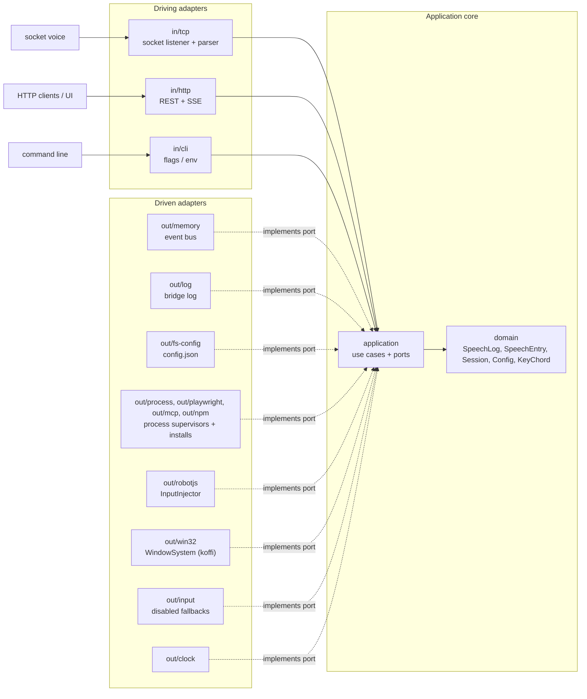

# Architecture

How the code is organised. Why it is written in Node.js is in [Decisions](decisions.md#nodejs-not-go).

Flows: [capture](flows/capture.md), [SSE replay](flows/sse-replay.md), [native input](flows/input.md), [lifecycle](flows/lifecycle.md), [config](flows/config.md), [child services](flows/child-services.md), [web UI](flows/web-ui.md).

## Monorepo

pnpm monorepo:

```
packages/
  bridge/   Node/TS process: TCP listener, HTTP API, native input, process supervisor (hexagonal)
  ui/       SvelteKit BFF (adapter-node), mounted in the bridge process (hexagonal-lite)
  client/   npm lib + CLI (`screenreader-speech-capture-client`) + Playwright fixture
            + agent skill (M6), for tests and agents
  shared/   HTTP API contract (DTO types), used by bridge, UI and client
```

Published packages: `screenreader-speech-capture` (the bridge, with the built UI in `dist/ui`) and
`screenreader-speech-capture-client`. `shared` is bundled into both and isn't published on its own.
The client never imports from the bridge, so test projects don't pull in the bridge's dependencies
(such as robotjs).

## Bridge: hexagonal (ports & adapters)



```
packages/bridge/src/
  domain/            Pure, no I/O:
                     SpeechLog (the buffer and the sessions, with their rules; speech-buffer and
                     seq-queue are its data structures), SeqCursor (a follower's position: no
                     duplicate between replay and live), SpeechEntry, SpeechEvent, Session,
                     CaptureState (listener and connections for the status), Config (defaults,
                     merge = validation), child services (settings, reachability, crash policy),
                     KeyChord (key-name parsing), text-match (wait matching), version (exact npm
                     versions), availability (input / focus on or off and why), AppError + codes
  application/
    ports/in/        driving ports (use cases): RecordSpeech, TrackCapture, SpeechUseCases (list,
                     watch, clear, mark, latest marker), WaitForSpeech, ManageSessions,
                     SendNativeInput (+ InputQueue), CaptureInput, FocusWindow, ManageConfig,
                     GetStatus, ChildServices (start, stop, reachability), BridgeLifecycle
    ports/out/       driven ports: SpeechEventBus, ConfigStore, ProcessSupervisor, InputInjector,
                     WindowSystem, Logger, Clock
    services/        use-case implementations (only depend on domain + ports): SpeechService,
                     SessionService, WaitForSpeechService, NativeInputService (the input queue),
                     InputCaptureService, WindowFocusService, ConfigService, StatusService,
                     ChildServicesService, BridgeLifecycleService, TranscriptService (speech
                     lines to the log at debug)
    shared/          helpers several services use: option checks, abort helpers, followLog
                     (buffer replay then live events, paced, no gap: watch, wait, capture)
  adapters/
    in/tcp/          socket listener + wire-format parsers → RecordSpeech;
                     reports its listener and connections → TrackCapture
    in/http/         server, router, request/response helpers; hands every other path to the UI
      routes/        one file per resource → driving ports
      sse/           open SSE streams (SseHub) and the frame format
      proxy/         passes /playwright and /playwright-mcp through to the child services
                     on loopback (HTTP streams and WebSocket tunnels)
      dto/           domain → API contract mappers, one file per resource
    shared/net/      listen helper (ListenError), port probe, reachable URLs of a listener,
                     used by in and out adapters
    in/cli/          flags / env → startup overrides (win over the config file)
    out/memory/      in-process event bus
    out/fs-config/   config.json in %APPDATA%
    out/process/     generic supervisor (ProcessSupervisor): spawn, readiness, restarts
                     with backoff, process-tree kill
    out/npm/         per-version npm install into a temp folder, renamed when complete
    out/playwright/  the Playwright server on that supervisor (installs the configured version)
    out/mcp/         supervisor for Playwright MCP
    out/robotjs/     InputInjector on @jitsi/robotjs (mouse click, key chords)
    out/win32/       WindowSystem on koffi + user32 (process tree, top-level windows, foreground)
    out/input/       DisabledInputInjector, DisabledWindowSystem: answer INPUT_DISABLED with the reason
    out/log/         bridge log: console + file, prefixes, colours, rotation
    out/clock/       system clock
    out/platform/    default file locations (config, log, Playwright cache) on shared `appDir`
  main.ts            composition root: startBridge, the only place adapters are wired to ports
  composition/       its helpers: config loading, logging, building the services, supervisors
                     and proxy routes, loading robotjs / koffi / the UI, listener start order,
                     `TestSeams` (what tests may replace).
                     Rules belong in the services; this only constructs and connects
  bin/cli.ts         executable: parses argv (adapters/in/cli), starts main.ts
```

**Dependency rule:** `adapters → application → domain`. The domain imports only `shared`, the application
imports only the domain, `shared` and its own ports, and the adapters implement or call the ports. Only the
composition root (`main.ts` + `composition/` in the bridge, `main.ts` in the client) knows the
concrete adapters. Adapters don't import the concrete services, the composition root or
each other (`in` ↔ `out`); the executables in `bin/` sit outside the adapters and call `main.ts`. ESLint (`no-restricted-imports` in `eslint.config.js`) enforces all of this. In the domain and the
application only relative imports and `shared` are allowed (no Node built-in with or without the `node:` prefix,
no npm package); it also forbids the timer globals, `Date.now()` / `new Date()` / `Date()`,
`AbortSignal.timeout`, `process`, `fetch`, `performance`, `console` and `globalThis`: time and timers come through
the `Clock` port, so tests can replace them. Ports don't import services, and the bridge and the client don't
import each other. `shared` stays browser-safe (no Node built-ins) except `platform-paths` and `openapi/`.

**Extending:**

- A different socket-voice wire format is a new parser in `adapters/in/tcp/`, selected by a new
  `tcp.format` setting.
- Persistent storage (for example SQLite) would add a driven port that the services write each
  `SpeechLog` change to, with the log staying the owner of the rules
  ([decisions](decisions.md#the-speech-log-owns-the-buffer-and-session-rules)).
- A different screen reader capture (for example an NVDA add-on instead of SAPI) is a new
  driving adapter calling `RecordSpeech` and `TrackCapture`.
- A different input method (for example direct `SendInput` through FFI, or the hypervisor's
  keyboard API) is a new `InputInjector`.

### Native input in the bridge

The bridge is bundled into one `cli.mjs`, and CI and development run on Linux, so robotjs must not
be required to build or start it:

- The `InputInjector` out-port (`keyDown`, `keyUp`, `keyTap`, `click`) has two adapters:
  `RobotjsInputInjector` and a `DisabledInputInjector` that rejects with `INPUT_DISABLED` and the
  reason ("robotjs failed to load: …"). `NativeInputService` builds a chord from the primitives:
  modifiers down, key tap, modifiers up (also when the key fails).
- `@jitsi/robotjs` is an **optional dependency** (external in the bundle because it is listed in
  `optionalDependencies`), loaded with a dynamic `import()` in `composition/input.ts`. If loading
  fails, the bridge starts with the disabled injector and logs why. Tests pass an injector through
  `TestSeams.inputInjector`. pnpm doesn't run its install script (`allowBuilds` in
  `pnpm-workspace.yaml`): the prebuilt binaries ship in the package.
- Key-name parsing (`KeyChord`) lives in the domain and knows no robotjs names. The adapter maps
  them, so another `InputInjector` can replace it.
- Input is serialized in one queue, so a click and a key chord from two requests can't interleave.
- `InputCaptureService` (the `CaptureInput` port, a request with `capture`) drives
  `NativeInputService` with a `beforeInject` hook that runs inside that queue: it waits for
  `settleMs` of silence if asked, then reads the start `seq`, so nothing gets between the two
  ([decision](decisions.md#captures-of-native-input-run-on-the-bridge)). After the input it follows
  the log with `followLog` and times the silence from the entries' `receivedAt` on the `Clock`.
- `WindowFocusService` (`POST /input/focus`) picks the window and holds the rules: the target
  supervisor's `pid()`, the windows of that process tree, the title marker and its wait. The
  `WindowSystem` out-port only reports facts (process tree, top-level windows front to back) and
  brings a window to the front. `Win32WindowSystem` builds the tree and does the Alt tap /
  `AttachThreadInput` sequence on a small `Win32` interface; `win32-bindings.ts` binds that to
  koffi (an optional dependency like robotjs, loaded in `composition/window-system.ts`, only on
  Windows) and is the only part CI can't run. The focus runs in the input queue (`InputQueue`)
  ([decision](decisions.md#the-bridge-focuses-browser-windows-it-started)).

## Client: hexagonal

The client uses the bridge's layout and the same ESLint rules (see the dependency rule above). The
CLI and the Playwright fixture are **driving adapters on the same in-ports as the library**, so they
can't drift from it (see [Test client](../usage/client.md)).

```
packages/client/src/
  domain/              bridge URL validation + precedence, config keys, output format, speech
                       entry and session model, bridge status, feed events, text matching +
                       normalize, API version compatibility, window geometry → click point, errors
  application/
    ports/in/          ManageClientConfig, SpeechCapture (the library's functions), NativeInput
    ports/out/         ClientConfigStore, BridgeApi, Clock
    services/          ClientConfigService, SpeechCaptureService (cursor, waits on the live feed),
                       NativeInputService (keys, clicks, captures, focus), speech-events (the SSE
                       follower with reconnect, backoff and Last-Event-ID, shared by waits and
                       onSpeech), live feed (onSpeech)
  adapters/
    in/cli/            argv → in-ports → stdout + exit code; parsing and output only
    in/playwright/     the fixture (`./playwright` subpath) and focusPage (bring to front,
                       else click + reload)
    out/fs-config/     client.json in %APPDATA% / ~/.config, atomic writes
    out/http/          BridgeApi on fetch (REST + SSE parser), DTO ↔ domain mapping, the API
                       version header check on every answer
    out/clock/         system clock
  main.ts              composition root: createClientConfig(env) and SpeechCaptureClient, the only
                       place that knows the concrete adapters and reads process.env
  index.ts             public API: re-exports from main.ts, in-port types and domain types
  bin/cli.ts           executable: wires main.ts into the CLI adapter (adapters/in/cli)
```

Unlike the bridge, the client is also used as a library, so the in-port interfaces are its public
types (users can fake them in their own tests). Users don't call `main.ts` functions explicitly
for the speech client: the public `SpeechCaptureClient` class lives in `main.ts`, implements
`SpeechCapture` and delegates to a service built with the default adapters, so
`new SpeechCaptureClient()` just works. It wraps the service (a private `#service` field) instead
of extending it, so the service's internals never become public types.

### Native input in the client

Native input gets its own in-port, `NativeInput` (`click(point)`, `pressKeys(keys)`,
`setFocus(page)`), instead of growing `SpeechCapture`: it has a different availability (Windows
only, `INPUT_DISABLED`), and users' fakes of `SpeechCapture` shouldn't grow with it. `click` and `pressKeys` work
in **screen coordinates**. `setFocus` takes a structural `FocusablePage` (`evaluate(expression)`,
which a Playwright `Page` satisfies) and an optional `FocusTarget` (`boundingBox()`, a `Locator`), so
`@playwright/test` never becomes a type dependency of the core. `SpeechCaptureClient` implements both
ports (the speech one and this one) and forwards to two services that share one `FetchBridgeApi`,
which checks the API version of every answer
([decision](decisions.md#the-client-checks-the-api-version-on-every-answer)).

The fixture (the `./playwright` subpath, a driving adapter) first asks `NativeInput.bringToFront`
(the bridge finds the window by a title marker). Where that returns `null`, `focusPage` reads the
window geometry from the `Page` (see [Native input](../usage/native-input.md)), clicks the corner
of the page content and reloads. Pure domain functions (`clickPoint(geometry, target?)`,
`contentCornerPoint`) do the math, so they are unit-tested without a browser.
`SpeechCaptureClient` forwards each method by hand to one of the two services, so its public type
is exactly the two ports.

## The web UI: a SvelteKit BFF

`packages/ui` is a SvelteKit app built with `adapter-node` that acts as a **backend for the frontend**:
the browser talks only to the UI's server code, and that code calls the bridge's public HTTP API as
the real backend ([decision](decisions.md#the-web-ui-is-a-sveltekit-bff-inside-the-bridge-process)).

```
packages/ui/src/
  hooks.server.ts  per request: `locals.local` (opened on the bridge's machine) and `locals.bridge` (the BridgeApi)
  lib/server/      the BFF's only way to the bridge: bridge-api.ts (fetch + schema check of every answer),
                   handed to routes and loads as `locals.bridge`
  lib/core/        pure: sessions, speech (the `SpeechFeed` port, row cap, heading and time formats)
  lib/adapters/    fetch / EventSource / localStorage / remote calls: SseSpeechFeed, HttpSessionsApi, ...
  lib/remote/      remote functions (`*.remote.ts`, server code): getSessions
  lib/stores/      Svelte runes stores built on the ports (speech, sessions, status, theme, ...)
  lib/components/  SpeechLog, SessionsPane, ... (one folder each, with a `*.svelte.test.ts`)
  routes/          pages and their `+page.server.ts` / `+layout.server.ts` load functions
```

The pages use a hexagon-lite layout ([M5](../ROADMAP.md#m5-web-ui-)): `lib/core` (client-side use
cases and the ports `SpeechFeed`, `SpeechApi`, `SessionsApi`, `StatusApi`; `InputApi` and `ConfigApi` are
planned), `lib/adapters` (their HTTP/SSE implementations), `lib/stores`, `lib/components` and one
composition file (`lib/composition.ts`) that wires adapters into stores, so components never call
`fetch` and can be tested against fake adapters. The root layout creates the stores
(`provideAppStores`) and components read them from the Svelte context (`appStores()`). They are
not module-level singletons: on the server every request renders its own app, and a shared store
would show one viewer's state to another. The adapters call the UI's own routes through one helper
(`lib/adapters/route-request.ts`) and don't check the answers against the schemas again: the BFF
checked every bridge answer, and only the UI calls `/ui/api/*`. The SSE entries are the exception,
because the stream relay passes them on unchecked.

ESLint enforces the layers (`uiLayers` in `eslint.config.js`; `*.test.ts` is exempt). Every UI file
also keeps the rule that `packages/ui` never imports bridge or client code (and the bridge never
imports the UI).

| Layer                                                            | May import                            | Must not                                                                                                                         |
| ---------------------------------------------------------------- | ------------------------------------- | -------------------------------------------------------------------------------------------------------------------------------- |
| `lib/core`                                                       | relative files, `#lib/core`, `shared` | packages, Svelte/SvelteKit, other layers; `fetch`, `EventSource`, browser globals, timers, `Date.now()`, `new Date()`, `console` |
| `lib/adapters`                                                   | core, packages                        | stores, components, routes, `lib/server`                                                                                         |
| `lib/stores`                                                     | core, Svelte                          | adapters (injected), components, `lib/server`, `lib/remote`; `fetch`, `EventSource`, `WebSocket`, `XMLHttpRequest`                             |
| `lib/components`, `routes/**/*.svelte`, `+page.ts`, `+layout.ts` | stores, core                          | adapters, `lib/server`, `lib/remote`; the same I/O globals                                                                                   |
| `lib/server`, `*.server.ts` (the BFF)                            | core, `shared`, SvelteKit             | stores, components, adapters                                                                                                     |

### The speech table's data path

The browser never talks to the bridge. `SseSpeechFeed` (adapter) implements the `SpeechFeed` port for
the speech store, which the monitor page re-opens whenever the selected scope changes:

- **Live scope** (the current session or `none`): an `EventSource` on `/ui/api/speech/stream?session=…&since=0`.
  The route in `routes/api/speech/stream/+server.ts` calls `BridgeApi.openSpeechStream` and returns
  the bridge's body unchanged (`text/event-stream`), so every event and the bridge's `Last-Event-ID`
  replay reach the browser. `EventSource` can't set a header on its first request, so `?since=` is
  sent upstream as `Last-Event-ID` (`0` replays the whole buffer of that scope). The header the browser
  sends on its own reconnects wins over the query. The upstream request is aborted with the browser's.
- **Ended session**: `GET /ui/api/speech?session=<id>&since=<seq>&limit=1000` (`BridgeApi.speech`),
  repeated while `hasMore`. No stream, because nothing new can arrive.
- The store drops an entry whose `seq` is not above the last one shown (replays after a reconnect),
  and keeps the newest `MAX_ROWS` rows. Whether a scope is live is decided when it opens.
- **Add marker**: `HttpSpeechApi` (the `SpeechApi` port) posts `{ label }` to `/ui/api/markers`, which
  calls `BridgeApi.addMarker` (`POST /api/v1/markers`). Nothing is added to the table locally: the
  entry comes back through the feed.

- **Clear speech**: `HttpSpeechApi.clear` sends `DELETE /ui/api/speech?session=<id|none>`, which calls
  `BridgeApi.clearSpeech` (`DELETE /api/v1/speech?session=<id|none>`). `canClearSpeech` shows the button
  for the live scopes only. Nothing is removed locally: the scope's SSE feed gets the bridge's scoped
  `clear` event and empties the table; the page then re-reads the sessions list for the counts.
- **Bridge settings**: `readConfigState` (`lib/server`) reads `{ active, saved, overrides }` with three
  bridge calls (`BridgeApi.config('active'|'saved')`, `configOverrides`). The Settings page's load calls it
  and the page seeds the config store while rendering, so the server's HTML has the settings. In the
  browser, `HttpConfigApi` (the `ConfigApi` port) re-reads it through `GET /ui/api/config` (after a save,
  or if the load failed) and saves with `PUT /ui/api/config` (`BridgeApi.updateConfig`, `PUT /api/v1/config`).
  A refused setting keeps the bridge's `details.field` as `error.field` (`App.Error`), which the adapter turns
  into a `SettingRejected`. The config store keeps the state and `pending` (`pendingFields`: the saved
  settings that differ from what runs); the page and its setting components only show it.
  Each setting is data in `lib/core/settings.ts` (label, texts, how its value is shown and read), and
  `buildPatch` makes a patch of the changed ones only. `SettingsForm` is the form of one section (drafts,
  save, restart notice) and renders each setting with `SettingField` (a read-only row if a flag sets it).
- **Sessions list**: the `getSessions` remote query (`lib/remote/sessions.remote.ts`, `BridgeApi.sessions`).
  The monitor page's load awaits it, so the server's HTML has the list and Kit puts the answer in the
  page. The page seeds the sessions store with it while rendering, on the server too.
  `HttpSessionsApi.list` re-reads it with `refresh()` (every 3 s, and after a start, end or delete): a
  query keeps its last answer while anything still uses it ([decision](decisions.md#the-ui-uses-sveltekits-experimental-remote-functions)).
- **Delete session**: `HttpSessionsApi.delete` sends `DELETE /ui/api/sessions/<id>`, which calls
  `BridgeApi.deleteSession` (`DELETE /api/v1/sessions?session=<id>`). `canDeleteSession` shows the
  button only for an ended session; the page picks the next scope with `scopeAfterDelete` before the
  list is read again.

### Serving the UI

The app lives under the base path `/ui` (`paths.base` in `packages/ui/vite.config.ts`): `/ui/` is the Monitor page, `/ui/settings` and `/ui/setup` the others, the BFF's routes under `/ui/api/` (`status`, `sessions` (`POST` only), `sessions/<id>`, `speech`, `speech/stream`, `markers`, `config`). Every route reads a scope the same way: `parseScope` (`lib/core/sessions.ts`)
accepts a session id or `none`. `scopeParam` (`lib/server/scope.ts`) applies it to `?session=` and
answers 400 for anything else, and the `id` matcher does the same for
`sessions/<id>` (`src/params.ts`, typed as a number), where an invalid id is a 404. The bridge's UI handler redirects the bare `/` to `/ui/`. Code builds URLs with `resolve()` from `$app/paths`.

The build of `packages/ui` (`build/`, with `handler.js`) is copied to `packages/bridge/dist/ui` by the
bridge's build (tsdown `copy`; the bridge depends on the UI in the workspace, so `pnpm build` builds
the UI first) and ships in the package's `files`. It has no runtime dependencies: all UI
dependencies are dev dependencies, so `adapter-node` bundles them.

At start the composition root (`composition/ui.ts`) checks for `ui/handler.js` next to the bundled
`cli.mjs`. If it is there, it passes a `UiHandler` to `HttpServer`; if not (running from source, as in
tests), there is no UI and the paths answer `404`. `HttpServer` sends a request to the UI when it is
not the API (`/api/v1…`) and no proxied service (`/playwright`, `/playwright-mcp`) claims it. The
Host and origin checks run first, so they cover the UI too. The API `Router` is unchanged.

Once the HTTP port is known (it can be `0` in tests), the bridge sets `SR_BRIDGE_API_URL` to its own
loopback address and loads `handler.js` (SvelteKit reads its environment when it loads). Until then a
request waits; if loading fails, the error is logged and the UI answers `503` while the API keeps
working. Before loading, it also puts its `[web-ui]` logger on `globalThis` under
`Symbol.for('screenreader-speech-capture.ui-logger')` (`UI_LOGGER_KEY`). The UI's `serverLog()`
(`lib/server/log.ts`) writes to it, and `handleError` in `hooks.server.ts` logs every unexpected
error there, so those lines reach the log file and never block on the console. Without a bridge
(`pnpm dev:ui`) it falls back to the console. The BFF reads the variable through `$app/env/private` (declared and checked in `src/env.ts`) and falls back to `http://127.0.0.1:5151`, so
`pnpm dev:ui` (the Vite dev server) works next to `pnpm dev`. See the
[flow](flows/web-ui.md).

## Shared contract

`packages/shared` holds only the **API contract**: the DTOs as valibot schemas, the protocol limits
and a check function ([decisions](decisions.md#the-api-contract-is-valibot-schemas)). Each hexagon
owns its own domain model and maps to and from the DTOs in its HTTP adapter. Its two pieces of behaviour are part of the contract, so
both sides use the same copy: the `normalize` text rule (`text-match.ts`, the bridge's
`GET /speech/wait` and the client's waits) and the key-chord rule (`key-chord.ts`, the bridge's
`POST /input/keys` and the CLI's `press` check and `--help`).

It also has one Node-only entry, `@screenreader-speech-capture/shared/platform-paths`: `appDir`
resolves the per-user config, state and cache folders (`%APPDATA%` / `%LOCALAPPDATA%` on Windows,
XDG elsewhere). It is shared because the bridge's `config.json` and the client's `client.json` must
sit in the same folder, and kept out of the main entry so the UI's bundle stays free of `node:*`.

## Errors

One path from the bridge's domain to the agent's exit code:

| Where | What |
|---|---|
| Bridge domain (`domain/errors.ts`) | `AppError(code, message, details?)` for every expected failure. `code` is one of `ErrorCode`, the same set as `ERROR_CODES` in `shared` (a type-level test keeps them equal). Services and the domain throw it; `invalidField(field, …)` sets `details.field`. |
| Bridge HTTP adapter (`adapters/in/http/errors.ts`) | `sendError` maps an `AppError` to `ERROR_STATUS[code]` (`shared/src/errors.ts`) and the [error body](../usage/http-api.md#errors). Anything else is `500 INTERNAL` with a generic message; the stack goes only to the bridge log. A stream that already sent its headers is destroyed instead. |
| Driven adapters | Report facts; only the disabled fallbacks (`out/input`) throw an `AppError`: `INPUT_DISABLED` with the load error as the reason. `WindowSystem.bringToFront` returns `false` when Windows refused, and `WindowFocusService` turns that into `FOCUS_FAILED` (no such window: `NOT_FOUND`). The proxy answers `SERVICE_UNAVAILABLE` for a service that isn't running. Any other thrown error stays plain and becomes `INTERNAL`. |
| Client (`domain/errors.ts`, `adapters/out/http`) | `FetchBridgeApi` turns an error body into `BridgeHttpError` (`status`, `code`, `details`), a failed `fetch` into `BridgeUnreachableError`, another major API version into `IncompatibleBridgeError`, and an answer that doesn't match its schema into `BridgeHttpError` `INVALID_RESPONSE`. Waits throw `SpeechTimeoutError` / `SpeechTruncatedError` with the entries seen. |
| CLI (`adapters/in/cli/errors.ts`) | A table maps each error class to its JSON `type` and exit code (`UsageError`, `ClientConfigError` → 3; `BridgeUnreachableError`, `BridgeHttpError`, `IncompatibleBridgeError` → 2; anything else `InternalError` → 4). Timeouts are not errors there: commands catch them and print a result with `status` and exit 1 ([usage](../usage/client.md#results-and-errors)). |

A new error code is a minor API version: add it to `ERROR_CODES` and `ERROR_STATUS` in `shared`,
to `ErrorCode` in the bridge, and to the table in [HTTP API → Errors](../usage/http-api.md#errors).
Clients treat an unknown code as an error of its HTTP status.

## Runtime model

The bridge is one Node process with one event loop: TCP capture, the HTTP API, the SSE streams, the
proxies and the web UI's server code all share it. Speech capture must never wait long behind
something else, so long work is cut into steps and a few things are serialised on purpose.

**Serialised:**

| Queue | Where | Why |
|---|---|---|
| Input queue | `NativeInputService` (a promise chain, `InputQueue` port) | A click, a chord, a focus and a capture's `beforeInject` (settle, start `seq`) never interleave, so a capture's start is exact ([flow](flows/input.md), [decision](decisions.md#captures-of-native-input-run-on-the-bridge)). `settleMs` holds the queue while it waits. |
| Config updates | `ConfigService` (a promise chain) | Each `PUT /config` starts from the `saved` result of the one before and writes the file once ([flow](flows/config.md)). |
| One speech log | `SpeechLog` (synchronous) | `seq`, session ids and the cap are assigned in one synchronous call per entry, so the order of `seq` is the order of arrival. |

**Cut into steps** (so capture runs in between):

- A replay (`followLog`) reads the log in pages of `REPLAY_PAGE` (500) and calls `pace` after each
  entry. For SSE, `SseHub.pace` waits for `drain` while the client hasn't read what was written,
  and yields with `setImmediate` every 256 frames; the bridge's wait and the capture yield every
  256 entries (`composition/pace.ts`) ([flow](flows/sse-replay.md),
  [decision](decisions.md#the-sse-replay-follows-the-reader)).
- A live SSE client that stops reading is destroyed once more than 1 MiB is queued for it
  (`SSE_MAX_BUFFERED_BYTES`); it reconnects with `Last-Event-ID`.
- A wait's `regex` runs synchronously on each entry and is not sandboxed: a catastrophic pattern
  blocks the loop ([decision](decisions.md#a-waits-regex-is-not-sandboxed)).

**Bounds** (what one client or one sender can make the bridge hold):

| What | Limit | Set in |
|---|---|---|
| Speech entries | `buffer.maxEntries` (default 10 000, at most 1 000 000), oldest dropped in O(1) | config, `CONFIG_LIMITS` |
| One TCP line | `tcp.maxLineBytes` (default 64 KiB, at most 16 MiB), cut and logged | config, `CONFIG_LIMITS` |
| Queued SSE bytes per live client | 1 MiB, then the stream is closed | `SSE_MAX_BUFFERED_BYTES` |
| A replay in memory | one page (500 entries) | `REPLAY_PAGE` |
| Entries in a wait's timeout answer | the last 1000 seen, plus `omitted` | `API_LIMITS.wait.seen` |
| Entries in a capture answer | the first 10 000, plus `omitted` | `API_LIMITS.capture.entries` |
| A request body | 1 MiB | `MAX_BODY_BYTES` in `request.ts` |

Child services (Playwright server, MCP, their browsers) are separate processes: a crash there
never takes the event loop down, and the supervisor kills their whole tree
([decision](decisions.md#child-process-trees-are-killed-by-the-bridge-not-the-os)).
