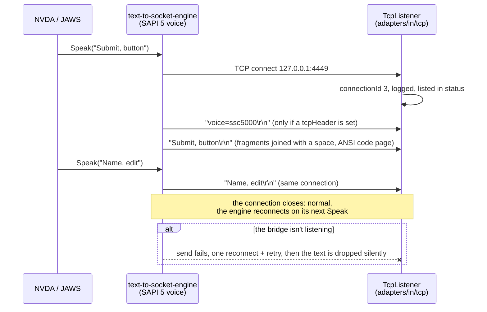
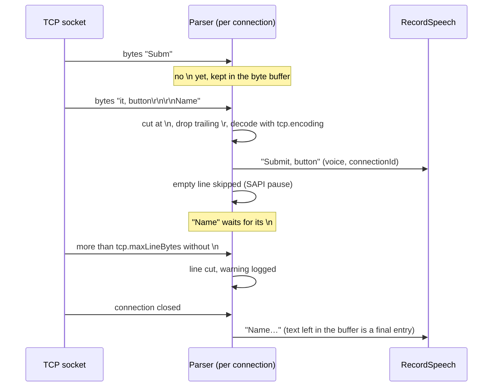
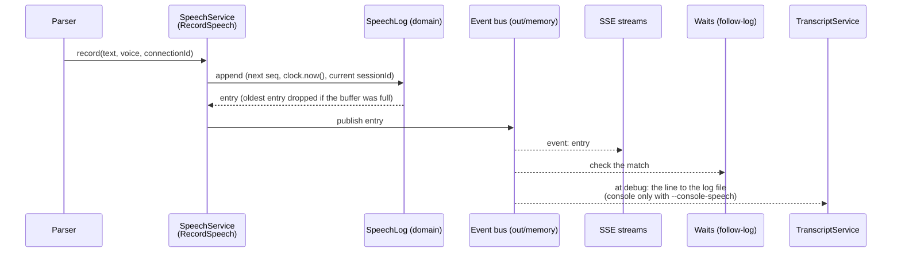

# Capture flows

Sequence diagrams of how speech gets from the socket voice into the bridge's speech log and out to
the readers. The rules are in [TCP capture](../tcp-capture.md) and
[Speech capture → Wire format](../../usage/speech-capture.md#wire-format).

**Contents**

1. [The socket voice connects and speaks](#the-socket-voice-connects-and-speaks)
2. [Framing and decoding](#framing-and-decoding)
3. [From line to readers](#from-line-to-readers)

## The socket voice connects and speaks

The engine is the TCP client and connects lazily, on the first text it has to speak. Each speaking
process opens its own connection. A `tcpHeader` arrives as the first line; nothing marks it as a
header except the `voice=<id>` form the parser looks for.

## Framing and decoding

Per connection, `text-to-socket-parser` cuts the bytes at `\n` before decoding, so a multi-byte
character split across TCP packets still decodes correctly.

## From line to readers

`RecordSpeech` gives the line its `seq` and `receivedAt` (from the `Clock` port), the `SpeechLog`
stores it (dropping the oldest entry when full) and the event bus hands it to every reader.

