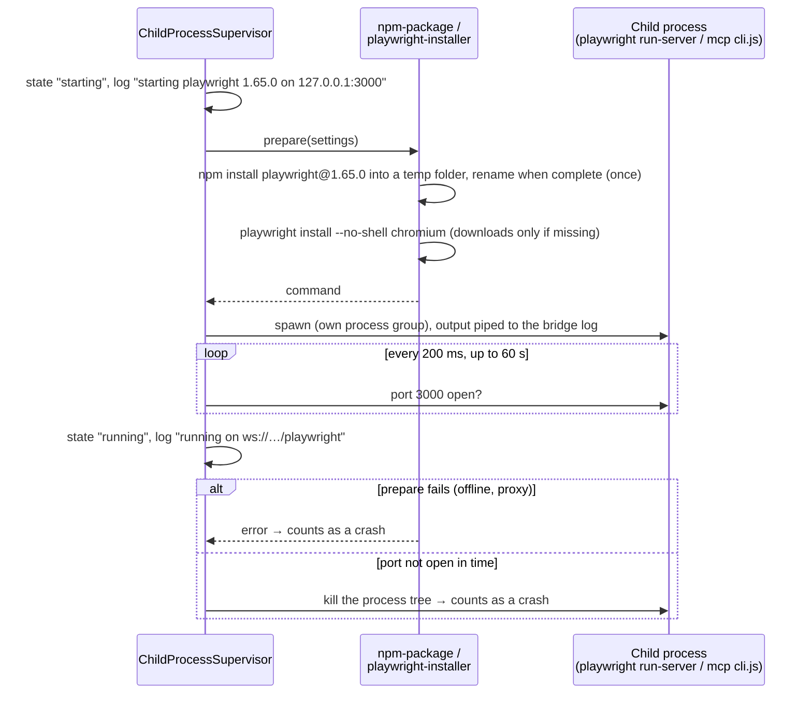
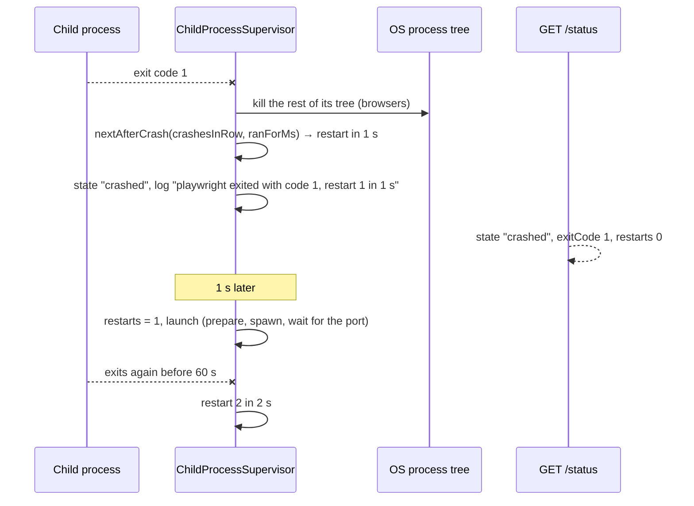
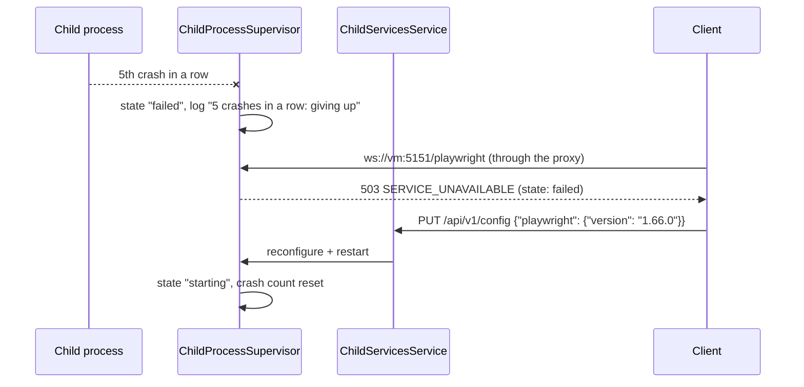

# Child service flows

Sequence diagrams of how `ChildProcessSupervisor` (`adapters/out/process`) runs the Playwright
server and Playwright MCP: prepare (install), spawn, wait for the port, restart after a crash. The
behaviour is described in [Operations → Child service crashes](../../usage/operations.md#child-service-crashes)
and [Remote Playwright & MCP → Install](../../usage/playwright-mcp.md#install).

**Contents**

1. [Start: install, spawn, wait for the port](#start-install-spawn-wait-for-the-port)
2. [Crash and restart with backoff](#crash-and-restart-with-backoff)
3. [Too many crashes in a row](#too-many-crashes-in-a-row)

## Start: install, spawn, wait for the port

`prepare` installs what the version needs (the npm package once per version, Chromium on every
start, a download only when missing). The service is `running` once its port accepts connections,
at most 60 s after the spawn.

## Crash and restart with backoff

A crash kills what is left of the process tree and restarts after a growing delay (1 s, 2 s, 4 s,
… up to 30 s). 60 s of stable running resets the count (`nextAfterCrash` in the domain).

## Too many crashes in a row

After 5 crashes without 60 s of stable running in between, the supervisor gives up: `failed` until
the bridge restarts, or a `PUT /config` change to the service's section restarts it
([Config flows](config.md)).

