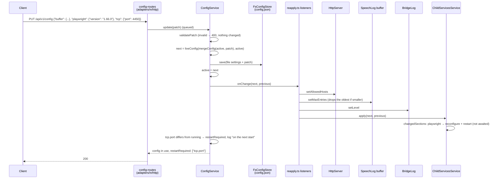

# Config flows

Sequence diagram of a live configuration change through the hexagon: the HTTP adapter,
`ConfigService`, the re-apply wiring in `composition/reapply.ts`, and the parts that apply a
change. The user-facing rules are in
[Configuration → Changing settings](../../usage/configuration.md#changing-settings).

**Contents**

1. [PUT /config through the layers](#put-config-through-the-layers)

## PUT /config through the layers

Updates run one at a time (a queue in `ConfigService`). The file is saved first, so a write error
changes nothing. Restart-only settings (`RESTART_FIELDS` in `domain/config/restart.ts`) are kept at
their running values by `liveConfig` and reported in `restartRequired`. Each `onChange` listener
runs even if the one before failed.

