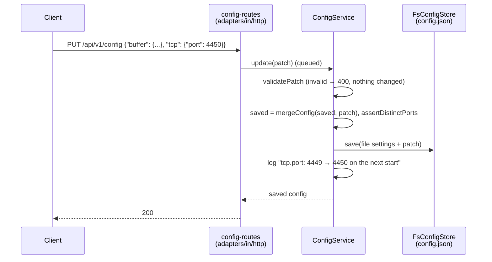

# Config flows

Sequence diagram of a configuration change through the hexagon: the HTTP adapter and
`ConfigService`. The user-facing rules are in
[Configuration → Changing settings](../../usage/configuration.md#changing-settings).

**Contents**

1. [PUT /config through the layers](#put-config-through-the-layers)

## PUT /config through the layers

Updates run one at a time (a queue in `ConfigService`). The file is saved first, so a write error
changes nothing. The configuration in use never changes while the bridge runs: `ConfigService`
keeps a second one, `saved` (in use plus every update), which the next update starts from and
`PUT` answers with
([Decisions](../decisions.md#settings-apply-on-the-next-start)).

