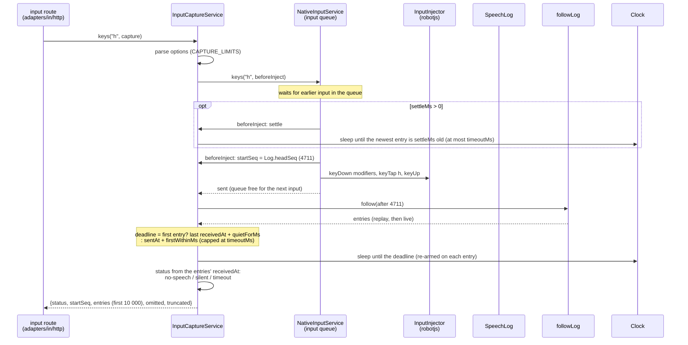
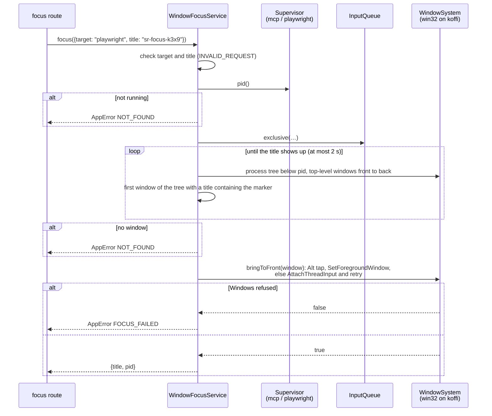

# Native input flows

Sequence diagrams of the bridge's input side through its layers: the input queue, a capture and
bringing a window to the front. The design is in
[Architecture → Native input in the bridge](../architecture.md#native-input-in-the-bridge), what
clients see in the [usage flows](../../usage/flows/native-input.md).

**Contents**

1. [A key press with capture](#a-key-press-with-capture)
2. [Bringing a window to the front](#bringing-a-window-to-the-front)

## A key press with capture

`InputCaptureService` hands `NativeInputService` a `beforeInject` hook that runs **inside** the
input queue: settle, then read the start `seq` (`SpeechLog.headSeq`), then the keys. Nothing can get
between the start and the input
([decision](../decisions.md#captures-of-native-input-run-on-the-bridge)). The recording itself runs
after the queue task, so the next input can already be sent; its speech then lands in this capture
too, if it comes before the silence.

A client that disconnects aborts the capture (`AbortSignal`); `shutdown()` aborts every pending one
with `SERVICE_UNAVAILABLE`.

## Bringing a window to the front

`WindowFocusService` holds the rules (which process tree, which window, how long to wait for a
title marker); `WindowSystem` only reports facts and does the Win32 calls. The focus runs in the same
input queue, so it never interleaves with a key press.

Without koffi, or not on Windows, `DisabledWindowSystem` throws `INPUT_DISABLED` on the first call;
the client then falls back to a click.
