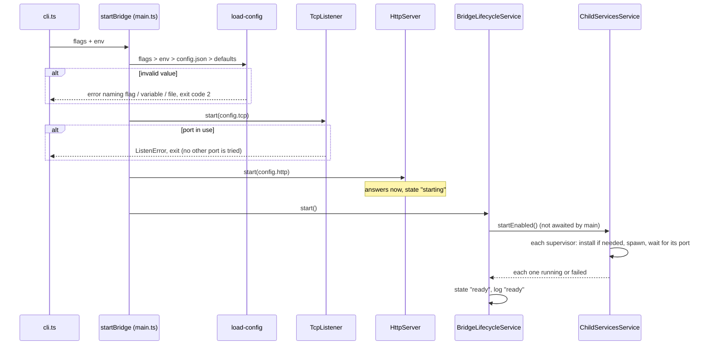
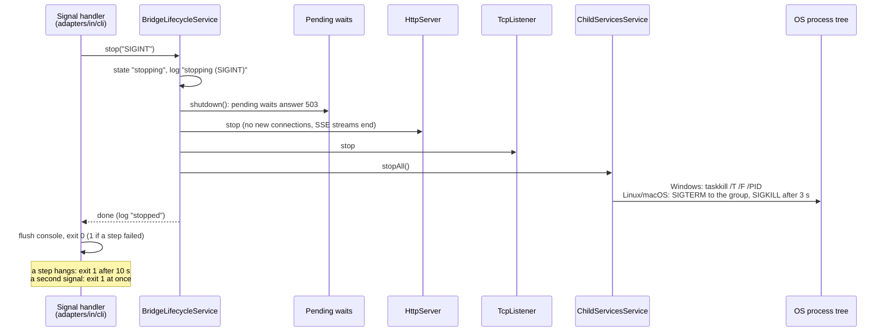

# Lifecycle flows

Sequence diagrams of how the bridge starts and stops, as wired in `main.ts` / `composition/` and
driven by `BridgeLifecycleService`. The behaviour is described in
[Operations](../../usage/operations.md#startup).

**Contents**

1. [Startup](#startup)
2. [Shutdown](#shutdown)

## Startup

The TCP listener starts first, so no speech is lost while the rest starts. The child services
start in the background: the API already answers while they install and start, and
`bridge.state` turns `ready` once each enabled one is running or has failed.

## Shutdown

On `SIGINT`, `SIGBREAK`, `SIGHUP`, `SIGTERM` or a crash, `stop()` runs once. Each part stops even
if the one before failed; the child services go last and their whole process tree is killed.

