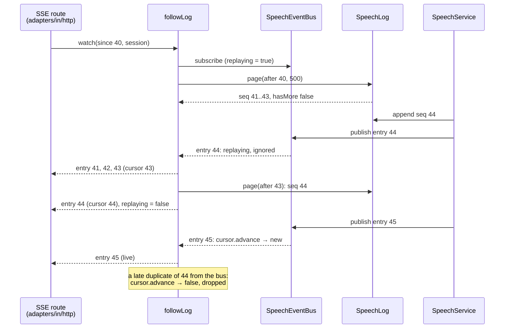
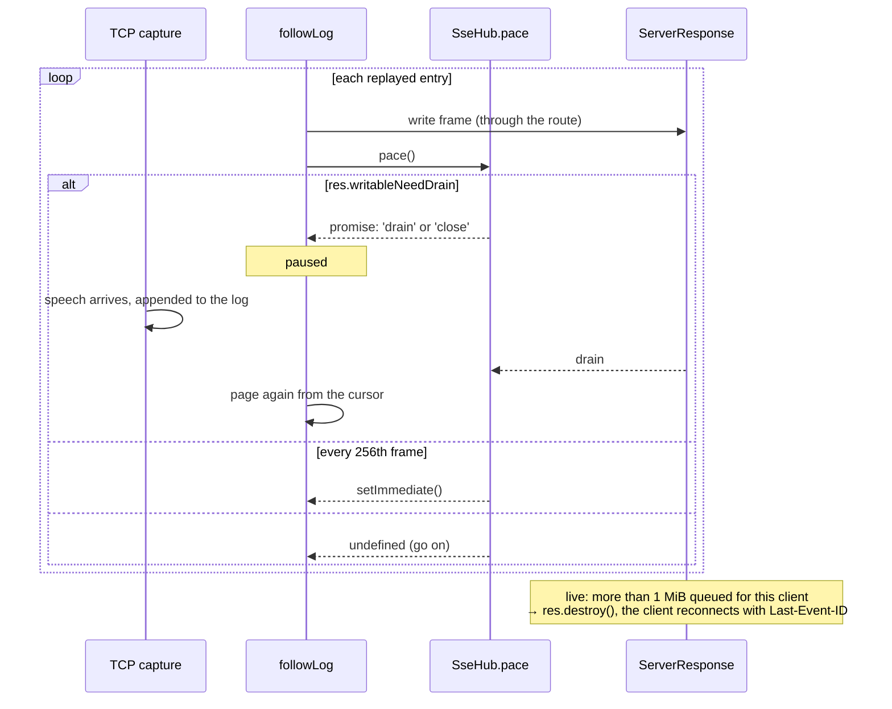
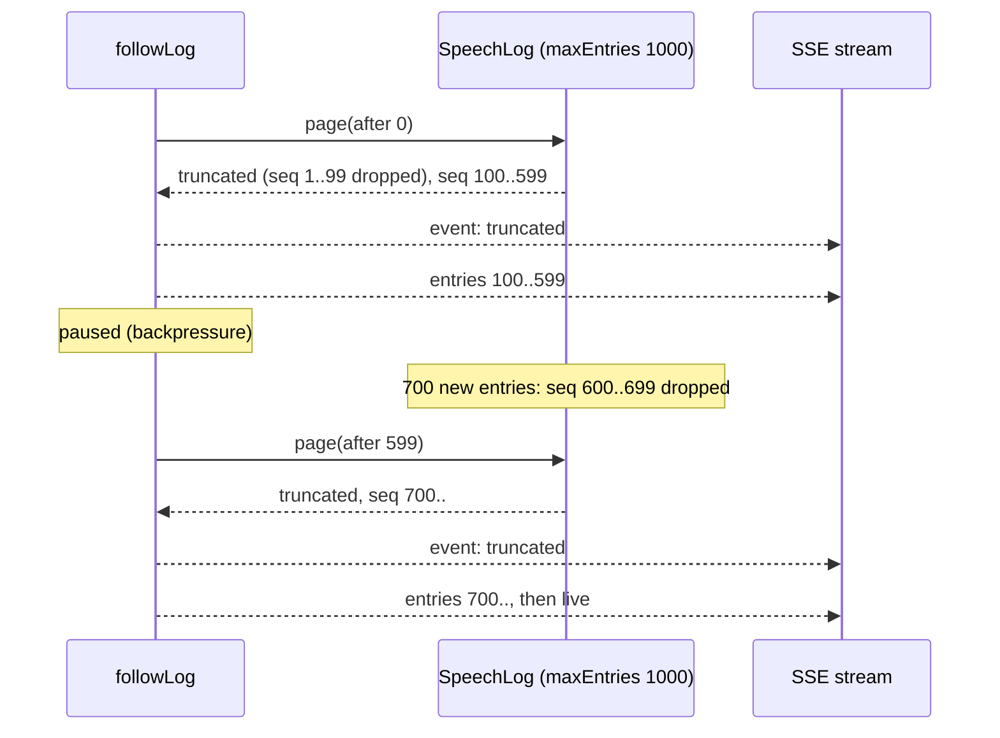

# SSE replay flows

Sequence diagrams of how `followLog` (`application/shared/follow-log.ts`) and `SseHub`
(`adapters/in/http/sse/`) hand a reader the buffer and then the live events, with nothing missed or
sent twice. The rules are in [Decisions → The SSE replay follows the reader](../decisions.md#the-sse-replay-follows-the-reader)
and [Runtime model](../architecture.md#runtime-model); what a client sees is in the
[usage SSE flows](../../usage/flows/sse.md).

**Contents**

1. [Subscribe first, then read](#subscribe-first-then-read)
2. [Pacing and backpressure](#pacing-and-backpressure)
3. [Entries dropped during a replay](#entries-dropped-during-a-replay)

## Subscribe first, then read

`followLog` subscribes to the event bus **before** it reads the first page. So every entry is
either in the log when a page is read, or published afterwards. While it replays, live entries are
ignored: the next page reads them from the log, in order. Once it caught up, `SeqCursor` drops an
entry the replay already read that the bus delivers late. This holds for any bus that delivers in
publish order (the `SpeechEventBus` contract).

## Pacing and backpressure

After each replayed entry, `followLog` calls `pace()`. A promise pauses the replay; it then reads
again from the cursor, because the log may have changed meanwhile. For SSE, `SseHub.pace` waits for
`drain` while the socket has unread data, and yields every 256 frames, so TCP capture and other
requests run in between. Only one page (500 entries) is held at a time.

## Entries dropped during a replay

The buffer keeps dropping its oldest entries while a slow replay runs. `SpeechLog.page` says
`truncated` when entries after the cursor are gone, and the reader gets a `truncated` event at
exactly that point, then the rest.

