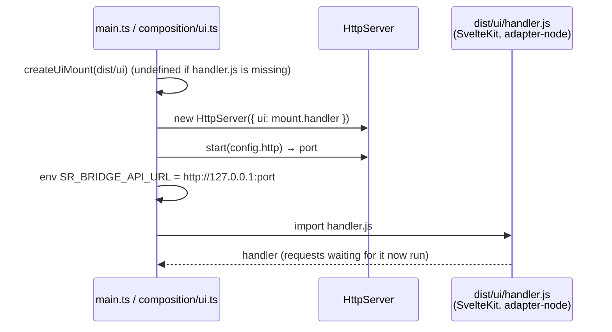
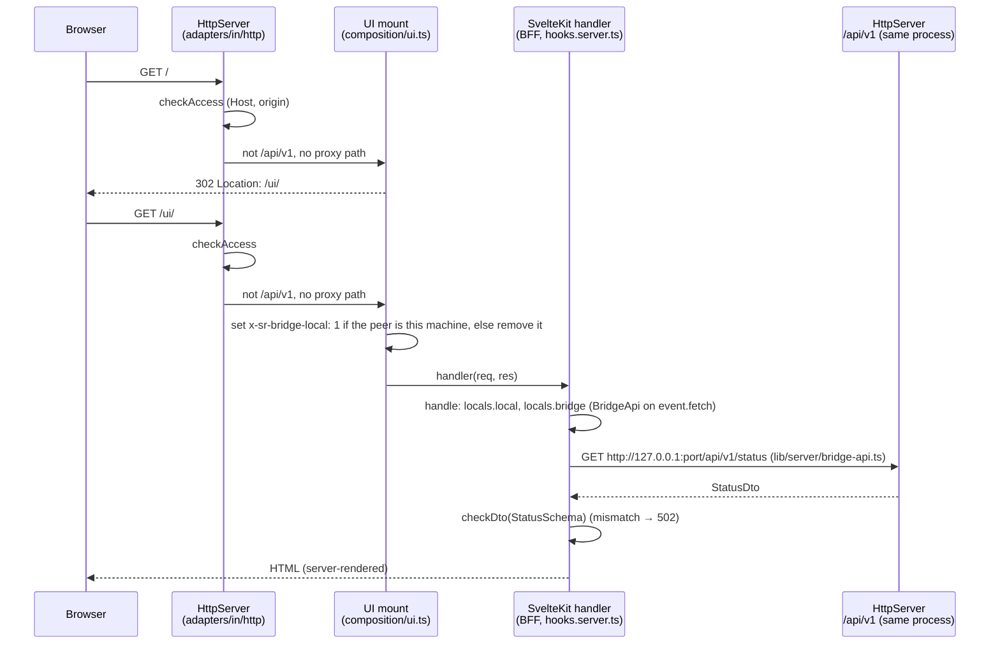
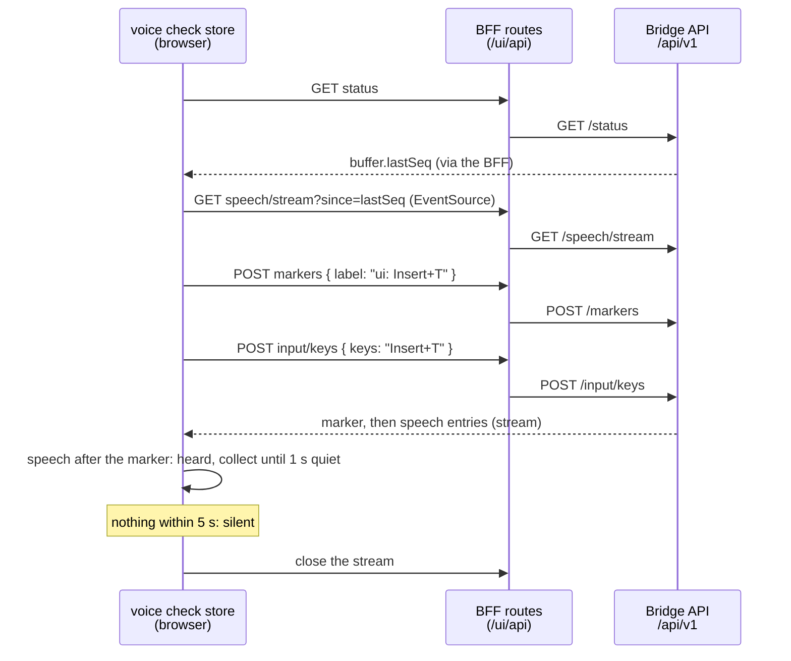

# Web UI flows

Sequence diagrams of how the SvelteKit BFF is mounted in the bridge and how a page request reaches
the API. The design is in [the web UI](../architecture.md#the-web-ui-a-sveltekit-bff).

**Contents**

1. [Mounting the UI at startup](#mounting-the-ui-at-startup)
2. [A page request](#a-page-request)
3. [The setup check](#the-setup-check)

## Mounting the UI at startup

The handler loads after the HTTP port is known, because SvelteKit reads `SR_BRIDGE_API_URL` when it
loads. Requests that arrive earlier wait. A failed load is logged and leaves the API working
([serving the UI](../architecture.md#serving-the-ui)).

## A page request

The bridge's UI mount (`composition/ui.ts`) redirects `/` to `/ui/` and marks a request from the
bridge's own machine with `x-sr-bridge-local: 1` (stripped from every other request), so the UI can
[hide its log from the local screen reader](../decisions.md#a-ui-opened-on-the-bridges-machine-hides-its-log-from-the-screen-reader).
`hooks.server.ts` builds a `BridgeApi` per request.

## The setup check

**Send Insert+T** on the Setup page ([what it does](../../usage/web-ui.md#speech-test)). **Listen** is
the same without the marker and the keys. The pieces are in
[the web UI](../architecture.md#the-web-ui-a-sveltekit-bff).

