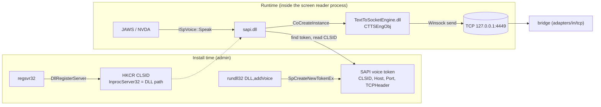

# text-to-socket-engine internals

A source walkthrough of the third-party SAPI 5 voice that feeds this bridge:
[`AmadeusITGroup/Assistive-Webdriver`, `components/text-to-socket-engine`](https://github.com/AmadeusITGroup/Assistive-Webdriver/tree/master/components/text-to-socket-engine)
(MIT, version 0.0.3 at the time of writing). This repo does not contain that code; these pages
explain what it does so we know exactly what arrives on port 4449 and why.

What the bridge does with the bytes is in [TCP capture](../tcp-capture.md); what users configure is
in [VM setup](../../usage/vm-setup.md). This folder is only about the **engine**.

> Everything below is read from the engine's source unless a sentence is marked *(inferred)*. Those
> mark SAPI/Windows behaviour the source relies on but doesn't show; verify them on a VM before
> building on them.

## Pages

| Page | Question it answers |
|---|---|
| [COM server](com-server.md) | What is the DLL, which COM class does it export, what does `regsvr32` write? |
| [Voice registration](voice-registration.md) | How does `addVoice` / `removeVoice` create a voice (a SAPI token) with host and port? |
| [Speaking and the TCP redirect](speak-and-tcp.md) | What happens from `ISpVoice::Speak` to bytes on the socket? Reconnects, header, framing. |
| [Build and packaging](build-and-packaging.md) | How are the DLL, the `.cmd` scripts and the npm package made? |
| [Quirks and risks](quirks.md) | Behaviour that surprises: encoding, blocking connect, dropped text, bitness. |

## tl;dr

- It is an **in-process COM DLL** (`TextToSocketEngine.dll`) implementing `ISpTTSEngine` and
  `ISpObjectWithToken`. It is based on Microsoft's sample TTS engine, with the audio code removed.
- `regsvr32` registers the COM class. `rundll32 …,addVoice` then creates a **SAPI voice token** whose
  `CLSID` points at that class and which stores `Host`, `Port` and `TCPHeader` as plain registry strings.
- When a screen reader speaks with that voice, SAPI loads the DLL **into the screen reader's
  process**, hands it the token, and calls `Speak`. The engine writes the text fragments to a TCP
  socket, one line per `Speak` call, and produces **no audio**.

## Source map

| File | Role | Page |
|---|---|---|
| `TextToSocketEngine.cpp` | DLL exports (`DllMain`, `DllGetClassObject`, `DllRegisterServer`…), `addVoiceW`, `removeVoiceW` | [COM server](com-server.md), [Voice registration](voice-registration.md) |
| `TextToSocketEngine.def` | Which functions the DLL exports | [COM server](com-server.md#exports) |
| `TextToSocketEngine.idl` | Type library: GUIDs, coclass and its interfaces | [COM server](com-server.md#the-type-library) |
| `ttsengobj.h` / `ttsengobj.cpp` | The `CTTSEngObj` class: `SetObjectToken`, `Speak`, `GetOutputFormat`, `sendData` | [Speaking and the TCP redirect](speak-and-tcp.md) |
| `ttsengobj.rgs` | ATL registry script run by `DllRegisterServer` | [COM server](com-server.md#what-regsvr32-writes) |
| `resource.rc` / `resource.h` | Embeds the `.rgs`, the type library and version info into the DLL | [Build and packaging](build-and-packaging.md) |
| `stdafx.*` | Precompiled-header boilerplate (ATL includes, `_Module`) | none |
| `build.cmd`, `register.cmd`, `unregister.cmd`, `addVoice.cmd`, `removeVoice.cmd` | Build and install scripts | [Build and packaging](build-and-packaging.md) |
| `package.json`, `setVersion.js` | npm package and version stamping | [Build and packaging](build-and-packaging.md) |

## Big picture

