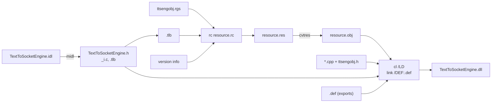

# Build and packaging

**tl;dr:** Four Microsoft tools turn five source types into one DLL (`build.cmd`). It ships on npm as
the DLL plus four `.cmd` scripts exposed as `bin` commands. The version is stamped into `resource.rc`
before building.

Source: `build.cmd`, `resource.rc`, `resource.h`, `setVersion.js`, `package.json`, `.gitignore`.

## The build

`build.cmd` needs the Visual C++ command-line environment (`cl`, `midl`, `rc`, `cvtres` on `PATH`):

| Step | Command | Produces |
|---|---|---|
| 1 | `midl /h TextToSocketEngine.h TextToSocketEngine.idl` | `TextToSocketEngine.h`, `_i.c`, `.tlb` |
| 2 | `rc resource.rc` | `resource.res` (embeds `.rgs`, `.tlb`, version info) |
| 3 | `cvtres /OUT:resource.obj resource.res` | `resource.obj` |
| 4 | `cl resource.obj *.cpp /LD /link /DEF:TextToSocketEngine.def /OUT:TextToSocketEngine.dll` | the DLL |

Points worth knowing:

- `resource.rc` has `IDR_TEXTTOSOCKETENGINE REGISTRY "TtsEngObj.rgs"`, `1 TYPELIB "TextToSocketEngine.tlb"` and a
  `VERSIONINFO` block. The `.rgs` and `.tlb` are **inside the DLL**; there is no separate file to deploy.
- The architecture (x86 or x64) is whatever the Visual C++ prompt targets. The script doesn't choose. See
  [Quirks](quirks.md#bitness).
- Winsock is linked via `#pragma comment(lib, "ws2_32.lib")` in `ttsengobj.cpp`, so no linker flag is needed.
- `build.cmd` has no `/EHsc`, `/MD` or Unicode defines: it relies on defaults, and the code uses ANSI `MessageBox`
  with narrow strings while the SAPI parts are wide.
- No tests exist for the engine.

## Version stamping

`setVersion.js` reads `package.json`'s `version` (`x.y.z`), turns it into `x,y,z,0`, and replaces every
`0,0,0,0` in `resource.rc` with it (`FILEVERSION`, `PRODUCTVERSION`, the string values). It exits 1 if nothing was
replaced. It runs in the upstream release process before `build.cmd`, so the checked-in `.rc` keeps
`0,0,0,0` *(inferred from the script; the call site isn't in this directory)*.

## npm package

`package.json` (`text-to-socket-engine`, `0.0.3`): `files` lists `TextToSocketEngine*.dll` and the four
scripts. `bin` maps:

| Command | Script | Needs |
|---|---|---|
| `text-to-socket-engine-register` | `register.cmd` | admin |
| `text-to-socket-engine-unregister` | `unregister.cmd` | admin |
| `text-to-socket-engine-add-voice` | `addVoice.cmd` | admin |
| `text-to-socket-engine-remove-voice` | `removeVoice.cmd` | admin |

Installing globally puts shims on `PATH`; the scripts find the DLL beside themselves via `%~dp0`, which is
why the glob `TextToSocketEngine*.dll` is used rather than a fixed name. The `*` allows the published package
to carry a differently named DLL *(inferred)*.

See also [VM setup](../../usage/vm-setup.md) for how this project documents the install.
