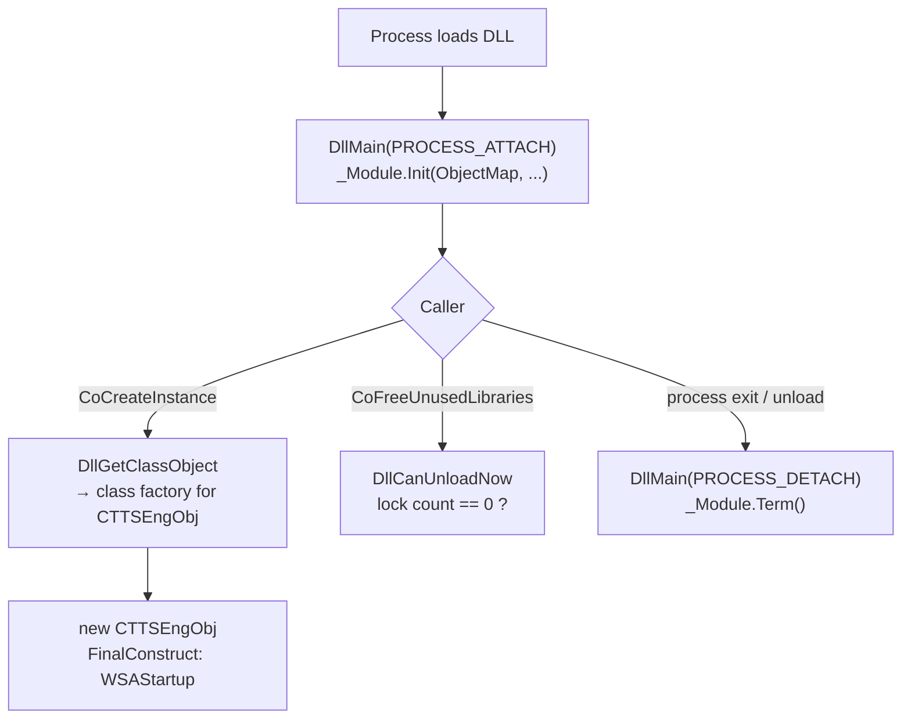
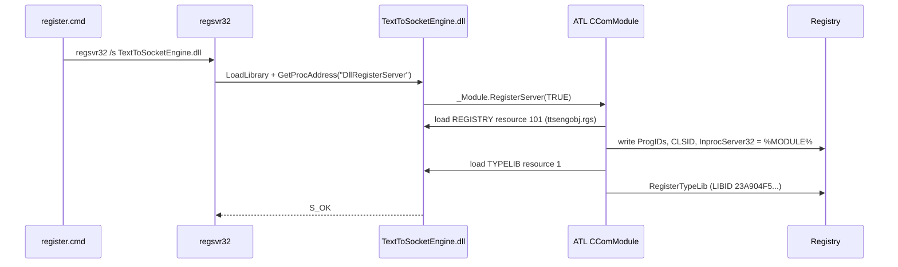

# COM server

**tl;dr:** `TextToSocketEngine.dll` is a classic ATL in-process COM server. It exports the four
standard COM entry points plus two custom ones (`addVoiceW`, `removeVoiceW`). `regsvr32` makes it
known to COM; it does **not** make it a voice. That is the job of [voice registration](voice-registration.md).

Source: `TextToSocketEngine.cpp`, `.def`, `.idl`, `ttsengobj.h`, `ttsengobj.rgs`.

## Exports

**tl;dr:** Four standard COM exports, marked `PRIVATE` so no import library is made, and two helper
functions that `rundll32` can call.

`TextToSocketEngine.def`:

| Export | Standard? | Implementation |
|---|---|---|
| `DllGetClassObject` | COM | `_Module.GetClassObject(...)`: returns the ATL class factory for `CTTSEngObj` |
| `DllCanUnloadNow` | COM | `S_OK` when `_Module.GetLockCount() == 0` |
| `DllRegisterServer` | COM (`regsvr32`) | `_Module.RegisterServer(TRUE)` |
| `DllUnregisterServer` | COM (`regsvr32 /u`) | `_Module.UnregisterServer(TRUE)` |
| `addVoiceW` | custom | creates a voice, see [Voice registration](voice-registration.md) |
| `removeVoiceW` | custom | removes a voice |

`rundll32 X.dll,addVoice` resolves `addVoice` to the exported `addVoiceW` because `rundll32` tries
the `W` suffix for the Unicode entry point *(inferred; the scripts depend on it)*. The signature
`void CALLBACK f(HWND, HINSTANCE, LPWSTR cmdLine, int)` is the `rundll32` contract: the whole rest of
the command line arrives as **one string**, which the code splits with `CommandLineToArgvW`.

### DLL lifetime

`DllMain` calls `_Module.Init(ObjectMap, hInstance, &LIBID_TEXTTOSOCKETTTSENGLib)` on process attach
and `_Module.Term()` on detach. `_Module` is the global `CComModule` that ATL requires (the name must
not change, see the comment in `stdafx.h`). `BEGIN_OBJECT_MAP` lists exactly one class:
`CLSID_TextToSocketEngine → CTTSEngObj`.



## The COM class

**tl;dr:** `CTTSEngObj` is a free-threaded-capable ATL object implementing two interfaces; SAPI
talks to it only through those.

`ttsengobj.h`:

- `CComObjectRootEx<CComMultiThreadModel>`: thread-safe reference counting. Registered with
  `ThreadingModel = Both`, so it can live in an STA or MTA. Note that the class itself adds **no
  locking** around its own state (the socket), see [Quirks](quirks.md#no-locking-around-the-socket).
- `CComCoClass<CTTSEngObj, &CLSID_TextToSocketEngine>`: ties the class to its CLSID and gives it a
  class factory.
- `ISpTTSEngine`: `Speak` and `GetOutputFormat`, see [Speaking](speak-and-tcp.md).
- `ISpObjectWithToken`: `SetObjectToken` / `GetObjectToken`, implemented with the SAPI helpers
  `SpGenericSetObjectToken` / `SpGenericGetObjectToken`. This is how the engine learns **which voice
  token it is serving**, and therefore which host and port to use.
- `DECLARE_REGISTRY_RESOURCEID(IDR_TEXTTOSOCKETENGINE)`: the registry script to run on registration is
  the `REGISTRY` resource with id 101 (the `.rgs`, embedded by `resource.rc`).
- `DECLARE_PROTECT_FINAL_CONSTRUCT()`: guards the ref count while `FinalConstruct` runs.

## The type library

**tl;dr:** The `.idl` exists mainly to generate the CLSID constant and the type library that ATL
registers. It declares no custom interfaces.

`TextToSocketEngine.idl` imports `sapiddk.idl` (for `ISpTTSEngine`) and declares:

| Thing | GUID |
|---|---|
| Type library `TEXTTOSOCKETTTSENGLib` v1.0 | `23A904F5-AE2A-496A-9026-E10B23762817` |
| coclass `TextToSocketEngine` | `57A5A4F1-85EA-4A9A-ADFB-AFBA4F3AC649` |

`midl` turns this into `TextToSocketEngine.h` (declares `CLSID_TextToSocketEngine`,
`LIBID_TEXTTOSOCKETTTSENGLib`), `TextToSocketEngine_i.c` (the GUID definitions) and
`TextToSocketEngine.tlb` (embedded as resource `1 TYPELIB`). The coclass lists `ISpTTSEngine` as the
default interface and `ISpObjectWithToken` as the second one.

## What `regsvr32` writes

**tl;dr:** A ProgID and a CLSID entry under `HKEY_CLASSES_ROOT` pointing at the DLL path, plus the
type library registration. No SAPI keys.

`regsvr32 /s TextToSocketEngine.dll` loads the DLL and calls `DllRegisterServer`, which runs
`_Module.RegisterServer(TRUE)`. `TRUE` means "also register the type library". ATL runs
`ttsengobj.rgs`, where `%MODULE%` is replaced with the DLL's full path:

```
HKCR
  TextToSocketEngine.TextToSocketEngine.1            "TextToSocketEngine Class"
      CLSID = {57A5A4F1-85EA-4A9A-ADFB-AFBA4F3AC649}
  TextToSocketEngine.TextToSocketEngine              "TextToSocketEngine Class"
      CLSID    = {57A5A4F1-...}
      CurVer   = TextToSocketEngine.TextToSocketEngine.1
  CLSID\{57A5A4F1-85EA-4A9A-ADFB-AFBA4F3AC649}       (ForceRemove: rewritten each time)
      ProgID                    = TextToSocketEngine.TextToSocketEngine.1
      VersionIndependentProgID  = TextToSocketEngine.TextToSocketEngine
      InprocServer32            = <full path to the DLL>
          ThreadingModel        = Both
      TypeLib                   = {23A904F5-AE2A-496A-9026-E10B23762817}
```

Admin rights are needed because `HKCR` writes go to `HKLM\Software\Classes`. Unregistering reverses
this (`ForceRemove` on the CLSID key; `NoRemove CLSID` keeps the parent).



`register.cmd` loops over `%~dp0\TextToSocketEngine*.dll`, so the DLL file may carry a suffix
(for example a version or architecture) and still be found.
