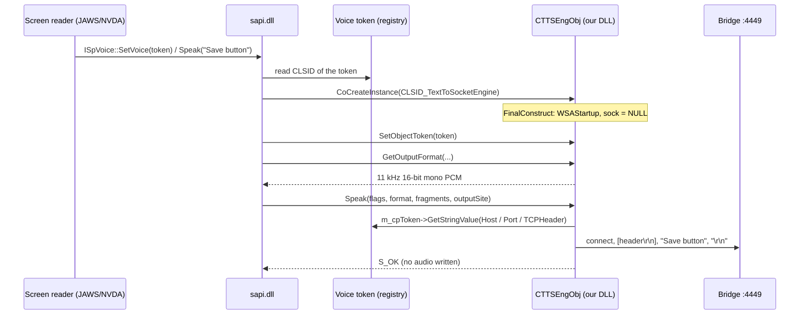
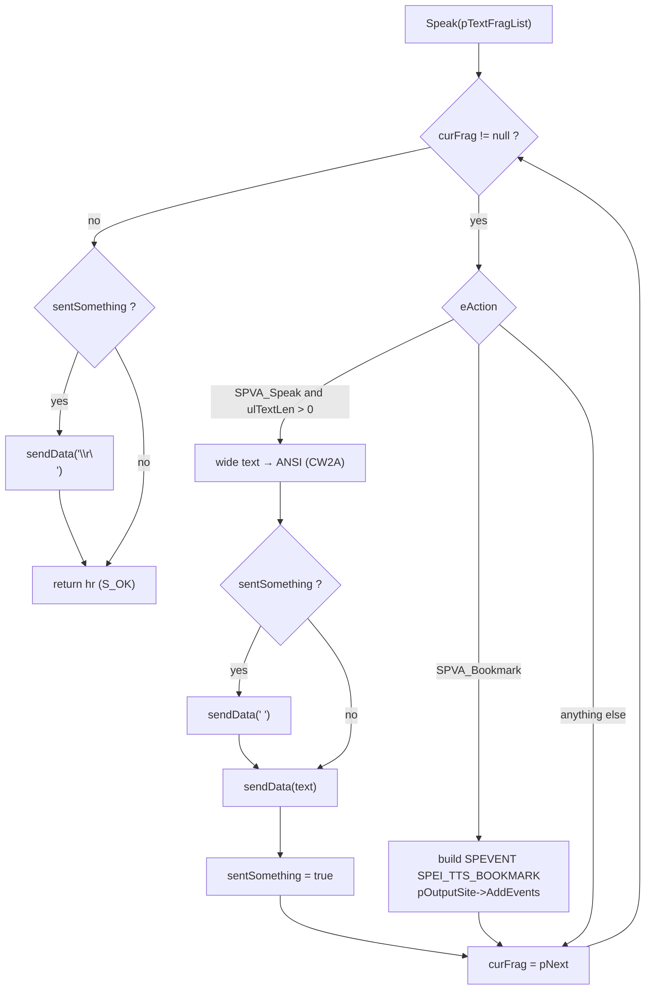
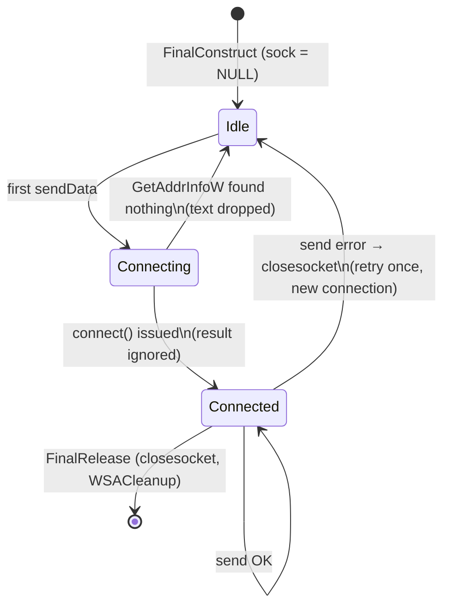
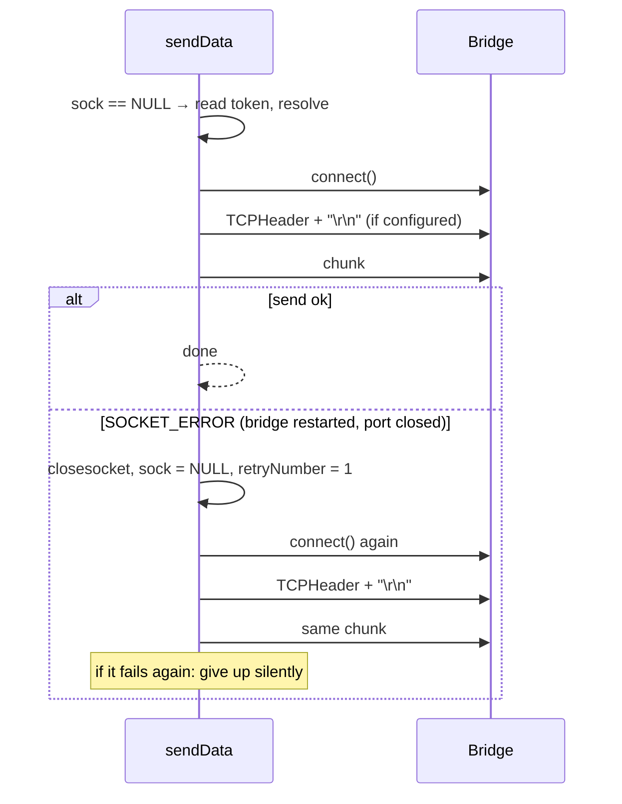

# Speaking and the TCP redirect

**tl;dr:** SAPI loads the DLL into the screen reader's process, gives it the voice token, and calls
`Speak` with a list of text fragments. The engine concatenates the speakable fragments with spaces, sends
them over a lazily opened TCP socket, ends the utterance with `\r\n`, and returns without producing any audio.

Source: `ttsengobj.h`, `ttsengobj.cpp`.

## How SAPI finds and starts the engine

**tl;dr:** token → `CLSID` value → `InprocServer32` → `CoCreateInstance` → `SetObjectToken`. The engine
never opens the registry itself to find its settings; SAPI hands it the right token.

1. The screen reader selects a voice (a token id such as `textToSocketVoice`) and calls `ISpVoice::Speak`.
2. SAPI reads the token's `CLSID` value (written by [`addVoice`](voice-registration.md)), then
   `CoCreateInstance`s that class. The class is registered `InprocServer32`, so the DLL is loaded into the
   **calling process**, not into a separate service *(inferred: standard in-proc COM behaviour)*.
3. SAPI queries `ISpObjectWithToken` and calls `SetObjectToken(token)`. The engine keeps it in `m_cpToken`.
4. SAPI calls `GetOutputFormat` once to learn the audio format, then `Speak` per utterance.



The same engine object is reused for many `Speak` calls, which is what makes the socket reuse below possible.

## Object lifetime

**tl;dr:** One Winsock init and one socket per engine object; the socket is opened on first use and closed
when SAPI releases the object.

| Method | Does |
|---|---|
| `FinalConstruct` | `WSAStartup(2.0)`, `sock = NULL`. No connection yet |
| `FinalRelease` | `closesocket(sock)` if open, then `WSACleanup()` |

So **registering a voice never connects anywhere**, and a bridge started later is found as soon as the next
`Speak` runs. Several screen reader processes (or several voice objects) each have their **own** connection,
which the bridge sees as separate `connectionId`s ([TCP capture](../tcp-capture.md#listening-and-connections)).

## `Speak`

**tl;dr:** Walk the fragment list; send text for `SPVA_Speak` fragments (space-separated), queue bookmark
events for `SPVA_Bookmark` fragments, ignore the rest; end the line with `\r\n`.

SAPI parses the XML/SSML-like markup of the text into a linked list of `SPVTEXTFRAG`: one fragment
per state change. Plain text is one fragment.



### Details

- **Speakable fragments.** Only `State.eAction == SPVA_Speak` with non-zero length. Other actions
  (silence, pronounce, spell-out, section) are skipped, so their text never reaches the socket.
- **Conversion.** `CAtlStringW` → `CW2A`: the UTF-16 text is converted to the system **ANSI code page**, not
  UTF-8. Characters that don't exist in it become `?` *(inferred: usual `WideCharToMultiByte` behaviour)*. This is why the bridge has
  `tcp.encoding`; see [Speech capture → Wire format](../../usage/speech-capture.md#wire-format) and
  [Quirks](quirks.md#ansi-encoding).
- **Joining.** The first fragment is sent as is, each later one preceded by a single space.
- **Terminator.** If anything was sent, a final `\r\n`. **One `Speak` call = one line on the wire**, which
  is why the bridge treats a line as one speech entry. A call with only empty/non-speakable fragments sends
  *nothing*: no empty line. (The bridge still skips blank lines, since other senders and the header can produce them.)
- **Embedded newlines.** The text itself isn't escaped. A newline inside a fragment would split one
  utterance into several lines.
- **Bookmarks.** The bookmark text is copied to a stack buffer (`_malloca`), turned into an
  `SPEI_TTS_BOOKMARK` event whose `wParam` is `_wtol(text)`, queued with `pOutputSite->AddEvents`, and the
  buffer freed. SAPI copies string `lParam`s for `SPET_LPARAM_IS_STRING` events *(inferred)*. Screen readers
  that wait for the bookmark event to learn "speech reached here" keep working this way.
- **Return value.** `hr` is from the last `AddEvents` call; everything else is `S_OK`. Socket errors are
  **never** reported to SAPI, so the screen reader can't tell that the text was lost.
- **No audio, no abort handling.** The engine never calls `pOutputSite->Write` and never checks
  `GetActions` for `SPVES_ABORT`, so `Speak` returns immediately and "speech" takes no time. Purges and
  rate/volume changes are therefore irrelevant to it.

### `GetOutputFormat`

Returns `SPSF_11kHz16BitMono` through `SpConvertStreamFormatEnum`. It must name some format, because SAPI
negotiates one before calling `Speak`, but no sample is ever produced.

## Connecting and sending

**tl;dr:** `sendData(buf)` connects on demand, sends a configured header line once per connection, and on a
send error closes the socket and tries once more with a fresh connection.

```cpp
void CTTSEngObj::sendData(const char *buf) {
    int retryNumber = 0;
    do {
        if (!sock) {
            // read Host / Port / TCPHeader from the token
            // GetAddrInfoW(host, port, NULL, &addrInfo); if none: return (data dropped)
            // sock = socket(family of first result, SOCK_STREAM, 0)
            // connect(sock, ...)                  // result NOT checked
            // if header non-empty: send(header), send("\r\n")
        }
        int res = send(sock, buf, lstrlenA(buf), 0);
        if (res == SOCKET_ERROR) { closesocket(sock); sock = NULL; retryNumber++; }
    } while (sock == NULL && retryNumber <= 1);
}
```

Step by step:

1. **Token values.** If `sock` is empty, `Host`, `Port` and `TCPHeader` are read from `m_cpToken`
   (all `HRESULT`s ignored). The header is converted to ANSI as well.
2. **Resolve.** `GetAddrInfoW(host, port, NULL, &addrInfo)`: no hints, so the name may resolve to several
   addresses; **only the first** is used. If nothing resolves, `sendData` **returns silently** and
   the text is lost.
3. **Create + connect.** `socket(family, SOCK_STREAM, 0)` followed by a blocking `connect`. Its return value
   is **not checked**: a failed connect only shows up as an error on the next `send`.
4. **Header.** If `TCPHeader` isn't empty, it's sent followed by `\r\n` immediately after connecting, on every
   new connection (so also after a reconnect). The bridge reads it as the voice id (`voice=<id>`) on the first line;
   see [TCP capture](../tcp-capture.md#framing-and-decoding).
5. **Send.** `send(sock, buf, strlen(buf), 0)`. The return value is only compared with `SOCKET_ERROR`; a
   short write isn't handled.
6. **Retry.** On `SOCKET_ERROR` the socket is closed and reset, and the loop runs again (`retryNumber <= 1` ⇒
   at most **2 attempts** per call). Only the **current chunk** is re-sent. Chunks sent earlier in the same
   `Speak` call, which were lost with the old connection, are not.

Note that `sendData` is called separately for the text, the space and the `\r\n` of one utterance, so one
line is several `send` calls (TCP may deliver them in one or several packets; the bridge frames on `\n`).





### What this means for the bridge

- The bridge may restart or be down at any time. The first `Speak` after it's back fails *or* succeeds
  into a dead socket's buffer (see [Quirks](quirks.md#lazy-failure-detection)), and later utterances reconnect.
- The "voice header" is only a convention between `addVoice`'s `TCPHeader` argument and the bridge's parser. The
  engine itself assigns no meaning to it.
