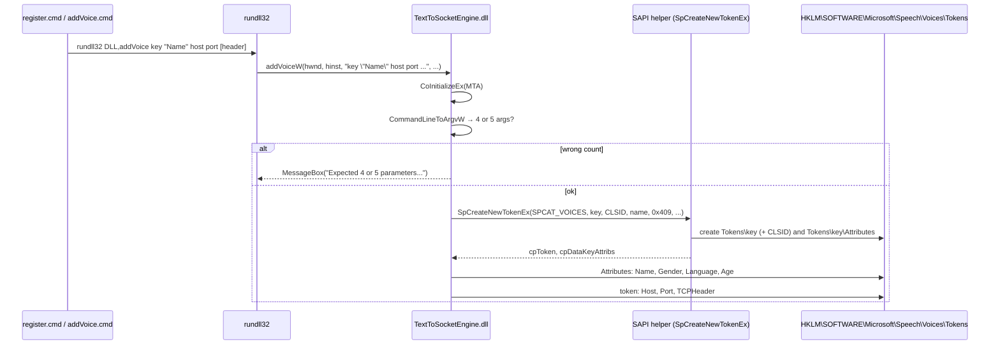

# Voice registration

**tl;dr:** A SAPI *voice* is a registry "token" under `HKLM\SOFTWARE\Microsoft\Speech\Voices\Tokens\<id>` *(inferred
path, standard SAPI layout)*. `addVoiceW` creates one with the SAPI helper `SpCreateNewTokenEx`, points its
`CLSID` at our engine class, and stores `Host`, `Port` and `TCPHeader` on it. One DLL, any number of voices, each
with its own destination.

Source: `TextToSocketEngine.cpp` (`addVoiceW`, `removeVoiceW`), `register.cmd`, `addVoice.cmd`,
`removeVoice.cmd`, `unregister.cmd`.

## Two registrations, two jobs

| Step | Tool | What it makes | Which question it answers |
|---|---|---|---|
| 1. [COM registration](com-server.md#what-regsvr32-writes) | `regsvr32` | CLSID → DLL path | "How do I load this class?" |
| 2. Voice registration (this page) | `rundll32 DLL,addVoice` | SAPI token with `CLSID`, `Host`, `Port`, `TCPHeader` | "Which voices exist, and which class speaks them?" |

SAPI enumerates **tokens**, not COM classes. Without step 2 the engine is invisible to JAWS/NVDA voice lists.

## `addVoice`

**tl;dr:** `rundll32 TextToSocketEngine.dll,addVoice <keyName> "<displayName>" <host> <port> [tcpHeader]`

### Argument handling

`rundll32` passes the rest of the command line as one wide string. The function calls
`CoInitializeEx(NULL, COINIT_MULTITHREADED)`, splits the string with `CommandLineToArgvW`, and requires
**4 or 5** arguments, otherwise it shows a `MessageBox` ("Expected 4 or 5 parameters: ...") and returns.

| Arg | Variable | Used for |
|---|---|---|
| 1 | `voiceKeyName` | Token key name (the voice id, e.g. `textToSocketVoice`) and the `Name` attribute |
| 2 | `voiceDisplayName` | Name shown in voice dialogs, e.g. `Text To Socket 127.0.0.1:4449` |
| 3 | `voiceHost` | Stored as `Host` |
| 4 | `voicePort` | Stored as `Port` (a string, passed to `GetAddrInfoW` as service name) |
| 5 (optional) | `voiceTCPHeader` | Stored as `TCPHeader`; empty string when omitted |

Quote arguments with spaces (the display name), because `CommandLineToArgvW` follows normal quoting rules.

### Creating the token

```cpp
SpCreateNewTokenEx(
    SPCAT_VOICES,              // category: HKLM\SOFTWARE\Microsoft\Speech\Voices
    voiceKeyName,              // token id (key name under ...\Tokens)
    &CLSID_TextToSocketEngine, // written as the token's CLSID value
    voiceDisplayName,          // default value / description
    0x409,                     // LANGID en-US: the description is stored as value "409"
    voiceDisplayName,          // language-independent description
    &cpToken, &cpDataKeyAttribs);
```

`SpCreateNewTokenEx` (from `sphelper.h`) builds the full token id from the category id and the key name,
creates the token (and its `Attributes` subkey), and returns two interfaces *(helper behaviour inferred
from SAPI docs; the call and arguments are from source)*:

- `cpToken` (`ISpObjectToken`): the token's root key,
- `cpDataKeyAttribs` (`ISpDataKey`): its `Attributes` subkey.

### What gets written where

On success, the code sets:

| Location | Value | Content | Purpose |
|---|---|---|---|
| `Attributes` | `Name` | `voiceKeyName` | Voice name matched by apps |
| `Attributes` | `Gender` | `Male` | Fixed value; SAPI voice selection can filter on it |
| `Attributes` | `Language` | `409` | en-US (hex LANGID) |
| `Attributes` | `Age` | `Adult` | Fixed |
| token root | `Host` | e.g. `127.0.0.1` | Read by the engine at connect time |
| token root | `Port` | e.g. `4449` | Read by the engine at connect time |
| token root | `TCPHeader` | e.g. `voice=jaws` or empty | Sent as the first line after connecting |
| token root | `CLSID` | `{57A5A4F1-...}` | Written by `SpCreateNewTokenEx` itself |

`Host`/`Port`/`TCPHeader` are **not** SAPI-defined: they are private values on the token that only this engine
understands. They are read back through `m_cpToken->GetStringValue` in [`sendData`](speak-and-tcp.md#connecting-and-sending).

> The return values of the `SetStringValue` calls are ignored, and `CoUninitialize` is never called. Harmless
> for a short-lived `rundll32` process, noted for completeness.



### Why it works for any number of voices

All voices share the one CLSID. At runtime SAPI gives the engine **its** token
([`SetObjectToken`](speak-and-tcp.md#how-sapi-finds-and-starts-the-engine)), so the same code connects
to a different host/port depending on which voice was selected. That is the reason the data lives on
the token and not in the DLL.

## `removeVoice`

**tl;dr:** `rundll32 TextToSocketEngine.dll,removeVoice <keyName>` deletes the voice token.

`removeVoiceW` requires exactly one argument. It calls `SpCreateNewTokenEx` with the same category and key name
(used here as *open-or-create*, with the key name also as display name), then `cpToken->Remove(NULL)`. `NULL`
means "remove the whole token, not a sub-key of it".

Consequence: removing a voice that doesn't exist first **creates** it and then deletes it. It ends
clean, so this is only an oddity. The COM class registration stays; only `unregister.cmd`'s `regsvr32 /u`
removes that.

## The scripts

| Script | Does |
|---|---|
| `register.cmd` | `regsvr32 /s` the DLL, then `addVoice textToSocketVoice "Text To Socket 127.0.0.1:4449" 127.0.0.1 4449` (no header) |
| `addVoice.cmd %*` | `rundll32 DLL,addVoice %*`: forwards all arguments |
| `removeVoice.cmd %*` | `rundll32 DLL,removeVoice %*` |
| `unregister.cmd` | `removeVoice textToSocketVoice`, then `regsvr32 /s /u` |

All use `FOR %%I IN (%~dp0\TextToSocketEngine*.dll)`, so they work from any directory and never hard-code the file name.
Hence the npm `bin` entries (`text-to-socket-engine-register`, `-add-voice`, ...) all just run these `.cmd` files; see
[Build and packaging](build-and-packaging.md#npm-package).

Run them from an **elevated** prompt: both the CLSID and the token live under `HKLM`.
