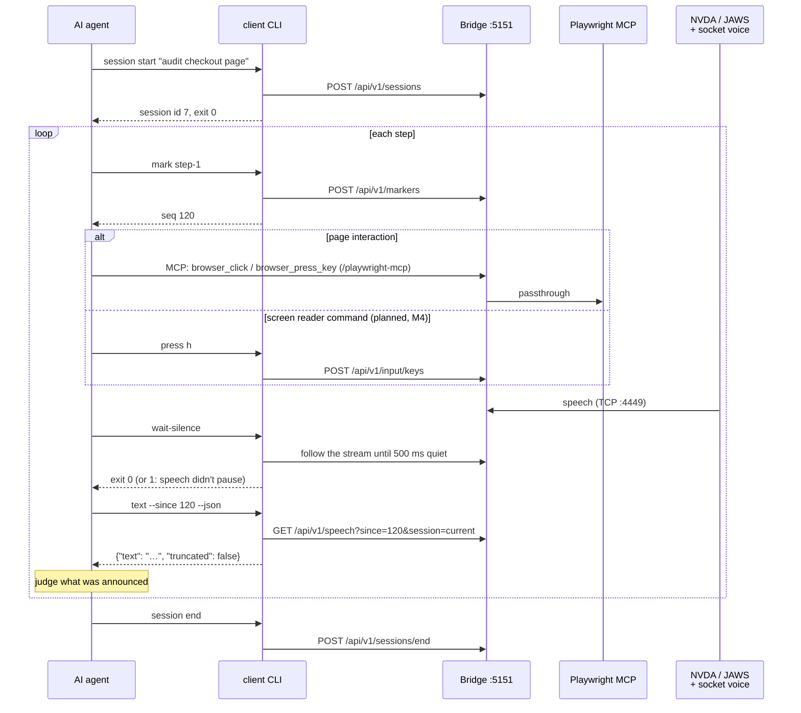
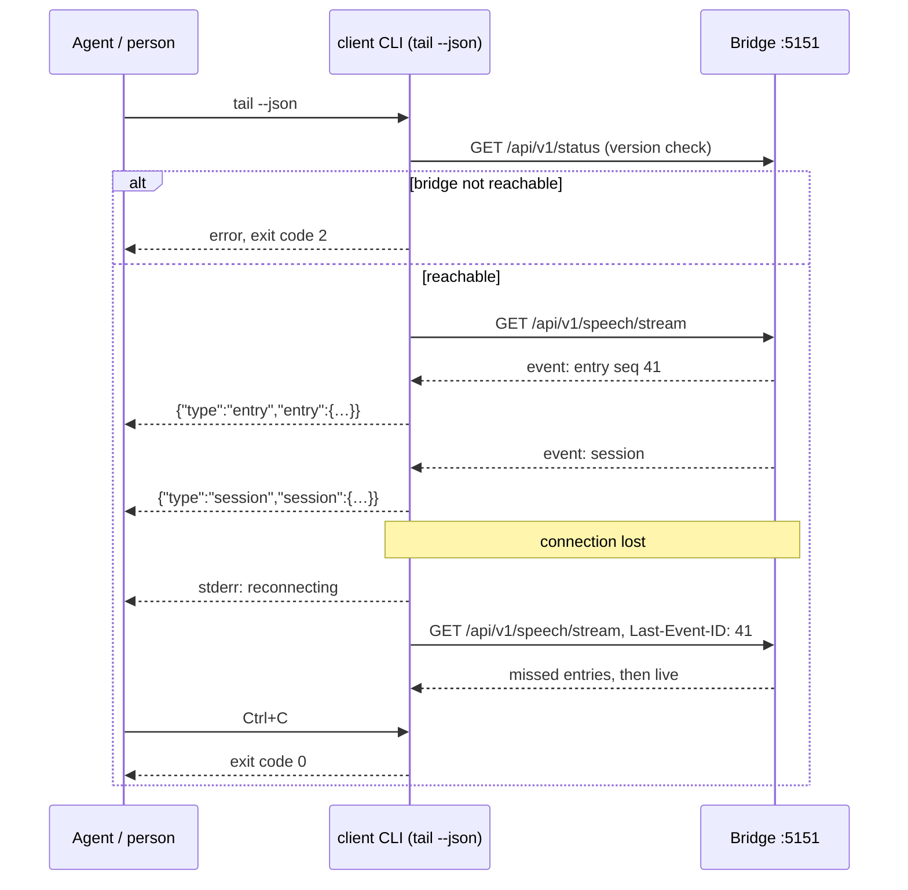

# Agent flows

Sequence diagrams of an AI agent working with the bridge through the CLI and Playwright MCP.
Details: [Agents](../agents.md), [CLI for agents](../client.md#cli-for-agents).

**Contents**

1. [The agent loop](#the-agent-loop)
2. [Following speech with tail](#following-speech-with-tail)

## The agent loop

One session per task, then per step: **mark → act → wait-silence → text --since**. A CLI call has
no memory, so the marker's `seq` is the step's starting point. The exit codes let the agent branch
without parsing output.

## Following speech with tail

`tail` prints each entry as it arrives until Ctrl+C, `SIGTERM` or a closed pipe. A lost connection
is reconnected without losing entries; a bridge that isn't reachable at the start is exit code `2`.

