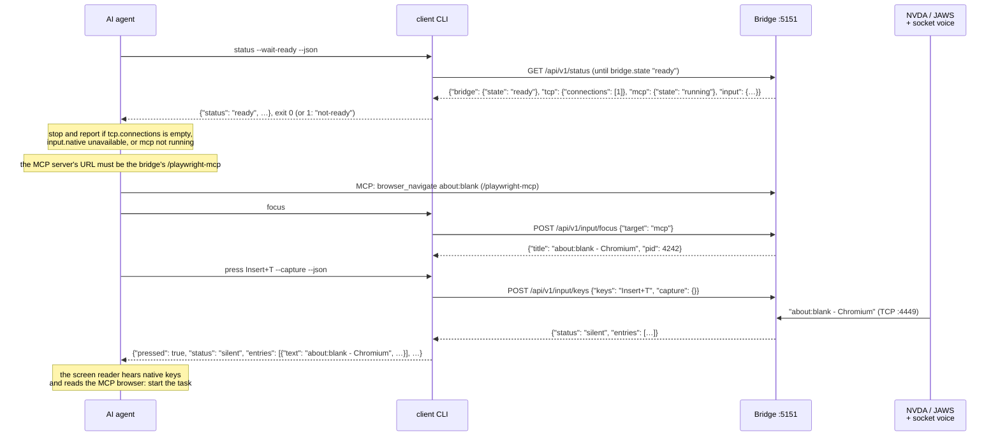
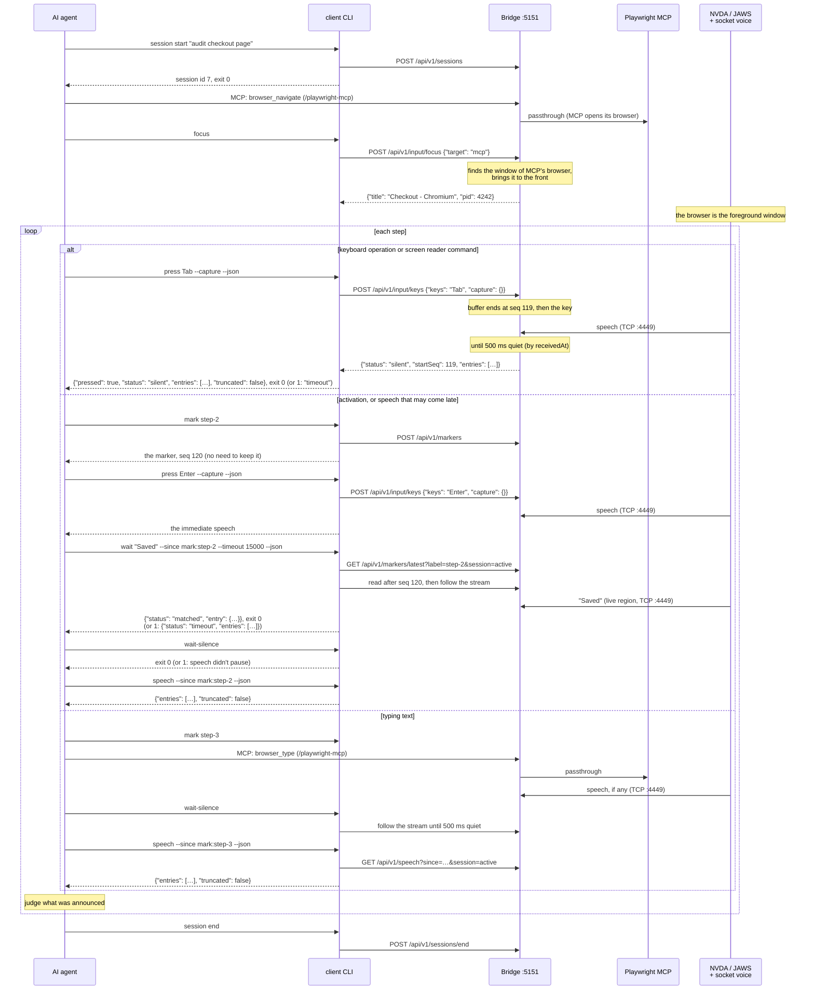
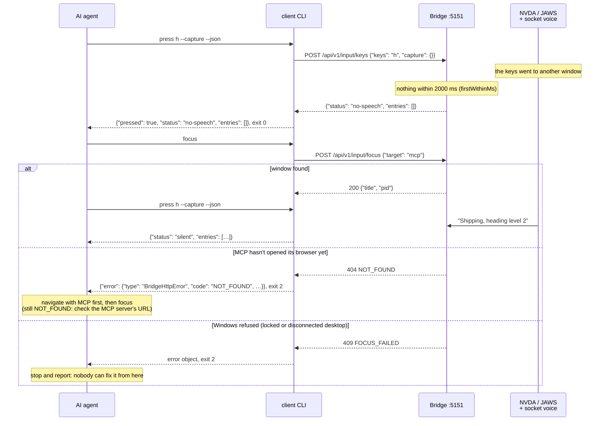
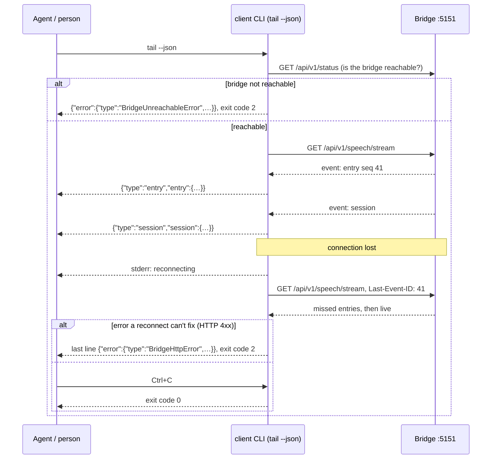

# Agent flows

Sequence diagrams of an AI agent working with the bridge through the CLI and Playwright MCP.
Details: [Agents](../agents.md), [CLI for agents](../client.md#cli-for-agents).

**Contents**

1. [Preflight](#preflight)
2. [The agent loop](#the-agent-loop)
3. [Recovering from a silent step](#recovering-from-a-silent-step)
4. [Following speech with tail](#following-speech-with-tail)

## Preflight

Before the first step, the agent checks that the setup can work at all, so it doesn't take silence
for a finding. `status --wait-ready` waits for the bridge and its services; the answer says whether
the screen reader is connected (`tcp.connections`) and whether native input and focus work
(`input`). One captured screen reader command, with the bridge's own Playwright MCP, then proves the
whole chain. Details:
[Preflight](../agents.md#preflight).

## The agent loop

One session per task, `focus` so native keys reach the MCP browser, then per step one of three
patterns: `press … --capture` (a keyboard operation or screen reader command: one call acts and
prints the speech it caused), **mark → press → wait → wait-silence → speech --since** (a key that
activates something, or speech that may come late), or **mark → act → wait-silence →
speech --since** (typing through Playwright MCP, which runs in another process). A CLI call has no
memory, so the marker is the step's starting point: `--since mark:<label>` finds it again by its
label, in the current session (`session=active`). The exit codes let the agent branch without
parsing output. Details: [Agent loop](../agents.md#agent-loop).

## Recovering from a silent step

A `press … --capture` that hears nothing (`no-speech`) almost always means the keys went to
another window: a dialog, a new window or the bridge console took the foreground. `focus` again and
repeat the step if that is harmless; a step the screen reader is slow to announce needs a larger
`--first-within` instead. Details: [When a step fails](../agents.md#when-a-step-fails).

## Following speech with tail

`tail` prints each entry as it arrives until Ctrl+C, `SIGTERM` or a closed pipe. A lost connection
is reconnected without losing entries; a bridge that isn't reachable at the start is exit code `2`
([errors with `--json`](../client.md#errors-with---json)). The first `GET /status` only checks that
the bridge answers; the API version comes with every answer, the stream's too
([Versioning](../http-api.md#versioning)).

