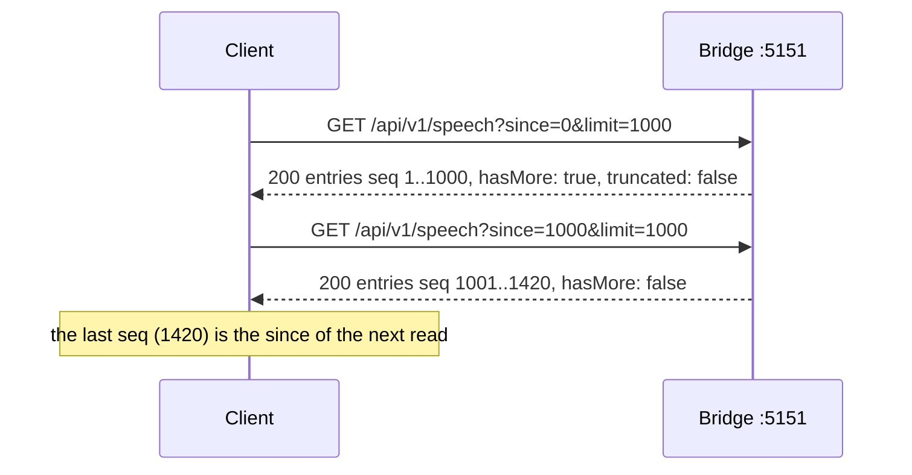
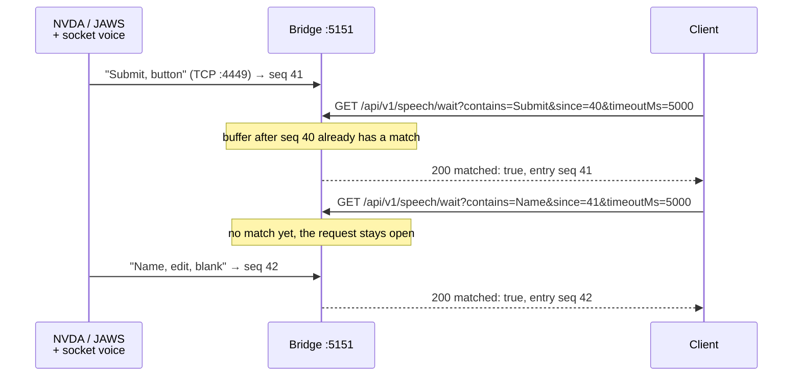
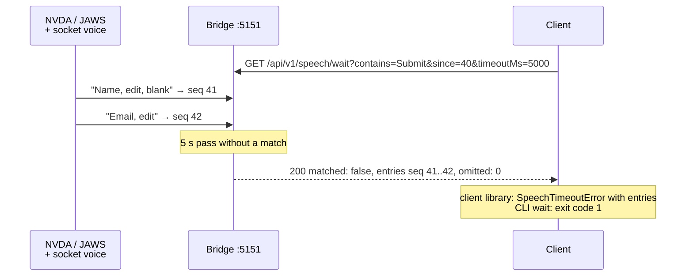
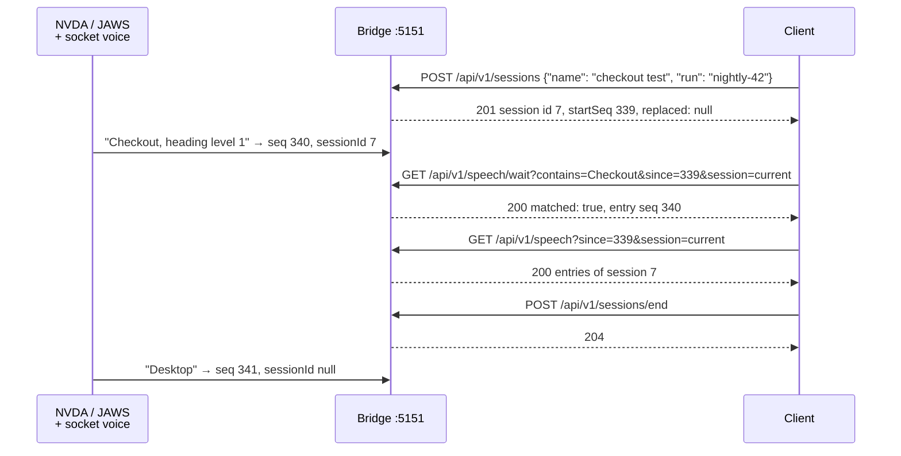
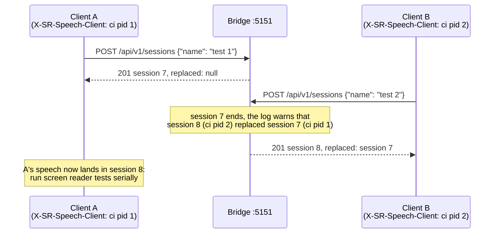
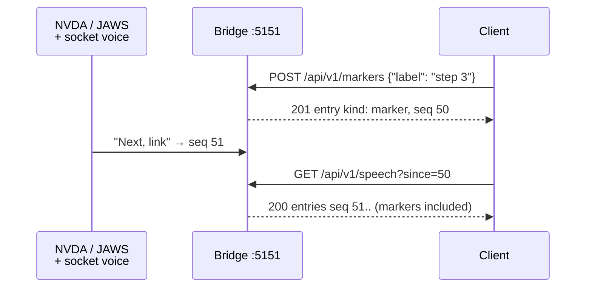
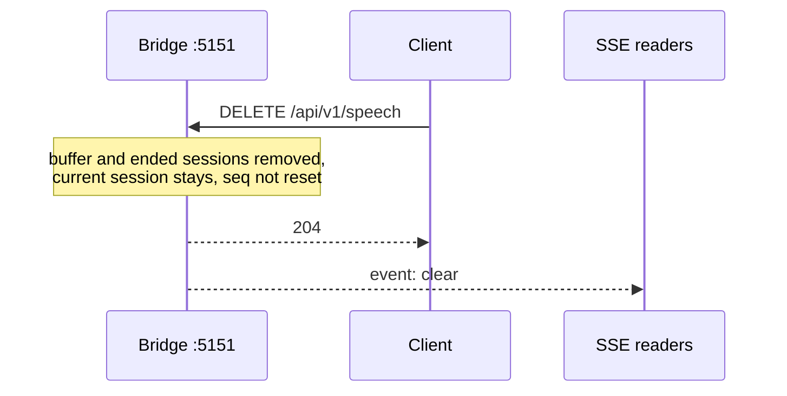
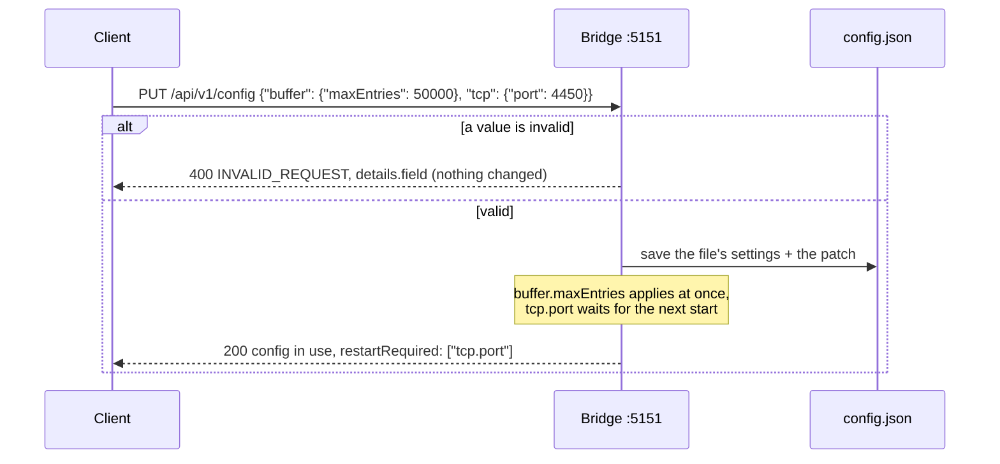
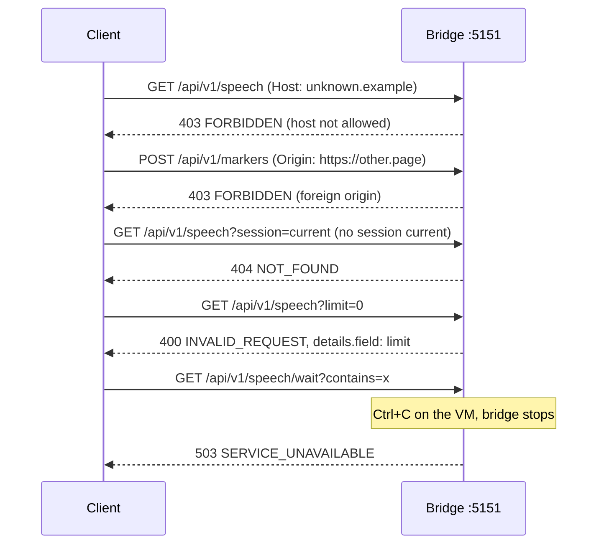
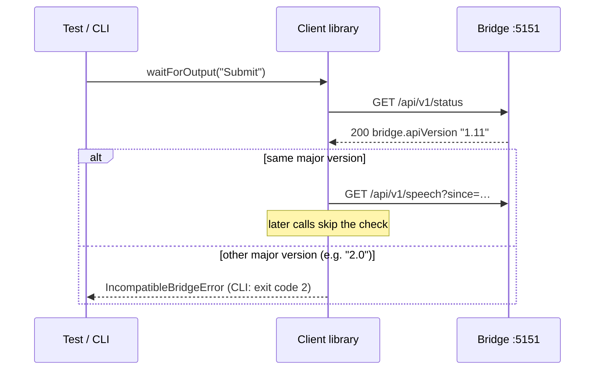

# HTTP flows

Sequence diagrams of the plain HTTP calls: reading, waiting, sessions, markers, config and the
errors on the way. The rules behind them are in the [HTTP API](../http-api.md); the
[test client](../client.md) wraps all of these calls.

**Contents**

1. [Read speech page by page](#read-speech-page-by-page)
2. [Wait for output: match](#wait-for-output-match)
3. [Wait for output: timeout](#wait-for-output-timeout)
4. [One session per test](#one-session-per-test)
5. [Two clients share the screen reader](#two-clients-share-the-screen-reader)
6. [A marker as a starting point](#a-marker-as-a-starting-point)
7. [Clear the buffer](#clear-the-buffer)
8. [Change the configuration](#change-the-configuration)
9. [Rejected requests](#rejected-requests)
10. [Version check on the first call](#version-check-on-the-first-call)

## Read speech page by page

`GET /speech` returns at most `limit` entries after `since`. `hasMore` says that more follow: ask
again with the last `seq` as `since`. Details: [Endpoints](../http-api.md#endpoints).

## Wait for output: match

`GET /speech/wait` first looks through the buffer after `since`, so speech that arrived before the
request is found too, then waits for new entries. Details: [Endpoints](../http-api.md#endpoints).

## Wait for output: timeout

A timeout is an answer, not an error: `200` with `matched: false`, the last 1000 entries seen after
`since` and how many earlier ones were left out (`omitted`). Details:
[Endpoints](../http-api.md#endpoints).

## One session per test

A session groups the speech of one test or agent task. Its `startSeq` is the `since` that reads it
from its start; `session=current` limits reads and waits to it. Details:
[Sessions](../speech-capture.md#sessions).

## Two clients share the screen reader

One screen reader means one current session. A second client's session is not refused: it ends the
first one, the bridge logs a warning, and the answer names the session it replaced. Details:
[Clients](../http-api.md#clients).

## A marker as a starting point

A marker is an entry in the timeline. Its `seq` is a `since` that starts right after it. Markers
never match a wait. Details: [Endpoints](../http-api.md#endpoints).

## Clear the buffer

`DELETE /speech` is a global wipe for manual use: all entries and all ended sessions go, the current
session stays current and empty. `seq` keeps rising. Tests and agents start a session instead.
Details: [Sessions](../speech-capture.md#sessions).

## Change the configuration

`PUT /config` checks the whole patch, saves it, then applies what can change while running.
Restart-only settings are saved and listed in `restartRequired`. Details:
[Changing settings](../configuration.md#changing-settings).

## Rejected requests

Every error has the same body (`error.code`, `message`, `details`). Details:
[Errors](../http-api.md#errors), [Host and origin](../security.md#host-and-origin).

## Version check on the first call

The client reads `apiVersion` once, before its first real call. Another major version stops it;
another minor version works. Details: [Versioning](../http-api.md#versioning).

