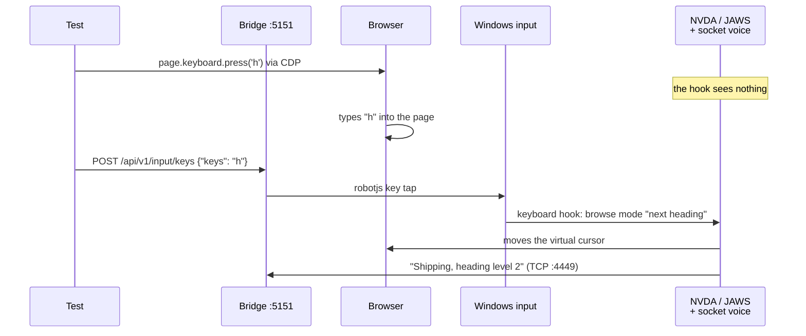
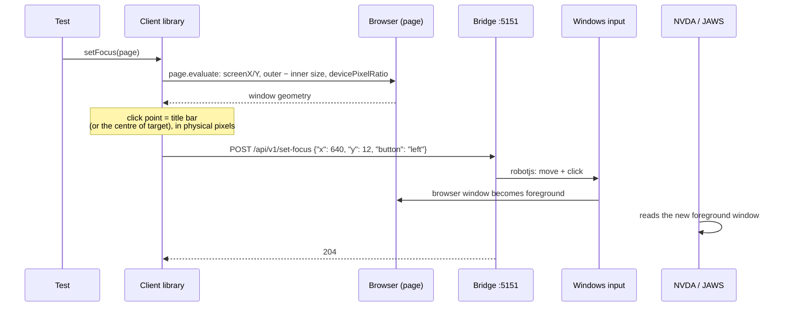
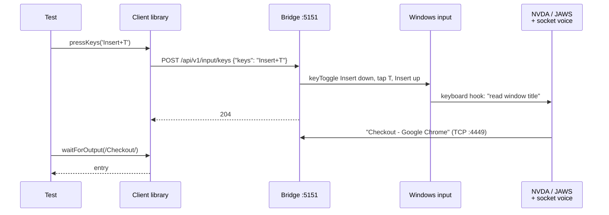
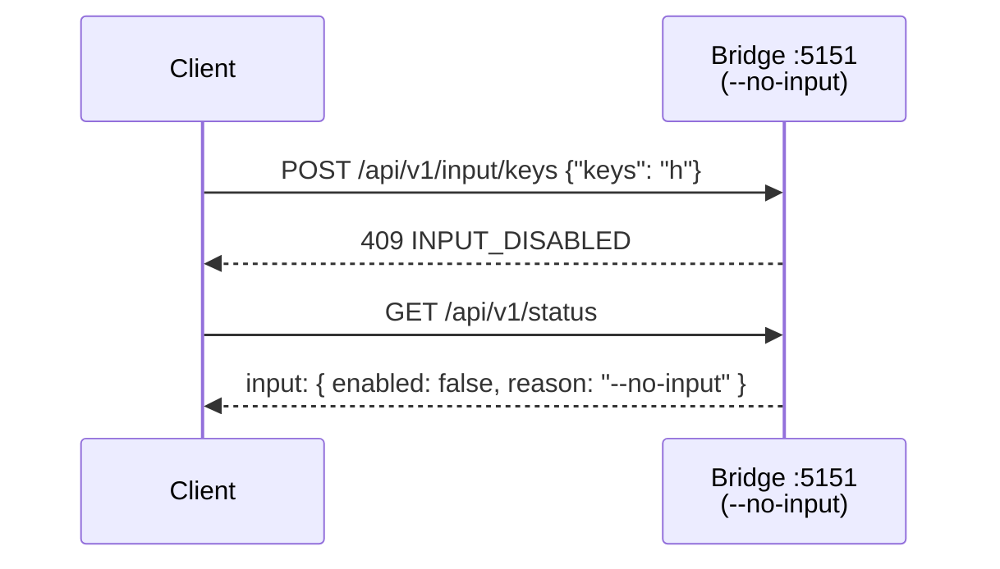

# Native input flows

> **Planned ([M4](../../ROADMAP.md#m4-native-input-)), not implemented yet.** These diagrams show the design.

Sequence diagrams of real OS clicks and key presses, for what Playwright input can't do. Details:
[Native input](../native-input.md).

**Contents**

1. [Why Playwright keys don't reach the screen reader](#why-playwright-keys-dont-reach-the-screen-reader)
2. [Bring the browser to the front](#bring-the-browser-to-the-front)
3. [Send a screen reader command](#send-a-screen-reader-command)
4. [Input is off](#input-is-off)

## Why Playwright keys don't reach the screen reader

Playwright sends keys into the browser through its protocol (CDP for Chromium). The screen reader
catches its commands with an OS keyboard hook *before* the browser, so it never sees them.

## Bring the browser to the front

The screen reader follows the OS foreground window, which `page.bringToFront()` doesn't change. The
bridge doesn't know where the window is, so the client computes the click point and the bridge
clicks there.

## Send a screen reader command

Chords are held with `keyToggle` (`Insert` and `CapsLock` work as modifiers, as the screen reader
key); sequences are sent one after the other with `delayMs` between them.

## Input is off

With `--no-input`, not on Windows, or when robotjs failed to load, both endpoints refuse, and the
status says why.

