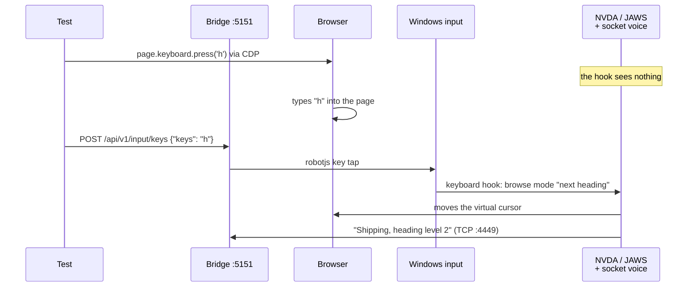
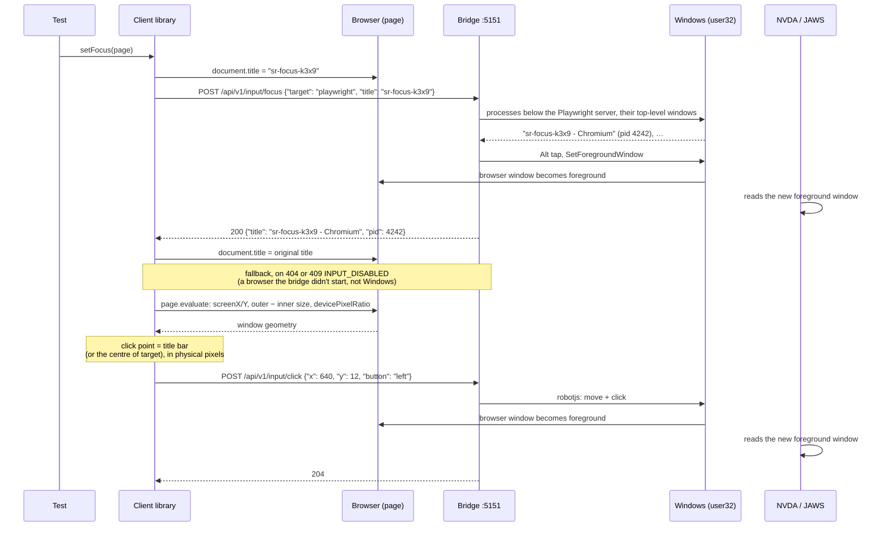
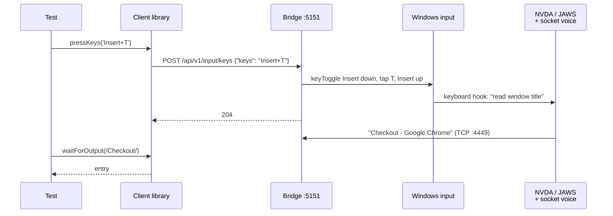
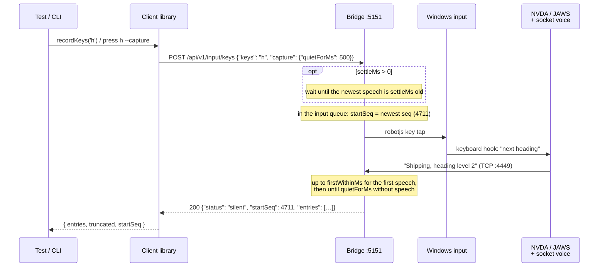
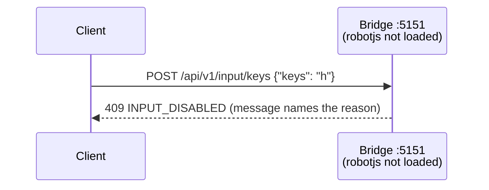

# Native input flows

Sequence diagrams of real OS clicks and key presses, for what Playwright input can't do. Details:
[Native input](../native-input.md).

**Contents**

1. [Why Playwright keys don't reach the screen reader](#why-playwright-keys-dont-reach-the-screen-reader)
2. [Bring the browser to the front](#bring-the-browser-to-the-front)
3. [Send a screen reader command](#send-a-screen-reader-command)
4. [Capture the speech a command causes](#capture-the-speech-a-command-causes)
5. [Input is not available](#input-is-not-available)

## Why Playwright keys don't reach the screen reader

Playwright sends keys into the browser through its protocol (CDP for Chromium). The screen reader
catches its commands with an OS keyboard hook *before* the browser, so it never sees them.

## Bring the browser to the front

The screen reader follows the OS foreground window, which `page.bringToFront()` doesn't change. If
the bridge started the browser (its Playwright server or MCP), it finds the window by a title
marker and brings it forward itself. Otherwise the client computes a click point and the bridge
clicks there. Details: [Bringing the browser to the front](../native-input.md#bringing-the-browser-to-the-front).

## Send a screen reader command

Chords are held with `keyToggle` (`Insert` and `CapsLock` work as modifiers, as the screen reader
key); sequences are sent one after the other with `delayMs` between them.

## Capture the speech a command causes

With `capture`, the bridge notes the newest `seq` in the input queue right before the keys, then
follows the speech after it and times the silence from the entries' `receivedAt`. Details:
[Capturing the speech an input causes](../native-input.md#capturing-the-speech-an-input-causes).

## Input is not available

Not on Windows, or when robotjs failed to load: the bridge starts anyway, and both endpoints refuse
with the reason.

