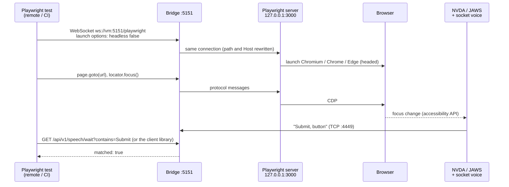
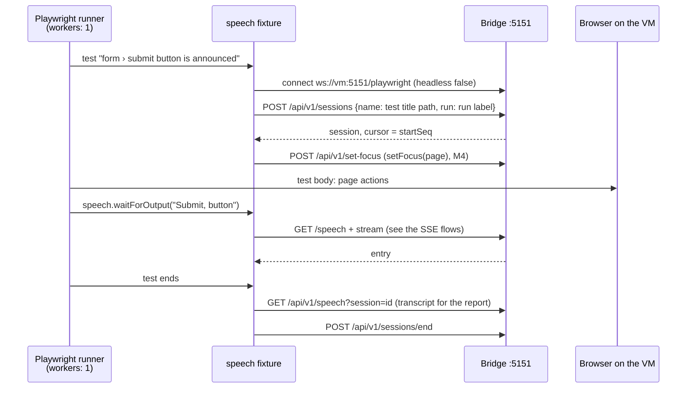
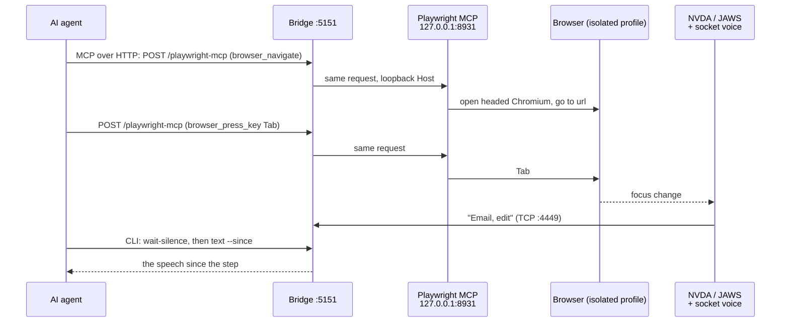
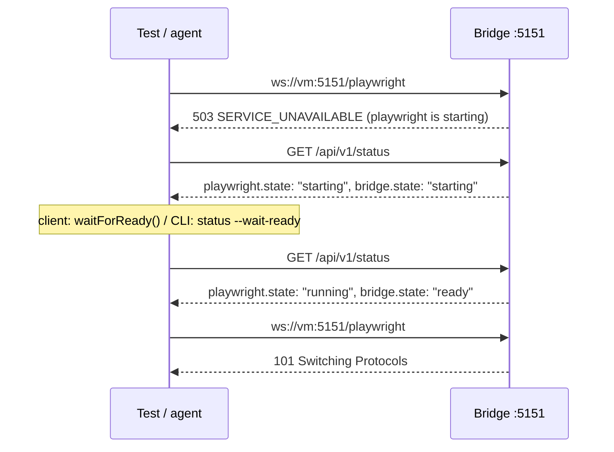
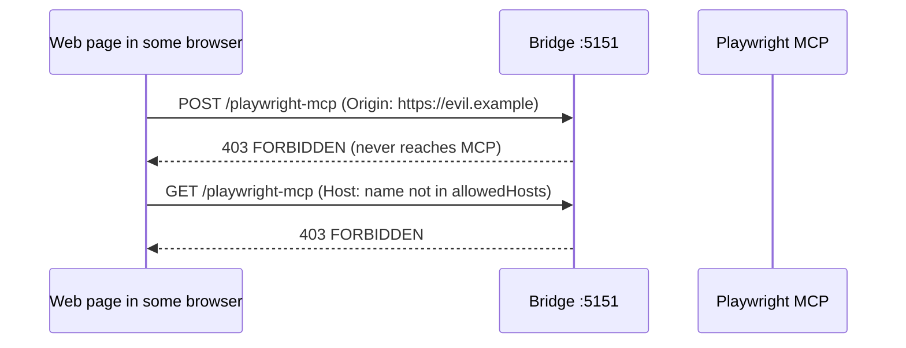

# Playwright & MCP flows

Sequence diagrams of the remote browser: tests through the Playwright server, agents through
Playwright MCP, both reached through the bridge's HTTP port. Details:
[Remote Playwright & MCP](../playwright-mcp.md).

**Contents**

1. [A test connects to the Playwright server](#a-test-connects-to-the-playwright-server)
2. [A test with the Playwright fixture](#a-test-with-the-playwright-fixture)
3. [An agent drives the browser through MCP](#an-agent-drives-the-browser-through-mcp)
4. [A service that isn't running](#a-service-that-isnt-running)
5. [Host and origin on the passthrough](#host-and-origin-on-the-passthrough)

## A test connects to the Playwright server

The bridge passes `/playwright` through to the Playwright server on `127.0.0.1:3000`. The browser
must be headed, or the screen reader has no window to read.

## A test with the Playwright fixture

*(planned, [M3](../../ROADMAP.md#m3-playwright--mcp-))*

The fixture connects through the bridge, brings the browser to the front, and wraps every test in a
session. Details: [Playwright fixture](../client.md#playwright-fixture).

## An agent drives the browser through MCP

Playwright MCP runs in HTTP mode on `127.0.0.1:8931`; the bridge passes `/playwright-mcp` through.
The agent reads the speech with the CLI. Details: [Agents](../agents.md#agent-loop).

## A service that isn't running

While a service is disabled, starting (installing), crashed or failed, its path answers
`503 SERVICE_UNAVAILABLE` in the API's error format. Speech capture and the API keep working.
Details: [Child service crashes](../operations.md#child-service-crashes).

## Host and origin on the passthrough

The proxied paths follow the API's [Host and origin](../security.md#host-and-origin) rules, plus a
stricter `Origin` check: a request from a web page with a foreign `Origin` is refused, even a read.

