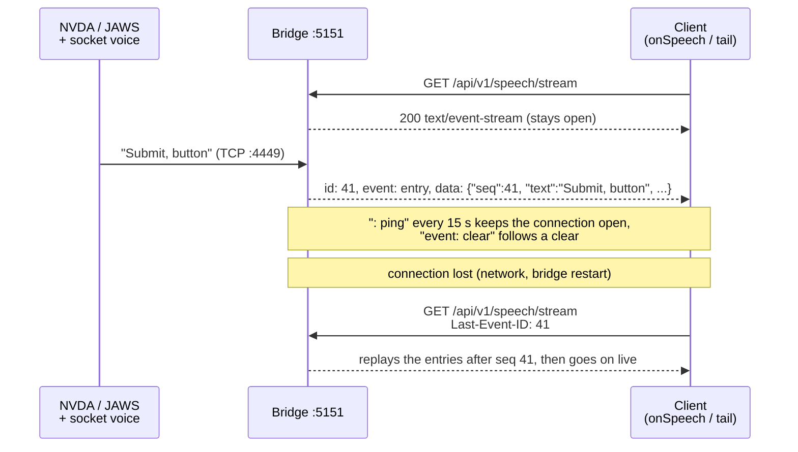
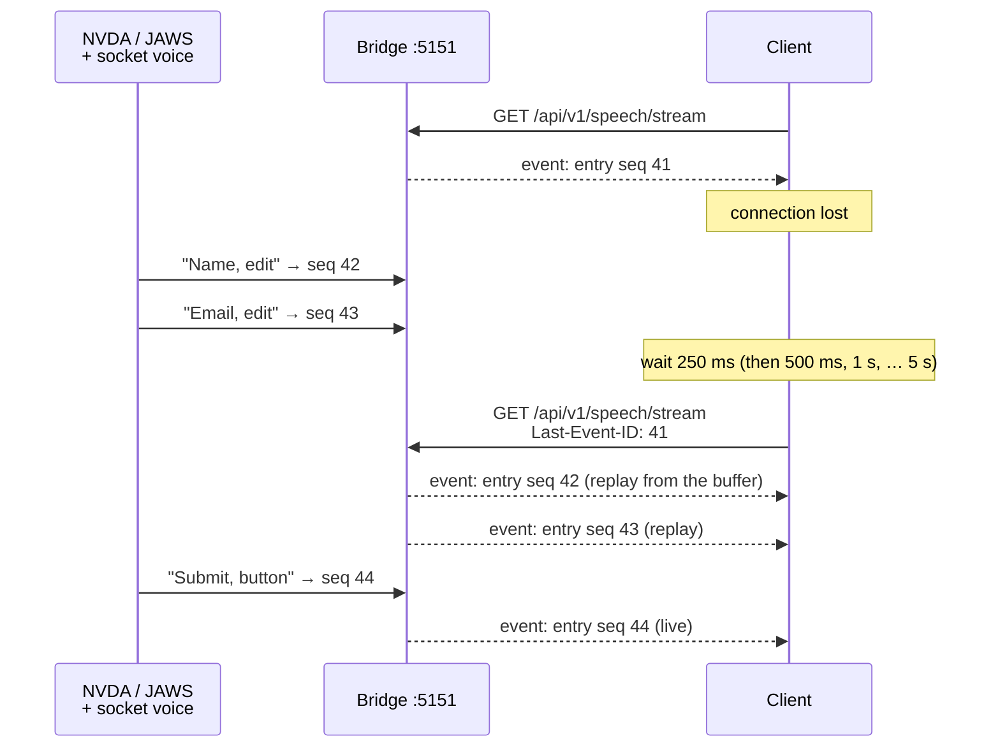
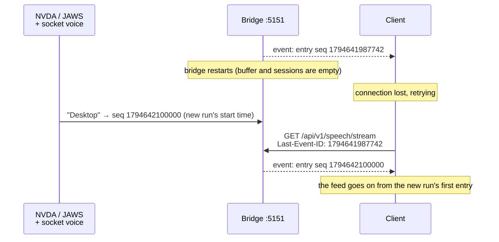
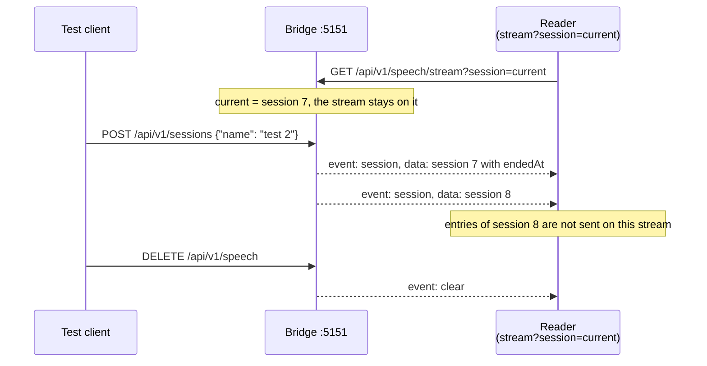
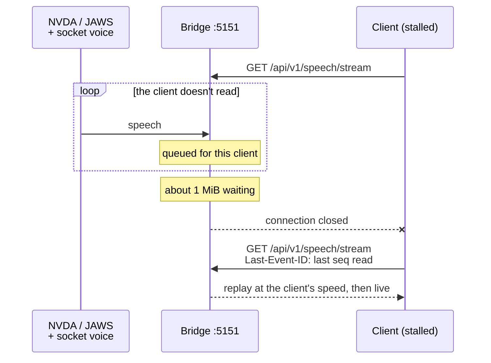
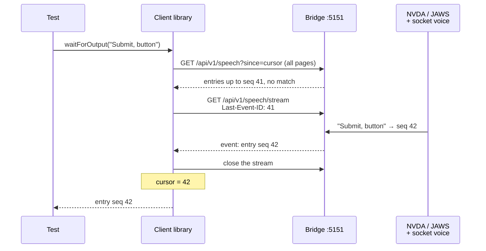
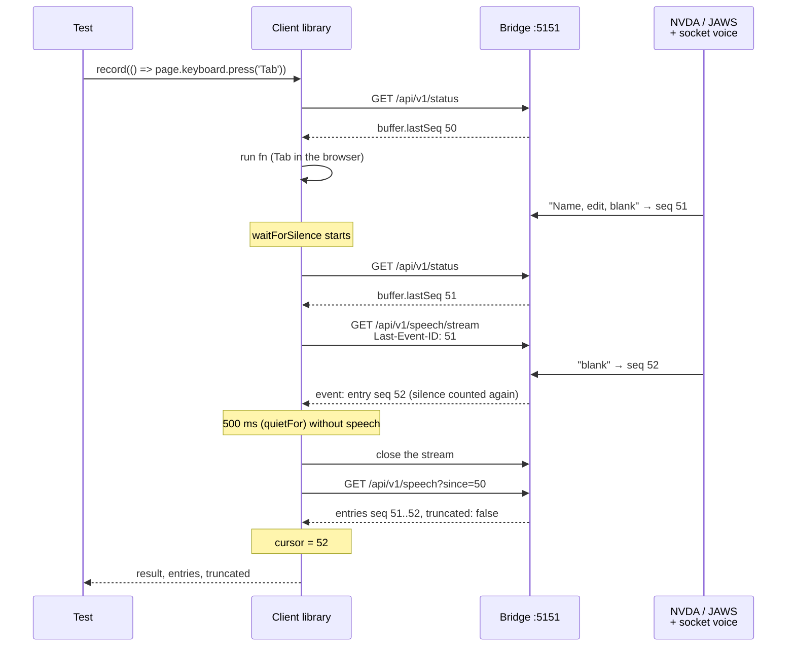

# Live feed (SSE) flows

Sequence diagrams of the Server-Sent Events stream `GET /api/v1/speech/stream` and the client
functions built on it. The stream's rules are in the [HTTP API](../http-api.md#endpoints), the
client side in [Test client → Live feed](../client.md#live-feed).

**Contents**

1. [Subscribe to the live feed](#subscribe-to-the-live-feed)
2. [Reconnect without losing an entry](#reconnect-without-losing-an-entry)
3. [Reconnect across a bridge restart](#reconnect-across-a-bridge-restart)
4. [Session and clear events](#session-and-clear-events)
5. [A slow reader is disconnected](#a-slow-reader-is-disconnected)
6. [How the client waits](#how-the-client-waits)
7. [Wait for silence and record](#wait-for-silence-and-record)

## Subscribe to the live feed

One long-lived HTTP response that the bridge keeps writing to. `onSpeech` and the CLI's `tail`
wrap it, so nobody parses the stream by hand.

## Reconnect without losing an entry

The client remembers the last `seq` it saw and reconnects with it as `Last-Event-ID` (after 250 ms,
doubling up to 5 s). No data for 45 s, not even a ping, also counts as a lost connection. The
replay follows the reader's speed, then the stream goes on live.

## Reconnect across a bridge restart

`seq` keeps rising across restarts: the first entry of a run gets the run's start time in
milliseconds. A `Last-Event-ID` from the old run is lower than every new entry, so the replay
starts at the new run's first entry. The old run's entries are gone. Details:
[Data model](../http-api.md#data-model).

## Session and clear events

`session` events are sent whenever a session starts or ends, also on a stream limited to one
session. A clear sends `clear`. Details: [Sessions](../speech-capture.md#sessions).

## A slow reader is disconnected

A client that stops reading live events is cut off once about 1 MiB waits for it, so it can't
hold the bridge's memory. It reconnects with `Last-Event-ID` and catches up at its own speed.

## How the client waits

`waitForOutput` / `waitForSequence` don't poll and don't use `GET /speech/wait`: they read the
buffer after the cursor once, and if nothing matches yet, follow the stream from the last entry
read. Details: [The cursor](../client.md#the-cursor).

## Wait for silence and record

`waitForSilence` follows the stream until nothing has been spoken for `quietFor` ms, counted from
the call. `record(fn)` notes the newest `seq`, runs `fn`, waits for silence and reads everything
after the noted `seq`. Details: [Functions](../client.md#functions).

