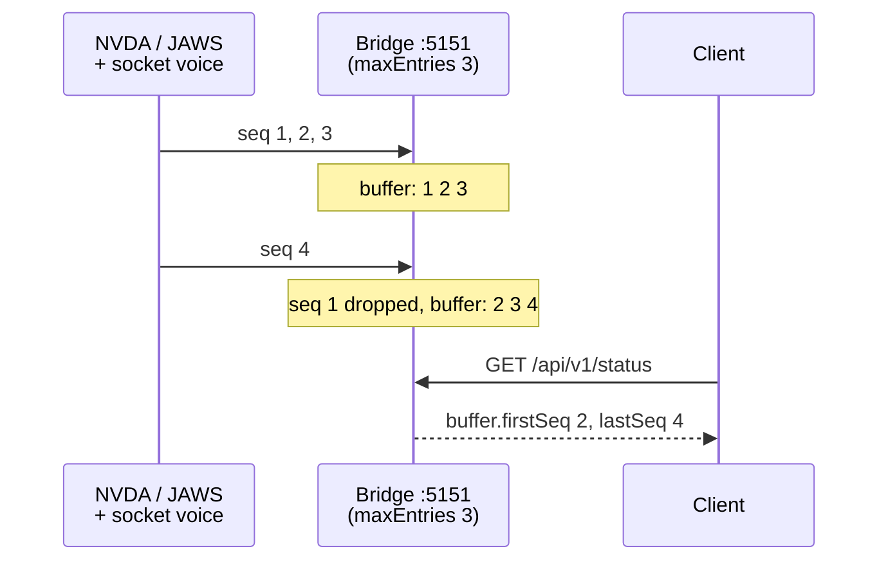
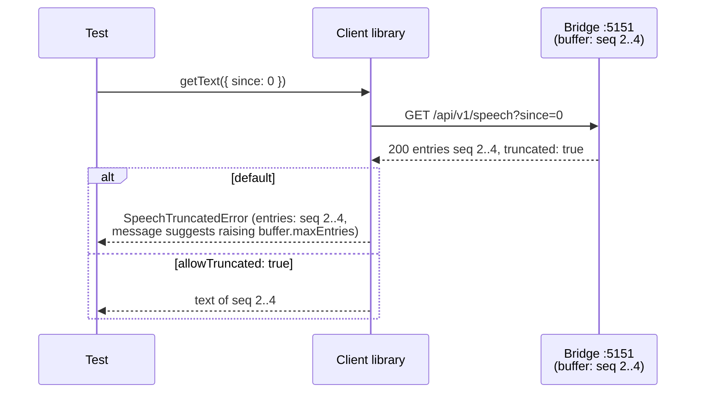
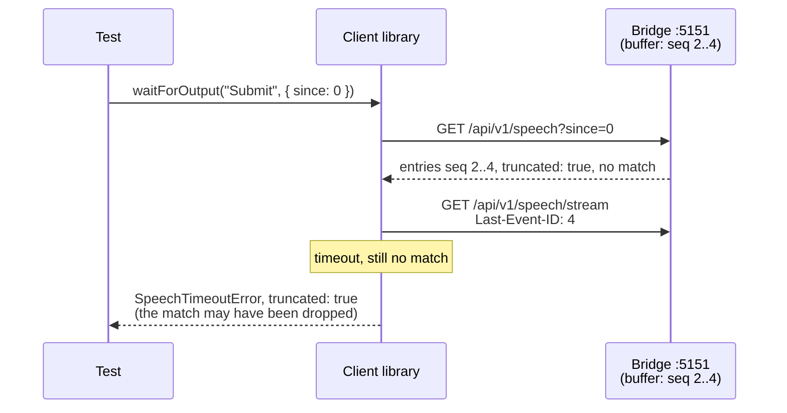
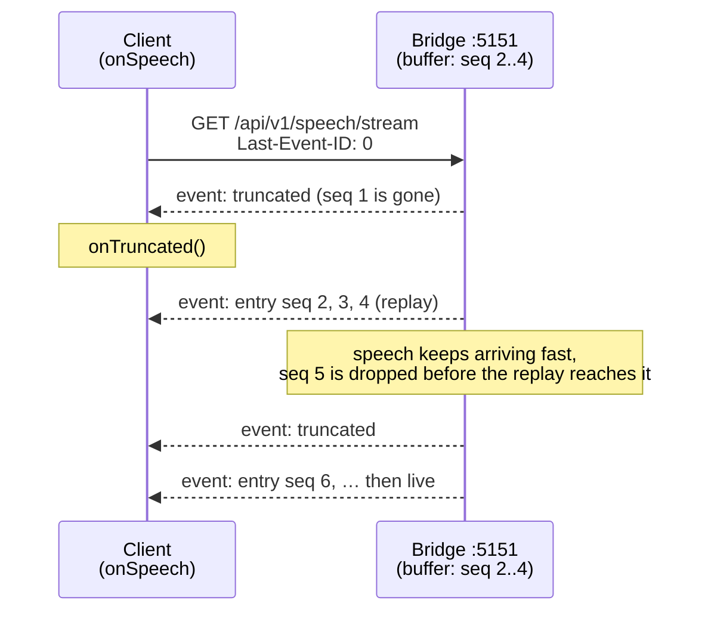
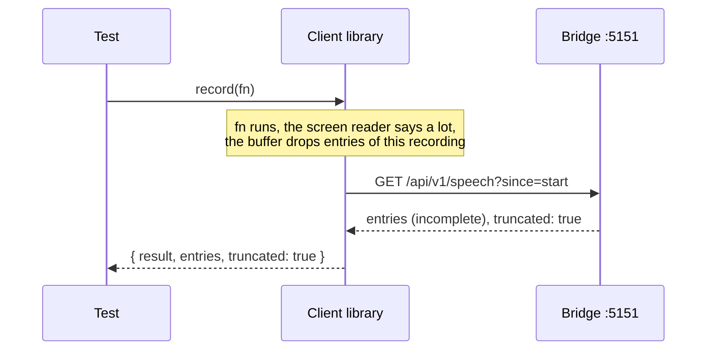
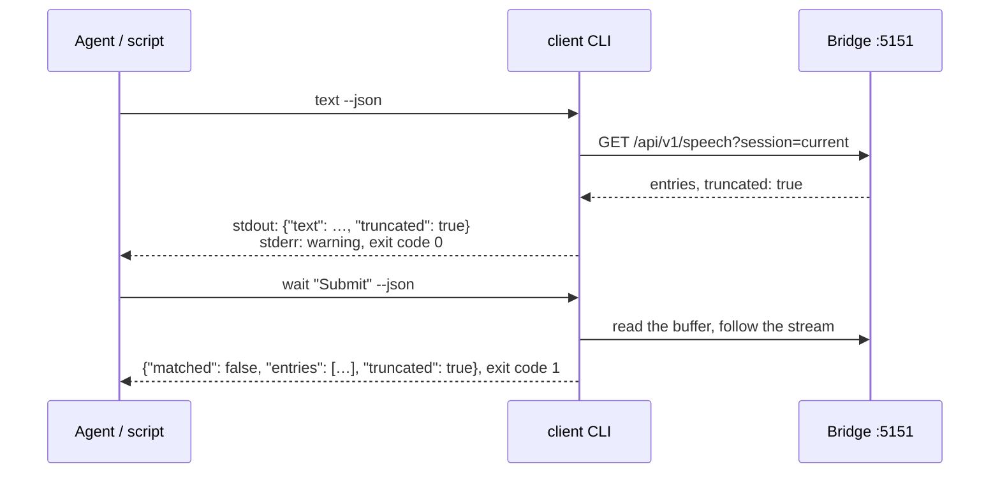

# Truncation flows

What happens when speech a reader asks for has already been dropped from the bridge's full buffer.
The buffer rules are in [Speech capture → Buffer](../speech-capture.md#buffer), the client's errors
in [Test client → Errors](../client.md#errors). The fix is always the same: raise
`buffer.maxEntries` ([Configuration](../configuration.md)) or read more often.

**Contents**

1. [The buffer drops the oldest entry](#the-buffer-drops-the-oldest-entry)
2. [Reading a range with a gap](#reading-a-range-with-a-gap)
3. [A wait times out after a gap](#a-wait-times-out-after-a-gap)
4. [A stream replay with a gap](#a-stream-replay-with-a-gap)
5. [record() with a gap](#record-with-a-gap)
6. [The CLI with a gap](#the-cli-with-a-gap)

## The buffer drops the oldest entry

The buffer holds at most `buffer.maxEntries` entries (default 10 000). Each new entry beyond that
drops the oldest one, and `buffer.firstSeq` moves up. A smaller `maxEntries` set through
`PUT /config` drops the oldest entries at once. Entries removed by a clear don't count as dropped.

## Reading a range with a gap

`GET /speech` sets `truncated: true` when entries after `since` were dropped. The client library
turns that into `SpeechTruncatedError`, so an assertion never runs on a transcript with a gap;
`allowTruncated: true` returns what is left instead.

## A wait times out after a gap

A match may have been among the dropped entries. A match found anyway is still a match; only a
timeout reports the gap, as `SpeechTimeoutError.truncated`.

## A stream replay with a gap

When a reconnect asks for entries that are already gone, the replay starts with a `truncated`
event. Entries dropped while a slow replay runs bring another `truncated` event at that point.
`onSpeech` reports both to `onTruncated`. Details: [Endpoints](../http-api.md#endpoints).

## record() with a gap

`record(fn)` doesn't throw: it returns what is left with `truncated: true`, so the test decides.

## The CLI with a gap

`speech` and `text` print what is left, warn on stderr and still exit `0`; with `--json` the
answer has `"truncated": true`. `wait` reports it on a timeout, `tail --json` prints a
`{"type":"truncated"}` line. Details: [CLI for agents](../client.md#cli-for-agents).

